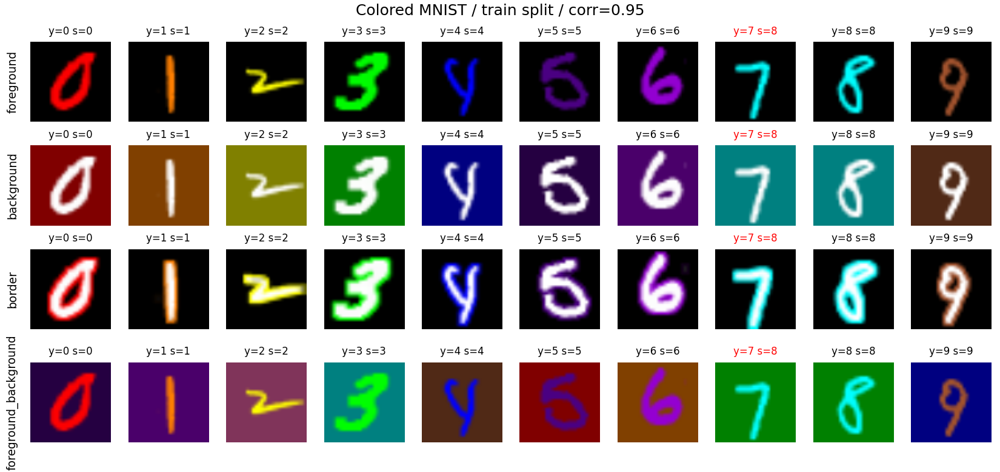
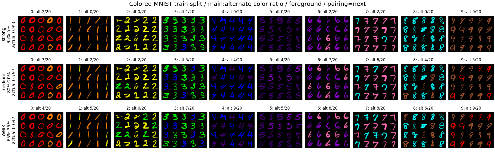

# Shortcut learning dynamics: VGG/ResNet × Colored MNIST/Waterbirds

PyTorch + Hugging Face Datasets experiment. Requirements: Python 3.10+, GPU recommended for Waterbirds.

## Install

```bash
pip install -r requirements.txt
```

Use a PyTorch+TorchVision version combination appropriate for your system/CUDA. The runner uses `torch.amp.GradScaler` and `torch.load(weights_only=True)`.

## Four experiments

```bash
# Colored MNIST: 10-way target = digit 0-9
# shortcut = color index 0-9; each digit has a main color and one alternate color
# --train-corr strong|medium|weak = main:alternate 95:05 | 80:20 | 65:35 (or any float); val/test 50:50
# --color-pairing next|random = alternate color of digit k is color k+1, or a seeded random pairing
python shortcut_experiment.py train --dataset colored_mnist --model resnet18 --epochs 20 --output runs/cm_resnet
python shortcut_experiment.py train --dataset colored_mnist --model vgg11_bn --epochs 20 --output runs/cm_vgg
# --color-mode chooses where the shortcut color is painted (default: foreground)
#   foreground | background | border | foreground_background
python shortcut_experiment.py train --dataset colored_mnist --model resnet18 --color-mode background --output runs/cm_resnet_bg
python shortcut_experiment.py train --dataset colored_mnist --model resnet18 --train-corr weak --color-pairing random --output runs/cm_resnet_weak
# Preview the dataset (saved to images/colored_mnist_examples.png by default)
python data.py
python data.py --color-modes border background --split test --per-digit 2 --output images/test_examples.png

# Waterbirds: target=landbird(0)/waterbird(1); shortcut=land(0)/water(1)
# pretrained weights are highly recommended for this smaller dataset
python shortcut_experiment.py train --dataset waterbirds --model resnet18 --pretrained --epochs 20 --batch-size 32 --output runs/wb_resnet
python shortcut_experiment.py train --dataset waterbirds --model vgg11_bn --pretrained --epochs 20 --batch-size 32 --output runs/wb_vgg
```

Default image size: 64 for Colored MNIST and 128 for Waterbirds (can override with `--image-size 224` for Waterbirds). Defaults: SGD(momentum=0.9), LR 0.01, cosine scheduler, seed 42, training from scratch unless `--pretrained`. ImageNet normalization is used for both datasets. VGG uses **VGG-11 with BatchNorm + global average pooling + a linear head** (not the original 4096-unit classifier); ResNet uses ResNet-18 with a linear head. The head is 10-way for Colored MNIST and 2-way for Waterbirds. Run multiple seeds for scientific conclusions. For close architecture comparison, fix the same dataset split, preprocessing, seed list, training budget, and pretrained condition.

### Colored MNIST color modes



One row per `--color-mode`; columns are digits 0-9 and the same samples appear in every row, so only the colored region differs. Titles show target `y` and shortcut color `s`; red titles mark conflicting samples (`s != y`). Regenerate with `python data.py`.



`--train-corr` presets on the train split (`foreground` mode, `--color-pairing next`). Each cell shows the first 20 training images of one digit; `alt n/20` counts those painted with the alternate color, and the row label gives the preset ratio and the actual split-wide share of main colors. The same images appear in every row, and an image that gets the alternate color under a stronger preset keeps it under weaker ones. `python data.py` writes both images; `--corr-mode`, `--corr-samples` and `--corr-output ''` (skip) control this one.

### Resume from any epoch (optimizer + scheduler + AMP state included)

```bash
python shortcut_experiment.py train --dataset colored_mnist --model resnet18 --output runs/cm_resnet --resume latest
# or --resume runs/cm_resnet/checkpoints/epoch_005.pt
```

**Important:** Resume restores the saved configuration, including total epochs. Keep the same `--output` run directory and avoid starting a fresh run into a directory containing old history. For an *earlier* checkpoint when newer checkpoints exist, first copy/fork the run into a clean directory and remove newer state there; the runner intentionally blocks overwriting newer saved epochs. It also rejects starting a fresh run into an existing history directory. Checkpoints are saved at the *end* of each epoch and at epoch 0 (untrained). On resume, latest.json points to the last committed checkpoint. A history row left by an interrupted checkpoint write is automatically discarded on resume.

### Evaluate a checkpoint on test

```bash
python shortcut_experiment.py eval --run runs/cm_resnet --checkpoint runs/cm_resnet/checkpoints/epoch_005.pt --split test
python shortcut_experiment.py eval --run runs/wb_resnet --checkpoint latest --split test
```

### Hidden-state features

```bash
python shortcut_experiment.py features --run runs/cm_resnet --checkpoint latest --split test --features-per-group 64 --output runs/cm_resnet/test_features.npz
python analyze.py --run runs/cm_resnet --epoch 5 --layer layer3
python analyze.py --run runs/cm_vgg --epoch 5 --layer features.14
```

Model hooks collect an average-pooled vector for each stage, with shape `[N, channels]` rather than storing huge spatial activation maps. `np.load('...npz')` keys: `layers` (module names), `labels`, `spurious`, `indices`, and `f0`, `f1`, ..., each with shape `[N, channels]`. Stage names for ResNet: `layer1, layer2, layer3, layer4, avgpool`; VGG names are generated from `MaxPool2d` stage indices + `avgpool`. To collect unpooled `[N,C,H,W]` maps, edit `FeatureHookCollector.hook` to omit `x.mean(dim=(2,3))`, and ensure adequate RAM/storage.

## Artifacts

```
runs/<name>/
  config.json
  latest.json
  history.csv                # train + validation by epoch, includes 0
  test_metrics.json          # final epoch only
  checkpoints/epoch_000.pt   # baseline untrained
  checkpoints/epoch_001.pt   # model, optimizer, schedule, RNG states
  ...
  features/epoch_000.npz     # fixed balanced val subset for hidden-state trends
  features/epoch_001.npz
  ...
  learning_curves.png        # created by analyze.py
  hidden_pca_epoch_005.png   # created by analyze.py --epoch 5
```

## Metrics and interpretation

* `val_acc`: standard classification accuracy.
* `val_g{y}{s}_acc`: accuracy conditioned on target **y** and spurious attribute **s** (4 groups for Waterbirds; 20 for Colored MNIST, i.e. each digit with its main and alternate color). `val_g{y}{s}_n`: counts.
* `val_wga`: minimum accuracy across **all possible (y, s) groups**; NaN if any of them has zero examples.
* `val_aligned_acc`, `val_conflicting_acc`: accuracy when `y==s` vs `y!=s`. A growing gap suggests shortcut dependence, not definitive proof by itself.
* Colored MNIST only: `val_cf_flip_rate` is fraction of samples for which the prediction changes when **the same digit** is repainted with its digit's other color (main ↔ alternate). `val_cf_acc` accuracy after the recolor; `val_cf_acc_drop` original accuracy minus recolored accuracy (the drop may be negative). **Flip rate is the most direct intervention-based reliance metric here.** Waterbirds has no naive analogous intervention: it would need a genuine same-bird alternate-background pair to avoid confounds.
* Feature snapshot and PCA: visualization of what features are *represented*. Decodability/separation is **not evidence** by itself that the classifier uses a feature causally.

## Dataset protocol and caution

* `ylecun/mnist`: split the official train into 55,000 train and 5,000 validation via a fixed seed; use the official 10,000 test images. The color assignment is *fixed per example* across epochs, not resampled per access. The palette is fixed: red, orange, yellow, green, blue, indigo, violet, pink, cyan, brown (`MNIST_COLORS` in `data.py`); white/gray/black are excluded so every color is visible on the black canvas. Digit k's main color is color k and its alternate color is color k+1 (`--color-pairing next`) or a seeded random derangement (`random`). With probability `corr` an example gets the main color, otherwise the alternate. Presets: `strong` 0.95, `medium` 0.80, `weak` 0.65; val and test default to 0.50, where color alone no longer favors either of the digit's two colors. These are independent Bernoulli assignments, so actual sample proportions may differ slightly. `--color-mode` sets which region carries the color: `foreground` (colored digit on black), `background` (white digit on a dimmed colored background), `border` (white digit with a colored outline on black), or `foreground_background` (colored digit on a dimmed background of a second color `MNIST_COLORS[(s+5)%10]`). The counterfactual recolor uses the same mode. This is **one 10-class Colored MNIST construction**, not a claim to reproduce every paper's Colored MNIST protocol.
* `grodino/waterbirds`: Hugging Face train/validation/test splits, label = landbird(0)/waterbird(1), place = land(0)/water(1), so Waterbirds `P(place==label)` is mostly high in train and more balanced in validation/test. The runner uses the dataset's actual metadata labels and group splits rather than resampling background correlations.
* To avoid selecting a model on the test set, validation is evaluated each epoch and the test set **once at the final epoch**. You can separately load earlier checkpoints to evaluate them for a retrospective analysis, but do not tune hyperparameters using those test outcomes.
* For Waterbirds, foreground/background are composite natural images. Worst-group accuracy can be noisy for small groups. Cross-seed statistics/uncertainty intervals strengthen conclusions.
* The pipeline does not do exact bitwise determinism across GPU/kernel or data-loader changes. RNG states are stored, but exact restart reproducibility can require matching hardware/library versions and `num_workers`, `--augment`, deterministic kernels.
* HF dataset download and pretrained weight download require internet on first use. Respect third-party dataset and weight licensing for redistribution.

### Raw spatial activation maps (one sample, not pooled)

```bash
python inspect_hidden.py --run runs/cm_resnet --checkpoint runs/cm_resnet/checkpoints/epoch_005.pt --split val --sample-index 0 --layer layer3 --channels 16
python inspect_hidden.py --run runs/cm_vgg --checkpoint latest --layer features.14 --channels 16
python inspect_hidden.py --run runs/cm_vgg --list-layers
```

This generates a full, **unpooled** activation tensor in `raw_epoch_....npz` (key `hidden`, shape `[C,H,W]`) plus a grid image `raw_epoch_....png`. Use this for the actual middle feature maps; the snapshots in `features/` are spatially pooled to permit compact per-epoch storage.
