# 실험 결과 정리: Colored MNIST · Waterbirds

> **연구 질문:** 학습 epoch가 늘어날수록 모델은 shortcut(색·배경)에서 벗어나는가, 아니면 더 의존하는가?
>
> - **H1:** epoch가 늘수록 shortcut 의존도가 감소한다.
> - **H2:** shortcut과 정답의 상관(correlation)이 강할수록 core feature를 배우는 데 더 많은 epoch가 걸린다.

이 문서는 GitHub `main`에 올라온 팀 결과(PR #11–#19)와, 같은 명령으로 다시 학습한 재실행 결과를 한 곳에 모아 정리한 것이다. 별도 표시가 없는 수치·그림은 팀 결과이고, 재실행 결과는 **A9절**(Colored MNIST)과 **B4절**(Waterbirds)에 모았다.

| 파트 | 원본 폴더 | 주 보고서 |
|---|---|---|
| Part A. Colored MNIST (팀) | [`metric_final_analysis_406/`](metric_final_analysis_406/) | [analysis_report.md](metric_final_analysis_406/analysis_report.md) |
| Part A. Colored MNIST (재실행) | [`cmnist_rerun50/`](cmnist_rerun50/) | [README.md](cmnist_rerun50/README.md) |
| Part B. Waterbirds (팀) | [`waterbirds_vgg50/`](waterbirds_vgg50/) | [WATERBIRDS_FINAL_RESULTS_KO.md](waterbirds_vgg50/WATERBIRDS_FINAL_RESULTS_KO.md), [독립 검토](waterbirds_vgg50/WATERBIRDS_INDEPENDENT_REVIEW_KO.md) |
| Part B. Waterbirds (재실행) | [`waterbirds_rerun50/`](waterbirds_rerun50/) | [README.md](waterbirds_rerun50/README.md) |
| Part B. Waterbirds (pretrained + CUB 전체 + B) | [`waterbirds_cubfull_pretrained/`](waterbirds_cubfull_pretrained/) | [README.md](waterbirds_cubfull_pretrained/README.md) |

## 한눈에 보기

| | Colored MNIST (VGG11_BN) | Waterbirds (VGG11_BN) |
|---|---|---|
| Shortcut | 숫자 색(배경색 BG / 글자색 FG) | 배경(육지/물) |
| Epoch 50 성능 | 정확도 95.6–98.9%, WGA 92–97% | 정확도 60–81%, WGA 6–30% |
| Shortcut 민감도(Epoch 50) | 9색 flip 0.9–5.8% | 배경 교체 flip 17–66% |
| H1 | **부분 지지**: 1→50에서 크게 감소, 하지만 단조 감소 아님 | **대체로 불지지**: 0.65에서만 일부 개선, 0.95는 후반에 재상승 |
| H2 | **행동 기준으로는 지지**(강건 행동 95% 도달 .65=2, .80=3, .95=46/미도달. 98% 기준 .65=16–18, .80=25–30, .95=미도달), core 학습 시작 지연은 미확정 | **방향만 일치**(낮은 corr이 최종 성능 우수), 시점 비교는 불가 |
| 재현성 | 재실행 6개가 팀 곡선과 거의 겹침(평균 차이 0.07–0.29pp) | 구간 평균·최종값은 재현(1–4pp, seed 3개에서도 같음), epoch별 값과 붕괴·강건 도달 epoch는 실행·seed마다 다름 |
| Stress test | noise·crop을 가하면 다시 색에 의존(9색 flip 최대 60%), blur는 영향 작음 | noise는 전부 landbird로 붕괴, crop에도 0.95는 여전히 배경을 따름 |
| 공통 교훈 | 정보가 표현에 있다(probe) ≠ 모델이 그것을 쓴다 | 낮은 flip ≠ 강건함(한 클래스만 예측해도 flip=0) |

두 데이터셋 모두 **correlation이 높을수록 shortcut 의존이 크게 남는다**는 점은 같다. 다만 Colored MNIST는 결국 거의 다 극복하고, Waterbirds는 50 epoch 안에 극복하지 못한다.

> **추가(B6):** Waterbirds를 ImageNet pretrained로 시작하고, CUB 새 전체(9,390마리)로 학습하고, 매 epoch 배경을 새로 뽑아 주면(lr 0.01 고정, seed 42) core 사용 시작이 .95 E2, .80 E1, .65 E1로 Colored MNIST(E2/E1/E1)와 같아지고 H1이 지지된다. 원래 Waterbirds가 다르게 움직인 것은 새를 잘 못 알아보고 작은 train을 금방 외우기 때문으로 보인다.

---

# Part A. Colored MNIST

## A1. 실험 설정

| 항목 | 설정 |
|---|---|
| 데이터 | 10-class Colored MNIST, 224×224, `--color-pairing all` |
| 모드 | **BG**: 흰 숫자 + 색 배경(밝기 0.5배) / **FG**: 검은 배경 + 색 숫자 |
| Train correlation | 0.95 / 0.80 / 0.65 (숫자 *i*가 색 *i*로 칠해질 확률) |
| Val / Test correlation | 0.10 (색이 숫자와 무관한 10색 균등) |
| 데이터 수 | Train 55,000 / Val 5,000 / Test 10,000 |
| 모델 | VGG11_BN, pretrained 없음 |
| 학습 | SGD lr 0.01 **고정**(scheduler none), momentum 0.9, wd 1e-4, batch 128, AMP, seed 42 |
| Epoch | 0–50 (epoch 0 = 학습 전). .95 두 조건만 같은 설정으로 100까지 이어 학습(A7) |

> `reports/epoch100/`의 100-epoch 결과는 **설정이 다른 별도 실험**(ResNet18 포함, 다른 해상도·pairing)이므로 이 정리에 넣지 않았다.

## A2. 지표 읽는 법

| 지표 | 뜻 | 좋은 방향 |
|---|---|---|
| Val Acc | 색이 숫자와 무관한 데이터에서의 정확도 | ↑ |
| Conflicting Acc | 숫자와 색이 *안 맞는* 이미지의 정확도 | ↑ |
| WGA | 숫자×(일치/불일치) 20개 그룹 중 최저 정확도 | ↑ |
| **9색 flip (All9 flip)** | 같은 숫자를 나머지 9색으로 다시 칠했을 때 예측이 바뀌는 비율 | ↓ (높으면 색에 의존) |
| C2I | 원래 맞히던 것이 색만 바꿨더니 틀리게 된 비율 | ↓ |
| Probe | 중간 feature에서 숫자/색을 선형 분류기로 읽어낼 수 있는 정도 | 정보 존재 여부(사용 여부 아님) |

## A3. Epoch 50 결과

Validation, 단위 %.

| 조건 | Val Acc | Conflicting | WGA | 9색 flip | 9색 C2I |
|---|---:|---:|---:|---:|---:|
| BG .95 | 96.40 | 96.00 | 93.09 | **4.82** | 2.05 |
| BG .80 | 98.54 | 98.38 | 96.67 | 1.36 | 0.57 |
| BG .65 | 98.88 | 98.75 | 97.11 | 0.87 | 0.35 |
| FG .95 | 95.56 | 95.06 | 92.13 | **5.77** | 2.38 |
| FG .80 | 98.34 | 98.15 | 96.77 | 1.63 | 0.63 |
| FG .65 | 98.86 | 98.75 | 96.54 | 0.94 | 0.43 |

- **.95만 확연히 나쁘다.** 9색 flip이 .80/.65보다 3–6배 높다. .80과 .65의 차이는 작다.
- **BG와 FG의 차이는 작다.** FG가 약간 더 색에 민감하지만, WGA는 .80에서 FG가 더 높아 일관된 우열은 없다.
- Test(Epoch 50)도 같은 순서다. 예: BG .95 Test 96.71%.

## A4. Epoch에 따른 변화 (H1)

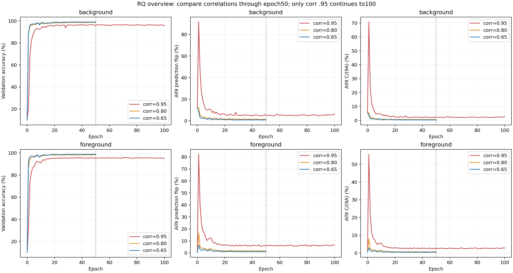

*왼쪽: Val 정확도 / 가운데: 9색 flip / 오른쪽: 9색 C2I. 위 BG, 아래 FG. 점선 오른쪽(50 이후)은 .95만 이어 학습한 구간.*

**읽는 포인트**

1. **Epoch 0→1: 색 의존이 급증한다.** .95에서 9색 flip은 BG 11.9% → **91.6%**, FG 0.4% → **82.2%**로 뛴다. 학습 첫 epoch에 모델은 거의 색만 보고 예측한다. 이것이 shortcut 학습의 직접 증거다.
2. **Epoch 1→10: 빠르게 감소한다.** .95 BG 9색 flip은 epoch 10에 약 10%로 내려간다.
3. **Epoch 10→50: 낮은 수준에서 오르내린다.** 6개 조건 모두 epoch 1→50에서 C2I가 줄었다. 하지만 인접 epoch 49번 중 **18–23번은 오히려 증가**했다. 단조 감소가 아니다.

| 조건 | Epoch 1 9색 C2I | Epoch 50 | 49번 중 증가 횟수 |
|---|---:|---:|---:|
| BG .95 | 15.16 | 2.05 | 21 |
| BG .80 | 4.86 | 0.57 | 21 |
| BG .65 | 3.30 | 0.35 | 22 |
| FG .95 | 17.42 | 2.38 | 19 |
| FG .80 | 6.94 | 0.63 | 18 |
| FG .65 | 2.71 | 0.43 | 23 |

세부 그림: 정확도 / 그룹 정확도 / flip / C2I

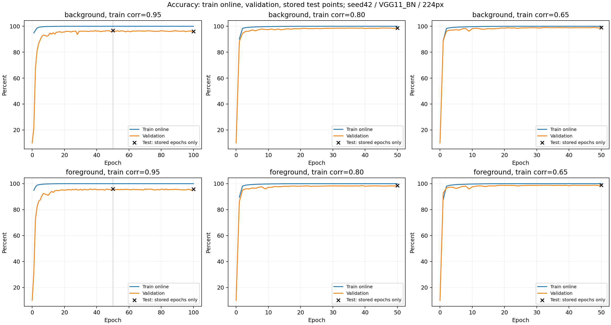
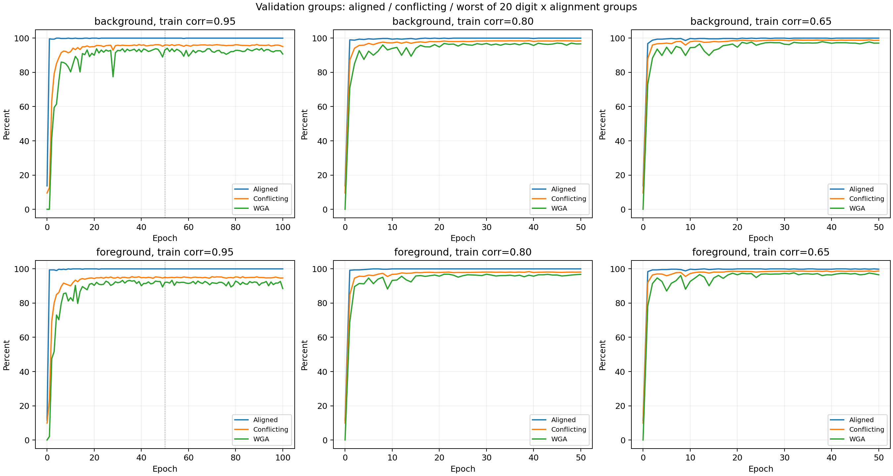
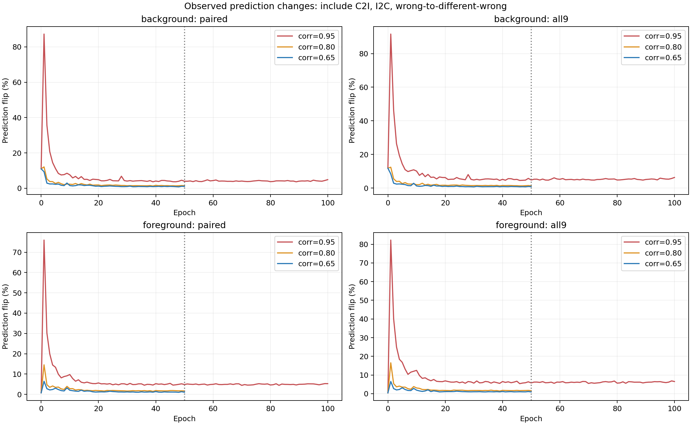
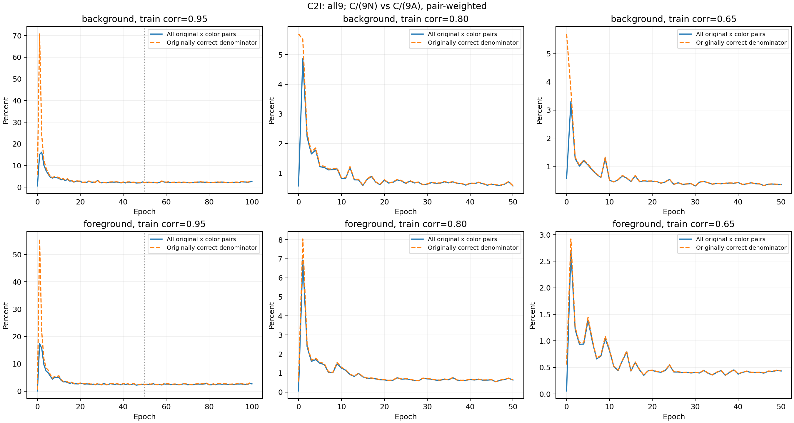

## A5. "정보가 있다"와 "쓴다"는 다르다 (H2)

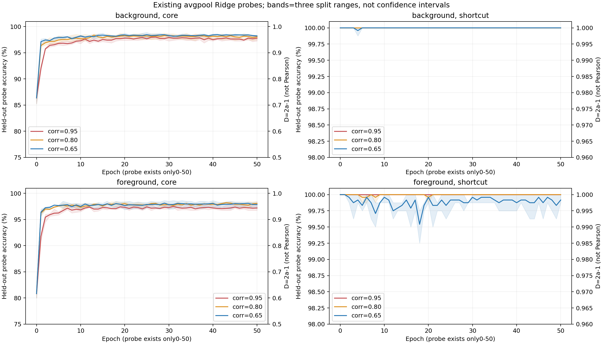

*마지막 feature(avgpool 512차원)에 선형 probe를 학습. 왼쪽: 숫자(core), 오른쪽: 색(shortcut). 띠는 3개 split 범위.*

- **색은 처음부터 끝까지 ~100% 읽힌다.** 학습 전(epoch 0)에도 마찬가지다.
- **숫자도 학습 전부터 BG 86% / FG 81% 읽히고, epoch 1에 이미 90%를 넘는다.** correlation과 무관하다.
- 그런데 모델이 실제로 숫자 모양으로 판단하기까지(강건 행동 기준)는 correlation에 따라 크게 다르다.

| 조건 | 숫자 probe 90% 도달 | 숫자 probe 95% 도달 | **강건 행동 95% 도달** |
|---|---:|---:|---:|
| BG / FG .65 | 1 | 1 | **2** |
| BG / FG .80 | 1 | 1 | **3** |
| BG .95 | 1 | 2 | **46** (46–48만 유지) |
| FG .95 | 1 | 3 | **50 내 미도달** (100까지도 미도달) |

*강건 행동 기준: Conflicting Acc ≥ 95%, 재색칠 정확도 ≥ 95%, 9색 flip ≤ 5%를 3 epoch 연속 만족하는 첫 epoch.*

**해석:** 숫자 정보는 표현 안에 일찍부터 있다. correlation이 높으면 분류기가 그 정보를 *쓰기 시작하는* 시점이 늦어진다. 따라서 H2는 "core 학습이 늦게 시작된다"가 아니라 **"core를 의사결정에 쓰는 시점이 늦다"**로 말해야 정확하다.

## A6. Grad-CAM (BG만 의미 있음)

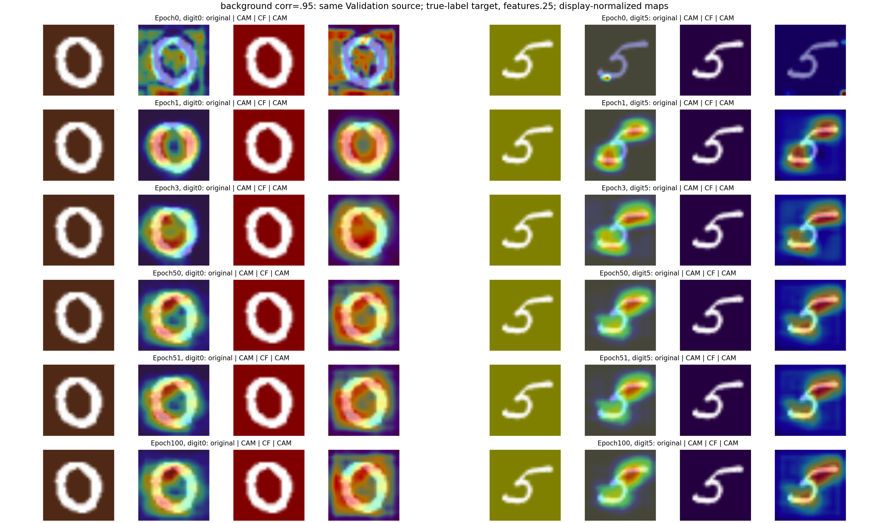

*BG .95, VGG `features.25`. 각 행: 원본 | CAM | 색만 바꾼 이미지(CF) | CAM. 위에서부터 epoch 0, 1, 3, 50, 51, 100.*

- Epoch 0은 배경 전체에 퍼져 있다. Epoch 1부터 숫자 획 주변으로 모인다.
- **주의:** epoch 1에도 CAM은 숫자 주변에 있지만, 실제 예측은 색에 크게 좌우된다. 예를 들어 digit 0은 원본 예측 9 → CF 예측 0으로 바뀐다. 정답 클래스 기준 CAM만으로는 "모양을 쓴다"고 말할 수 없다.
- FG는 색이 숫자 획 위에 있어 색과 모양이 같은 위치에 겹친다. 그래서 Grad-CAM으로 둘을 구분할 수 없다. 그림: [FG CAM](metric_final_analysis_406/figures/11_cam_phases_fg.png)

## A7. 참고: .95를 100 epoch까지 이어 학습 (같은 설정)

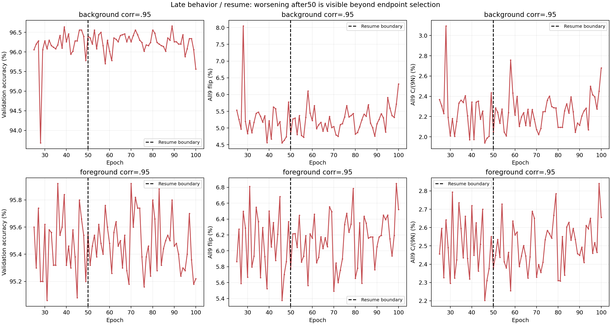

| 조건 | Epoch | Val Acc | WGA | 9색 flip | 9색 C2I |
|---|---:|---:|---:|---:|---:|
| BG .95 | 50 → 100 | 96.40 → 95.56 | 93.09 → 90.71 | 4.82 → 6.32 | 2.05 → 2.68 |
| FG .95 | 50 → 100 | 95.56 → 95.22 | 92.13 → 88.48 | 5.77 → 6.52 | 2.38 → 2.66 |

**더 학습해도 나아지지 않고 오히려 약간 나빠졌다.** 마지막 5 epoch 평균으로 비교해도 같다. Train 정확도는 50 epoch 시점에 이미 100%이므로 더 배울 신호가 거의 없다. 같은 checkpoint에서 이어 학습한 것이므로 설정은 동일하다. 다만 RNG 일부가 복원되지 않아 끊김 없이 학습한 경우와 bit 단위로 같지는 않다.

## A8. 특이점: BG .95 Epoch 28

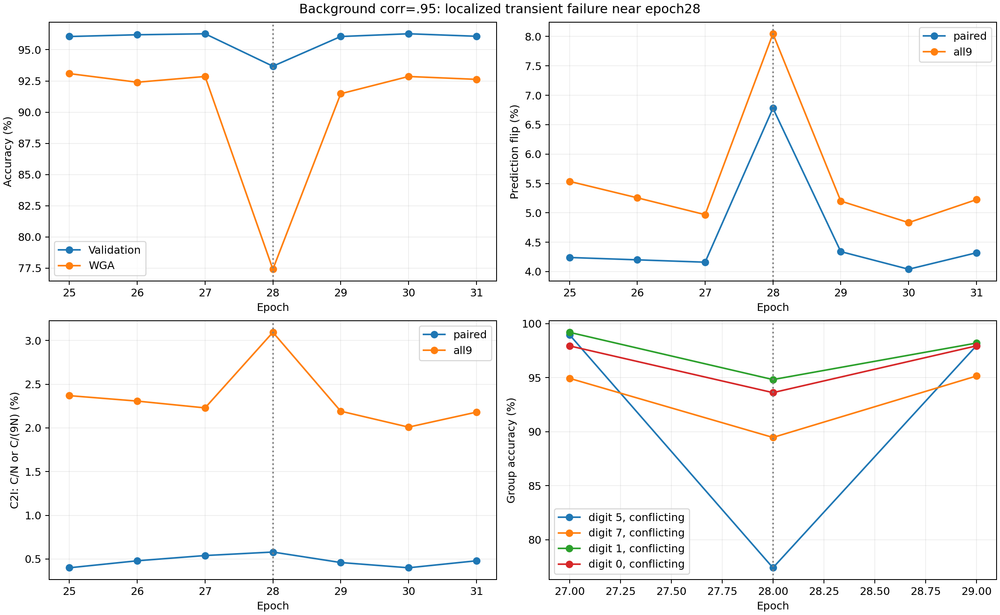

- Epoch 27 → 28 → 29의 WGA: 92.86 → **77.41** → 91.47%.
- 하락은 **숫자 5의 conflicting 그룹**(n = 394)에 집중됐다. 정확도 98.98 → 77.41 → 97.97%. 전체 정답 순감소의 65%를 차지한다.
- 새로 틀린 193개 중 160개(83%)는 다음 epoch에 회복했다.
- 같은 시점의 숫자 probe는 97.8%로 정상이다. 정보는 그대로인데 행동만 일시적으로 무너진 사례다. 원인은 미확정이다.
- **같은 명령으로 재실행했을 때 epoch 28 급락은 재현되지 않았다**(WGA 92.4%). 대신 epoch 14에 80.9%로 떨어졌다. 특정 epoch에 고정된 현상이 아니라 실행마다 달라지는 흔들림으로 보인다([cmnist_rerun50 §2](cmnist_rerun50/README.md#2-재현-확인)).

## A9. 재실행으로 확인한 것

팀의 6개 실험을 **같은 명령·같은 설정**(lr 0.01 고정, seed 42, 50 epoch)으로 RTX 5070 Ti에서 다시 학습했다. 저장된 체크포인트로 팀 결과에 없던 그림과 stress test를 추가했다. 자세한 내용은 [`cmnist_rerun50/README.md`](cmnist_rerun50/README.md)에 있다.

### 재현 확인

| 조건 | Val 정확도 평균 차이 | 9색 flip 평균 차이 | 강건 행동 95% 도달 (팀 / 재실행) |
|---|---:|---:|---|
| BG .95 | 0.24pp | 0.29pp | 46 / 46 |
| BG .80 | 0.14pp | 0.11pp | 3 / 3 |
| BG .65 | 0.16pp | 0.14pp | 2 / 2 |
| FG .95 | 0.21pp | 0.27pp | 미도달 / 미도달 |
| FG .80 | 0.12pp | 0.11pp | 3 / 3 |
| FG .65 | 0.08pp | 0.07pp | 2 / 2 |

*Epoch 1–50의 팀 run 대비 절대 차이 평균. 그림: [팀 vs 재실행 곡선](cmnist_rerun50/figures/04_reproduction.png)*

- 6개 모두 팀 결과가 재현된다. 차이는 GPU가 달라 생기는 부동소수점 비결정성 수준이다.
- 단, **A8의 epoch 28 급락은 재현되지 않았다**(재실행 WGA 92.4%). 대신 재실행은 epoch 14에 80.9%로 떨어진다. 이런 일시적 급락은 실행마다 위치가 달라지므로, 결론에는 장기 추세만 쓴다.

### H2: 기준을 높여도 순서가 유지된다

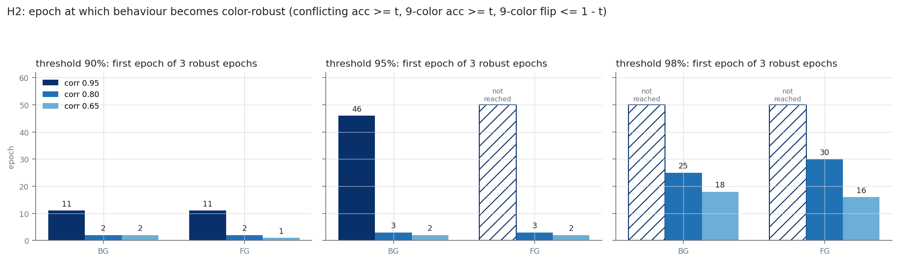

*conflicting 정확도·재색칠 정확도 ≥ t, 9색 flip ≤ 1−t를 3 epoch 연속 만족한 첫 epoch. 빗금 = 50 epoch 내 미도달.*

팀 보고서의 95% 기준에서는 .65(2)와 .80(3)의 차이가 거의 없다. **98% 기준으로 올리면 .65=16–18, .80=25–30, .95=미도달**로 세 조건의 순서가 분명히 드러난다.

### 첫 epoch에는 색으로 답한다

재색칠한 test 숫자를 **칠한 색의 클래스로 예측한 비율**(%):

| 조건 | epoch 1 | epoch 2 | epoch 10 | epoch 50 |
|---|---:|---:|---:|---:|
| BG .95 | **81.5** | 34.2 | 7.2 | 3.3 |
| FG .95 | **64.2** | 25.0 | 8.7 | 3.8 |
| BG / FG .80 | 7.7 / 8.7 | 3.4 / 3.2 | 1.2 / 1.7 | 0.7 / 0.8 |
| BG / FG .65 | 4.1 / 3.5 | 1.7 / 1.6 | 0.6 / 0.9 | 0.4 / 0.5 |

같은 epoch 1에 마지막 층에서 숫자를 읽어내는 probe 정확도는 이미 92% 이상이다. **숫자 정보는 있는데 모델은 색으로 답하고 있다**(A5와 같은 결론). 예시 그림: [BG .95 숫자 3·7을 10색으로 칠했을 때의 epoch별 예측](cmnist_rerun50/figures/10_recolor_grid_bg095.png)

### Stress test (proposal 6.1)

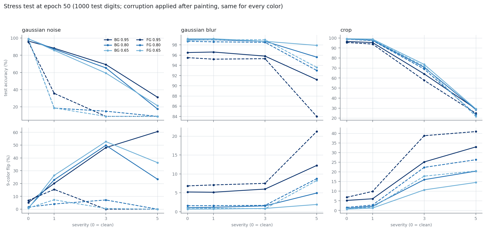

*Epoch 50 모델, test 숫자 1,000개를 10색으로 칠한 뒤 손상. 위: 정확도, 아래: 9색 flip. 실선 BG, 점선 FG.*

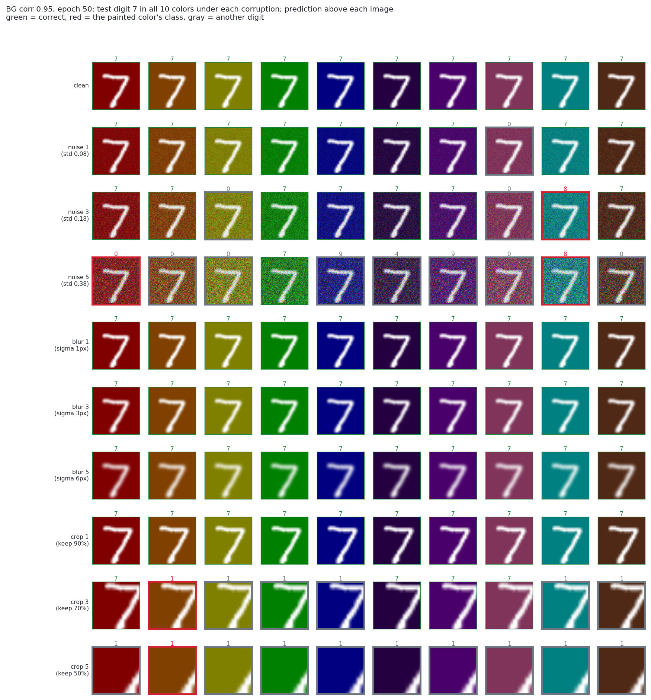

*BG .95, 숫자 7을 10색으로 칠하고 손상을 가했을 때의 예측. 초록=정답, 빨강=칠한 색의 클래스, 회색=다른 숫자.*

| 손상 (강도) | BG .95 | BG .65 | FG .95 | FG .65 |
|---|---|---|---|---|
| 없음 | 96.5 / 5.2 | 99.2 / 0.7 | 95.5 / 6.8 | 98.9 / 0.9 |
| Gaussian noise (3) | 69.2 / 48.0 | 59.3 / 52.7 | 8.9 / 0.0 † | 8.9 / 0.5 † |
| Gaussian blur (5) | 91.2 / 12.2 | 97.9 / 1.9 | 84.0 / 21.2 | 93.6 / 8.2 |
| Crop (3, 70% 남김) | 64.1 / 25.2 | 73.6 / 10.7 | 57.7 / 38.8 | 71.8 / 17.8 |

*정확도 / 9색 flip(%). † 한 클래스만 예측하는 붕괴 상태라 flip이 낮다(강건함이 아님). .80 포함 전체 수치: [stress_epoch50.csv](cmnist_rerun50/stress_epoch50.csv)*

- **Noise:** BG에서는 correlation과 상관없이 9색 flip이 50% 안팎으로 오른다. 모양이 가려지면 .65 모델도 다시 색으로 판단한다. 색 정보는 학습 내내 feature에 ~100% 남아 있기 때문이다(A5).
- **Blur·crop:** correlation이 높을수록 색 판단으로 더 많이 돌아간다. 예시 그림의 crop 3에서 BG .95는 10색 중 6색을 틀리고, [BG .65](cmnist_rerun50/figures/14_stress_examples_bg065.png)는 모두 맞힌다.
- Crop 강도 5(50% 남김)는 숫자 자체가 잘려 나가는 경우가 많아, 정확도 하락을 색 의존으로 해석하면 안 된다.

## A10. Colored MNIST 결론

| 가설 | 맞는 부분 | 안 맞는 부분 | 판정 |
|---|---|---|---|
| **H1** | 6개 조건 모두 epoch 1→50에서 9색 flip·C2I가 크게 감소. .95는 epoch 1에 재색칠 숫자의 64–82%를 색으로 답하다가 epoch 50에 3–4%로 감소(재실행) | ① epoch 0→1에서 오히려 급증 ② 이후 49번 중 18–24번 재상승(팀·재실행) ③ 일시적 WGA 급락(팀 e28, 재실행 e14) ④ .95는 50→100에서 악화 ⑤ noise·crop을 가하면 epoch 50 모델도 다시 색에 의존(재실행 stress test) | **"초기에 색을 배운 뒤 점차 벗어난다"는 지지, "계속 단조 감소"·"완전히 벗어난다"는 불지지** |
| **H2** | 강건 행동 도달: 95% 기준 .65=2, .80=3, .95=46(BG)/미도달(FG). 98% 기준 .65=16–18, .80=25–30, .95=미도달(재실행). 팀·재실행에서 같은 순서 | 숫자 probe는 모든 조건에서 epoch 1에 90% 이상. core 정보는 처음부터 있음 | **"core 사용 시점 지연"은 지지, "core 학습 시작 지연"은 미확정** |

한 줄 요약: **색 shortcut은 첫 epoch에 바로 학습되고 이후 빠르게 줄지만, correlation이 높으면 잔류 의존이 남고 오래 학습해도 사라지지 않는다. 입력이 손상되면 모델은 다시 색에 기댄다.**

---

# Part B. Waterbirds

## B1. 실험 설정

| 항목 | 설정 |
|---|---|
| 데이터 | 프로젝트에서 재구성한 Waterbirds (CUB 새 + Places 배경 합성). **공식 Waterbirds split과 다름** |
| 과제 | 새 종류 분류: Landbird(0) / Waterbird(1) |
| Shortcut | 배경: Land(0) / Water(1) |
| Train correlation | 0.95 / 0.80 / 0.65 (= P(새 종류 = 배경 종류)) |
| Val / Test correlation | 0.50 |
| 데이터 수 | Train 4,795 / Val 1,199 / Test 5,794 |
| 클래스 비율 | Landbird 77% / Waterbird 23% (불균형) |
| 모델 | VGG11_BN, pretrained 없음, 출력 2 |
| 학습 | SGD lr 0.01 고정, momentum 0.9, wd 1e-4, batch 128, 224px, AMP, seed 42, augmentation 없음 |
| Epoch | 0–50 |

세 조건은 **같은 새 이미지와 같은 split을 쓰고, train의 배경 선택만 다르다.** Val/Test는 세 조건에서 동일하다.

> **주의:** Val의 77%가 Landbird이므로 "전부 Landbird"라고만 답해도 정확도가 77%다. 이때 WGA = 0%, flip = 0%가 된다. 정확도나 낮은 flip만 보고 좋다고 판단하면 안 된다.

## B2. Epoch 50 결과

Validation, 단위 %. 세 조건 모두 Train 정확도는 100%다.

| Train corr | Val Acc | Balanced Acc | WGA | 배경 교체 flip | C→I |
|---|---:|---:|---:|---:|---:|
| 0.95 | 59.97 | 52.99 | 5.84 | **65.72** | 52.71 |
| 0.80 | 73.81 | 63.38 | 17.52 | 35.53 | 23.05 |
| 0.65 | 80.73 | 66.84 | 29.93 | 16.51 | 11.16 |

Test(Epoch 50)도 같은 순서다. 정확도 62.08 / 76.56 / 82.21%, WGA 9.50 / 26.48 / 35.20%.

- **correlation이 낮을수록 확실히 좋다.** Colored MNIST보다 차이가 훨씬 크다.
- **0.95는 사실상 배경 분류기다.** 배경만 바꿔도 예측의 66%가 바뀐다. Balanced Acc 53%는 거의 무작위 수준이다.
- **가장 약한 그룹은 세 조건 모두 "Waterbird on Land"(g10)다.** 정답 8/137, 24/137, 41/137개.

| Train corr | Landbird/Land | Landbird/Water | Waterbird/Land | Waterbird/Water |
|---|---:|---:|---:|---:|
| 0.95 | 98.70 | 32.90 | **5.84** | 74.45 |
| 0.80 | 98.06 | 67.10 | **17.52** | 70.80 |
| 0.65 | 97.19 | 87.66 | **29.93** | 52.55 |

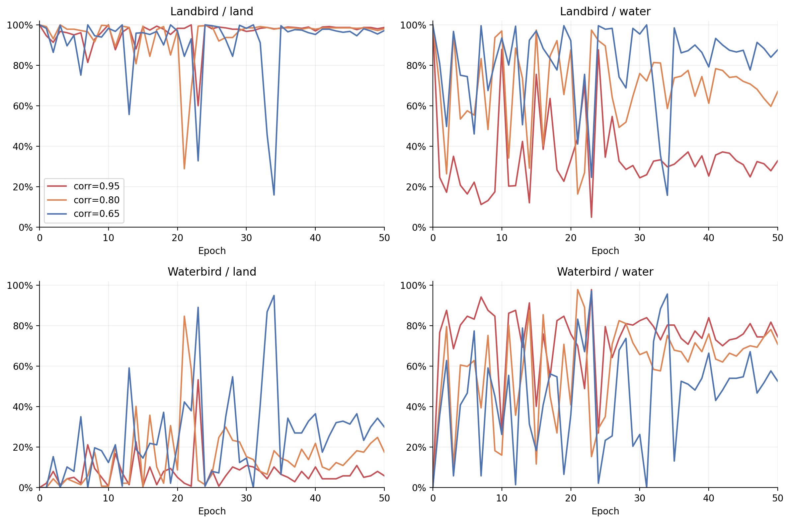

## B3. Epoch에 따른 변화 (H1)

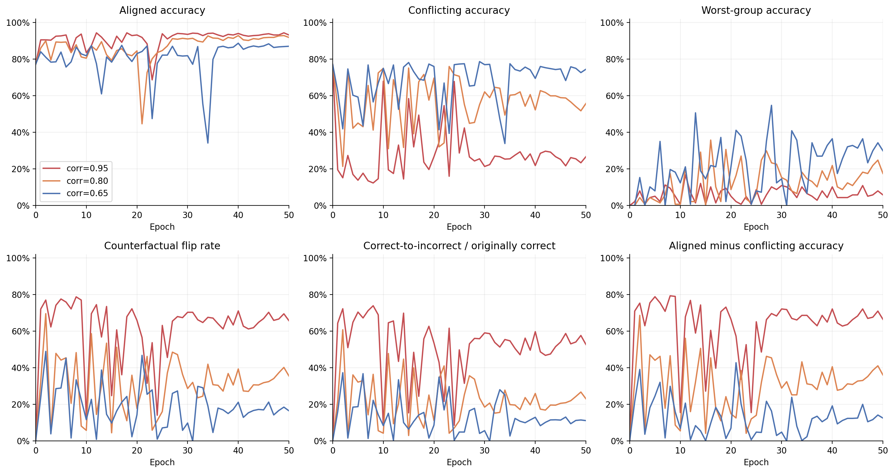

*위: Aligned / Conflicting / WGA. 아래: 배경 교체 flip / C→I / Aligned−Conflicting 격차.*

**Colored MNIST와 달리 매우 불안정하다.** 지표가 epoch마다 수십 %p씩 오르내린다. 구간별 평균(단위 %)은 다음과 같다.

| Corr | 구간 | Val Acc | WGA | Flip | C→I |
|---|---|---:|---:|---:|---:|
| 0.95 | 초기(1–10) / 중기(11–30) / 후기(31–50) | 56.1 / 61.0 / 59.8 | 5.0 / 6.3 / 6.5 | 68.0 / 56.9 / **66.0** | 61.3 / 47.2 / **53.1** |
| 0.80 | 초기 / 중기 / 후기 | 69.5 / 69.4 / 74.9 | 3.9 / 15.6 / 14.8 | 32.7 / 30.2 / 32.2 | 24.8 / 22.8 / 20.8 |
| 0.65 | 초기 / 중기 / 후기 | 71.4 / 74.3 / 76.1 | 11.9 / 22.3 / 27.5 | 24.9 / 17.5 / 16.9 | 17.6 / 12.6 / 12.1 |

- **0.95:** 중기에 줄던 flip이 후기에 다시 오른다. H1과 반대다.
- **0.80:** 정확도는 오르지만 flip은 30–33%에서 정체한다.
- **0.65:** 초기→후기로 WGA·정확도가 오르고 flip·C→I가 내려간다. H1에 맞는 유일한 조건이다. 하지만 **epoch 31에 "전부 Landbird" 붕괴**(WGA 0%, flip 0%)가 있다.

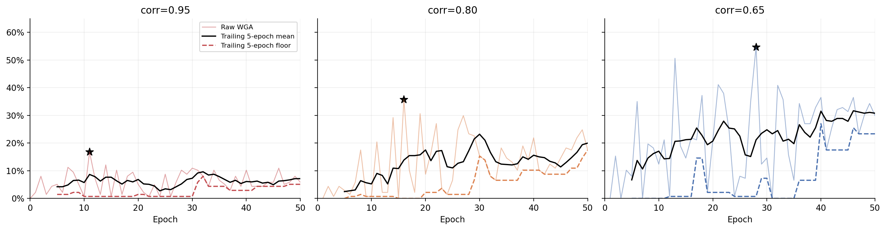

*WGA 원곡선과 직전 5 epoch 평균·최솟값. 최고점은 모두 바로 다음 epoch에 무너진다.*

| Corr | 최고 WGA | 다음 epoch |
|---|---|---|
| 0.95 | 16.79% (E11) | 7.30% |
| 0.80 | 35.77% (E16) | 10.22% |
| 0.65 | 54.74% (E28) | 12.41% |

추가 그림: 정확도 / 클래스 불균형 보정 지표

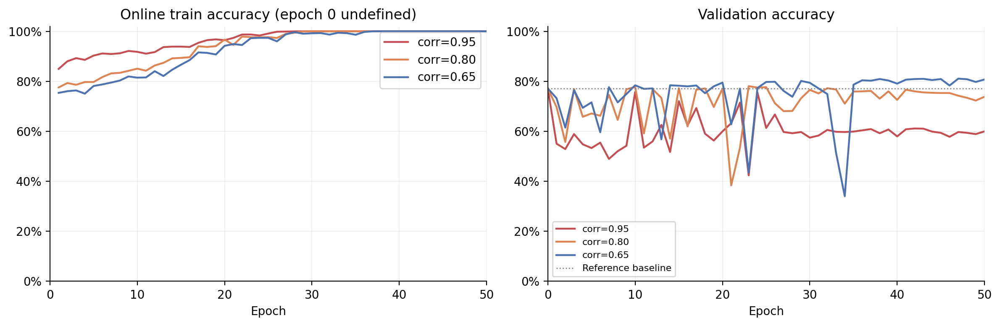
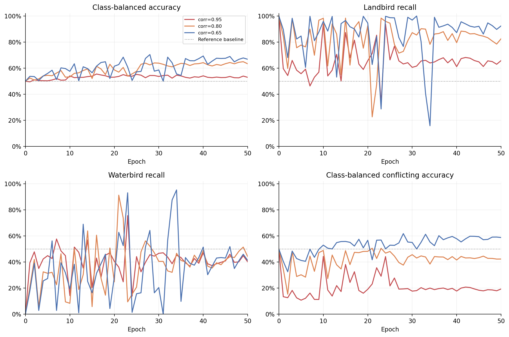

## B4. 재실행으로 확인한 것

팀의 3개 실험을 **팀 코드의 설정 함수 그대로**(lr 0.01 고정, seed 42, 50 epoch) RTX 5070 Ti에서 다시 학습했다. 데이터는 팀 downloader·manifest 생성기로 새로 만들었고, 팀 manifest와 **바이트 단위로 같음**을 확인했다(원본 해시 43,578개, 세 조건 CSV sha256 일치). 저장된 체크포인트로 팀 결과에 없던 probe·Grad-CAM·stress test를 추가했다. 같은 설정에서 학습 seed만 바꾼 run(43, 44)도 3개씩 더 학습했다. 자세한 내용은 [`waterbirds_rerun50/README.md`](waterbirds_rerun50/README.md)에 있다.

> **데이터 주의:** 팀 manifest는 원래 [`data.py`](../data.py)와 새·라벨·split·그룹 배정은 같지만 **배경 사진 배정이 다르다**. 배경을 내용 해시로 묶어 train/val/test에 60/20/20으로 나눠, train에서 본 배경이 test에 다시 나오지 않게 했다(원래 방식은 375장 겹침). 그래서 원래 `data.py`로 만든 Waterbirds 결과와는 직접 비교하면 안 된다.

### 재현 확인

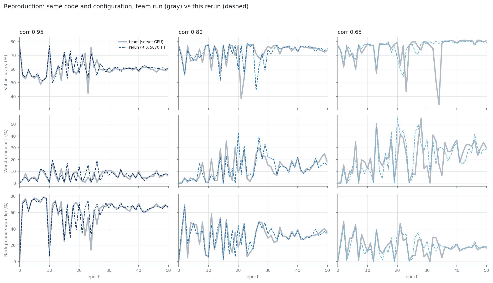

*회색 실선: 팀 run, 점선: 재실행. 위부터 Val 정확도, WGA, 배경 교체 flip.*

| Epoch 50 Test (팀 → 재실행) | 0.95 | 0.80 | 0.65 |
|---|---|---|---|
| 정확도 | 62.1 → 62.0 | 76.6 → 77.1 | 82.2 → 81.4 |
| WGA | 9.5 → 10.7 | 26.5 → 22.6 | 35.2 → 33.6 |
| 배경 교체 flip | 67.2 → 67.7 | 33.5 → 32.8 | 17.5 → 19.3 |

- Epoch 0은 완전히 같고, 구간 평균(초기·중기·후기)과 epoch 50 값은 대부분 1–4pp 안에서 같다. B3의 구간별 해석(0.95 후기 재상승, 0.80 flip 정체, 0.65 개선)이 그대로 나온다.
- 그러나 **epoch별 값은 epoch 1–2부터 갈라진다**. 매 epoch 10–40pp씩 출렁이는 데이터라, GPU 비결정성 수준의 차이가 어느 epoch에 출렁이는지를 바꾼다(Colored MNIST 재실행은 평균 차이 0.07–0.29pp).
- 그 결과 **시점에 관한 값은 실행마다 다르다**.

| | 팀 run | 재실행 |
|---|---|---|
| 0.65 "전부 Landbird" 붕괴 | epoch 31 | epoch 19 |
| 0.65 강건 기준 3 / 5 epoch 연속 도달 | 16 / 36 | 26 / 26 |
| 0.80 · 0.95 강건 기준 | 미도달 | 미도달 |

*강건 기준 = 균형 conflicting ≥ 50% & WGA ≥ 20%. "0.65만 도달"이라는 결론은 같지만 도달 epoch는 10–20 epoch씩 다르다.*

### Seed를 바꿔도 (seed 43 / 44)

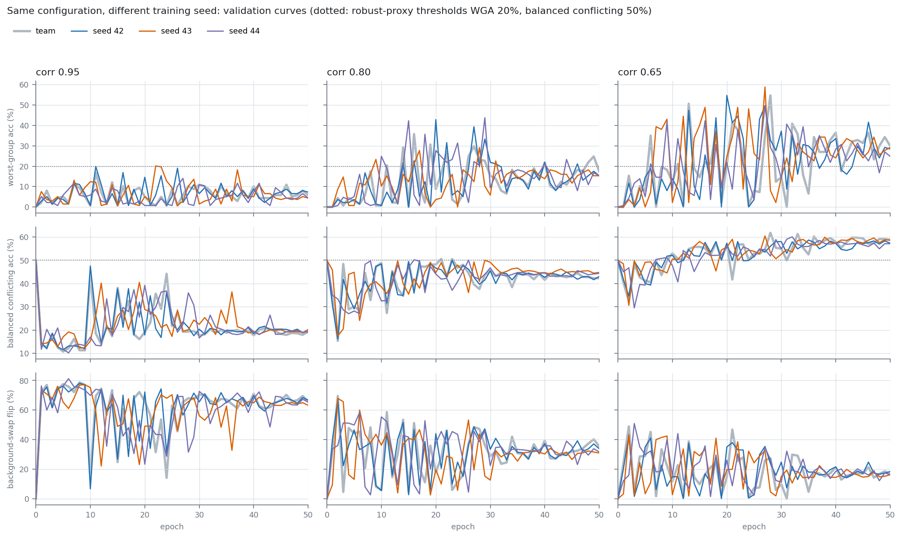

*Validation. 회색 굵은 선 = 팀 run, 파랑 = 재실행 seed 42, 주황 = 43, 보라 = 44. lr 0.01 고정 등 나머지 설정은 같다.*

| | 팀 | seed 42 | 43 | 44 |
|---|---|---|---|---|
| 후기(31–50) Val WGA, 0.95 / 0.80 / 0.65 | 6.5 / 14.8 / 27.5 | 6.7 / 14.6 / 25.9 | 5.8 / 16.1 / 27.6 | 5.6 / 15.5 / 28.0 |
| 후기 Val flip, 0.95 / 0.80 / 0.65 | 66.0 / 32.2 / 16.9 | 66.1 / 32.7 / 17.5 | 61.5 / 30.7 / 16.2 | 64.4 / 32.7 / 18.6 |
| 0.65 강건 기준 3 / 5 epoch 연속 도달 | 16 / 36 | 26 / 26 | 14 / 33 | 26 / 36 |
| 0.80 · 0.95 강건 기준 | 미도달 | 미도달 | 미도달 | 미도달 |
| 0.65 waterbird recall = 0인 epoch | 31 | 19 | 없음 | 없음 |

- **구간 평균·최종값·판정은 seed와 상관없이 같다.** 후기 WGA 차이는 약 2pp, flip은 5pp 안이고, H1 해석(0.65만 감소, 0.95 후기 재상승)과 "강건 기준은 0.65만 도달"도 네 run 모두 같다.
- **시점은 seed마다 다르다.** 0.65의 도달 epoch는 14–26(3 epoch 연속), 26–36(5 epoch 연속)이다.
- **"전부 landbird" 붕괴는 특정 epoch의 사건이 아니다.** 정확히 일어난 것은 팀과 seed 42뿐이지만, waterbird recall이 5% 미만으로 떨어지는 epoch는 0.65·0.80의 모든 seed에 있다.
- probe(배경 79–90% ≫ 새 종류), Grad-CAM(0.95 오답은 새를 7–13%만 봄), stress test(noise에서 waterbird 예측 3% 이하) 결론도 세 seed에서 같다.

자세한 표: [waterbirds_rerun50 §8](waterbirds_rerun50/README.md#8-seed-반복-42--43--44)

### 배경만 바꾸면 예측이 바뀐다

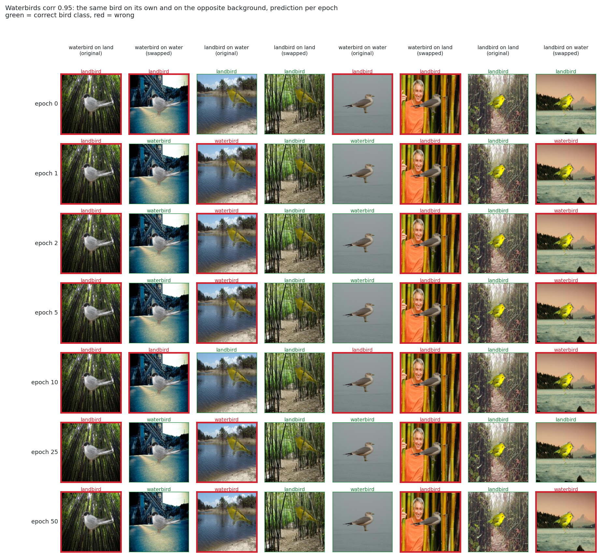

*0.95. 같은 새를 원래 배경과 반대 배경에 놓았을 때의 epoch별 예측(열은 원본 | 배경 교체 쌍). 초록=정답, 빨강=오답.*

0.95 모델은 epoch 1부터 50까지 대부분 **배경이 물이면 waterbird, 땅이면 landbird**로 답한다. 같은 갈매기가 물 위에서는 waterbird, 대나무 숲 앞에서는 landbird다. [0.65 격자](waterbirds_rerun50/figures/05_swap_grid_065.png)에서는 배경을 따르는 경우가 줄지만, 대신 landbird 쪽으로 기운다.

### 새 정보가 약하다 (probe)

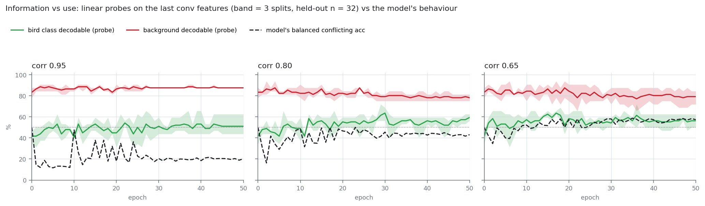

*마지막 conv 층 feature에 선형 probe. 초록=새 종류, 빨강=배경 해독 정확도, 점선=모델의 균형 conflicting 정확도.*

- 배경은 학습 전부터 약 85% 해독된다.
- 새 종류는 0.95에서 50 epoch 내내 우연 수준(≈50%)이다. 0.80·0.65는 후반에 55–69%다. 팀 probe 방식(PR #23, 56/56장 분할)이 이 문서 방식보다 5–10pp 높게 나오지만, 두 방식 모두 배경보다 10pp 이상 낮다([waterbirds_rerun50 §5](waterbirds_rerun50/README.md#5-정보가-있는-것--쓰는-것-probe)).
- Colored MNIST는 숫자 정보가 epoch 1에 90% 이상 있었지만 쓰지 않았다(A5). Waterbirds는 **새 정보가 약하다**. 0.95에서는 거의 생기지 않고, 0.80·0.65에서도 배경보다 약하다. pretrained 없이 4,795장으로 학습한 VGG11_BN이 새를 구분하는 특징을 충분히 만들지 못한 것으로 보인다.
- 저장된 feature가 그룹당 32장뿐이라 probe 평가는 32장(한 장 = 3.1pp)이다. 크기 차이(배경 ≫ 새)만 근거로 쓴다.

### Grad-CAM

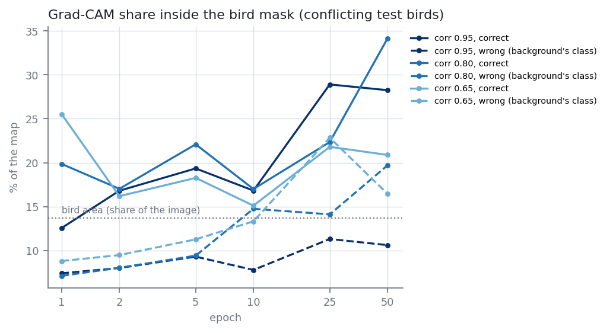

*conflicting test 이미지에서 Grad-CAM heatmap 중 새 마스크 안 비율. 실선=정답, 점선=배경 클래스로 오답. 가로 점선=새가 이미지에서 차지하는 비율(13.7%).*

맞힌 예측은 새 면적보다 많이(13–34%) 새를 본다. 배경 클래스로 틀린 예측은 초반에 7–11%만 새를 본다. 0.95의 오답은 50 epoch 내내 이 수준이다. 예시: [0.95 Grad-CAM 격자](waterbirds_rerun50/figures/06_gradcam_grid_095.png)

### Stress test (proposal 6.1)

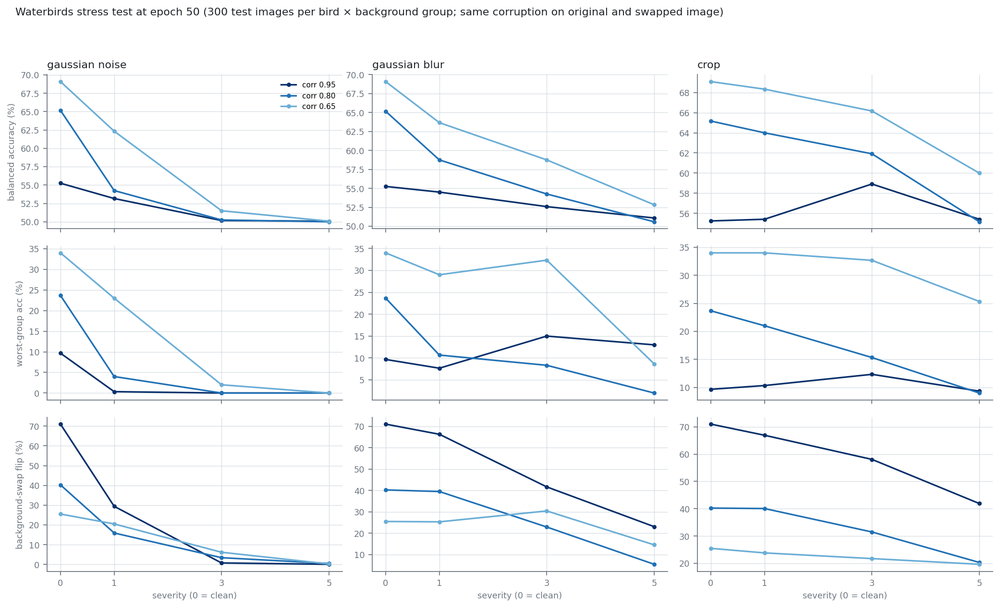

*Epoch 50 모델, test 그룹당 300장. 원본과 배경 교체 이미지에 같은 손상. 위: 균형 정확도, 가운데: WGA, 아래: 배경 교체 flip.*

| 손상 (강도) | 0.95 | 0.80 | 0.65 |
|---|---|---|---|
| 없음 | 55.2 / 71.0 | 65.2 / 40.2 | 69.1 / 25.5 |
| Gaussian noise (3) | 50.2 / 0.8 † | 50.2 / 3.4 † | 51.5 / 6.2 † |
| Gaussian blur (3) | 52.6 / 41.7 | 54.2 / 22.9 | 58.8 / 30.4 |
| Crop (3, 70% 남김) | 58.9 / 58.1 | 61.9 / 31.5 | 66.2 / 21.8 |

*균형 정확도 / 배경 교체 flip(%). † 거의 모든 이미지를 landbird로 예측하는 붕괴(waterbird 예측 0.3–3%)라 flip이 낮다. 강건함이 아니다. 전체 수치: [stress_epoch50.csv](waterbirds_rerun50/stress_epoch50.csv)*

- **Noise:** 세 모델 모두 다수 클래스(landbird) 하나로 붕괴한다. Colored MNIST FG + noise와 같은 현상이다.
- **Blur:** 정확도가 떨어지면서 landbird 쪽으로 기운다. 0.65는 blur 3까지 WGA를 유지한다(34 → 32%).
- **Crop:** 영향이 가장 작다. 0.95는 70%만 남겨도 flip 58%로 여전히 배경을 따른다.
- 세 손상 모두 correlation이 낮은 모델이 정확도·WGA를 더 잘 유지한다. 예시 그림: [0.95 손상 예시](waterbirds_rerun50/figures/09_stress_examples_095.png)

## B5. Waterbirds 결론

| 가설 | 맞는 부분 | 안 맞는 부분 | 판정 |
|---|---|---|---|
| **H1** | 0.65에서 초기→후기 flip·C→I 감소, WGA 상승(팀·재실행 같음) | 0.95는 후기 재상승, 0.80은 flip 정체, 0.65도 거의 landbird만 답하는 epoch가 모든 seed에 있음(완전 붕괴는 팀 E31, seed 42 E19). Flip–epoch 순위상관(E11–50) +0.12 / +0.16 / −0.01 | **일반적 감소 가설은 불지지.** 0.65에서만 제한적 일치 |
| **H2** | 낮은 corr일수록 최종 WGA·균형 정확도 높고 flip 낮음(팀·재실행 같음). "균형 conflicting ≥ 50% & WGA ≥ 20%"를 5 epoch 연속 만족: 0.65만 도달(팀 E36, seed 42/43/44 E26/33/36) | 0.80·0.95는 50 epoch 내 미도달이라 지연 순서·크기를 비교할 수 없음. 0.65의 도달 epoch도 실행·seed마다 10–20 epoch 다름. probe상 새 정보가 약함(0.95는 우연 수준) | **방향은 일치, 시점 지연은 확인 불가** |

한 줄 요약: **Waterbirds에서는 50 epoch 동안 배경 shortcut이 해소되지 않았다. correlation이 낮을수록 덜 의존하지만, 오래 학습한다고 저절로 줄지는 않았다. 새를 구분하는 정보가 약하고(0.95는 우연 수준), 언제 무엇이 일어나는지는 실행·seed마다 달라 단일 run으로 시점을 정할 수 없다(seed 3개에서 결론은 같고 시점만 다르다).**

## B6. 새를 알아볼 수 있고 train을 금방 외우지 못하면

B5의 결과에는 원인이 두 가지 있었다. 새를 잘 못 알아보고(회색 바탕에 새만 보여주면 균형 정확도 .95 57%, .80 69%, .65 80%), 4,795장의 train을 epoch 23–28에 다 외운다. 그래서 세 가지를 바꿔 다시 학습했다(seed 42, lr 0.01 고정, scheduler none, 나머지 팀 설정과 같음). 자세한 내용: [waterbirds_cubfull_pretrained/README.md](waterbirds_cubfull_pretrained/README.md)

- **ImageNet pretrained** VGG11_BN에서 시작한다(head만 새로 만들고 전체 layer 학습).
- **CUB 새 전체** 9,390마리로 학습한다. val은 같고 test는 다른 1,199마리다.
- **매 epoch 새 배경(B):** 같은 장소 종류의 train 배경 풀에서 새로 뽑는다. corr은 그대로다.

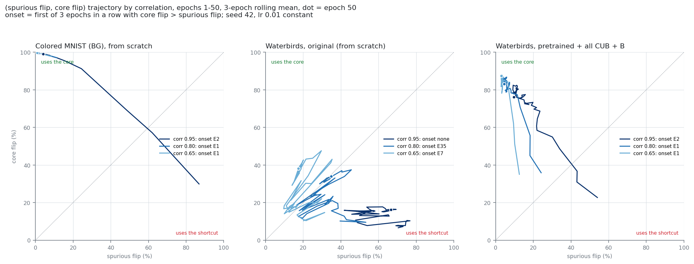

| corr | core 사용 시작 | 팀 강건 기준 | core flip | spurious flip | val WGA | 새만 |
|---|---|---|---|---|---|---|
| .95 | **E2** (원래 없음) | **E3** (원래 미도달) | 80% (16%) | 10% (66%) | 73% (7%) | 94% (57%) |
| .80 | **E1** (원래 E35) | **E2** (원래 미도달) | 85% (32%) | 4.6% (33%) | 84% (15%) | 93% (69%) |
| .65 | **E1** (원래 E7) | **E2** (원래 E26) | 86% (37%) | 3.3% (17%) | 85% (26%) | 94% (80%) |

*괄호 안은 원래 설정(seed 42). flip·WGA·새만은 E31–50 평균. core 사용 시작 = core flip > spurious flip이 3 epoch 연속인 첫 epoch(Colored MNIST BG: E2/E1/E1).*

- **H1:** 지지. 세 corr 모두 spurious flip이 초반에 크게 줄고(.95: E1 54% → E5 21% → E31–50 10%) 후반 재상승이 없다.
- **H2:** 순서는 지지. core 사용 시작 .95 E2 > .80·.65 E1, 강건 기준 E3 > E2, 도착점도 .95 < .80 < .65. 시점 차이는 1 epoch뿐이고 seed 하나다.
- **한계:** 원래 Waterbirds 설정이 아니다(시작 가중치·데이터 양·배경 조합이 다름). 새 특징을 ImageNet에서 가져오므로 "core를 배우는 시간"보다 "core를 쓰기 시작하는 시점"에 가깝다. .95의 val WGA가 후반에도 52–82%로 흔들리고, core flip이 Colored MNIST(99%)보다 낮다(80–86%).

---

# 종합: proposal과 비교

| Proposal 항목 | Colored MNIST | Waterbirds |
|---|---|---|
| H1 (epoch↑ → 의존↓) | 대체로 맞음. 단조 아님, 후반 정체·악화 | 대체로 안 맞음 |
| H2 (corr↑ → core 학습 늦음) | 행동 기준으로 맞음(95%·98% 기준 모두 같은 순서). probe상 core 정보는 처음부터 있음 | 방향만 맞음 |
| Decoded core correlation (probe) | 실시. 정보는 있으나 사용과 다름 | 재실행에서 실시(B4). 배경 ≈85%, 새 종류는 우연 수준(0.95)~69%(0.65). 새 정보가 약함 |
| Flip rate | 실시. 대체색 하나가 아니라 나머지 9색 전부로 측정(9색 flip) | 실시 (배경 교체) |
| Grad-CAM | BG만 해석 가능, FG는 색·모양 위치가 겹쳐 불가 | 재실행에서 실시(B4). 배경 클래스로 틀릴 때 새를 덜 봄 |
| Stress test 6.1 (noise/blur/crop) | 재실행 체크포인트로 수행(A9). noise·crop에서 다시 색 의존, correlation 높을수록 심함 | 재실행 체크포인트로 수행(B4). noise는 landbird 붕괴, correlation 낮을수록 성능 유지 |
| 재현성 | 재실행 6개로 확인. 평균 차이 0.07–0.29pp, 강건 도달 epoch 동일 | 재실행 3개 + seed 43/44 6개로 확인. 구간 평균·최종값·판정은 같고, epoch별 값·시점은 다름 |
| Stress test 6.2 (correlation 조작) | 실시 (.95/.80/.65) | 실시 (.95/.80/.65) |
| 모델 | VGG11_BN만 | VGG11_BN만 |

**공통 한계**
- Colored MNIST는 seed 42 하나뿐이다. Waterbirds는 seed 42/43/44 세 개다(B4). epoch나 probe split을 독립 반복으로 볼 수 없고, 통계적 유의성은 주장하지 않는다. Waterbirds는 seed마다 시점이 크게 달랐으므로, 시점의 분포를 좁히려면 seed가 더 필요하다.
- Train 정확도는 학습 중 online 측정이고, Val은 epoch 끝 고정 모델 평가다. 둘은 직접 비교할 수 없다.
- ResNet은 이번 결과에 없다.
