# Colored MNIST 6개 실험 재실행 · 체크포인트 시각화 · Proposal 대비 정리

팀이 공유한 Colored MNIST × VGG11_BN 50-epoch 실험 6개(BG/FG × train corr .95/.80/.65)를 **같은 명령으로 다시 학습**했다. 저장된 51개 체크포인트(epoch 0–50)로 그림을 새로 만들었다. 끝에서 proposal의 가설·지표·stress test 계획과 맞는 부분과 맞지 않는 부분을 정리한다.

> 팀 결과 원본 정리는 [`../RESULTS_OVERVIEW_KO.md`](../RESULTS_OVERVIEW_KO.md)와 [`../metric_final_analysis_406/`](../metric_final_analysis_406/)에 있다. 이 폴더는 재실행 결과와 새 그림만 다룬다.

## 요약

| | 결과 |
|---|---|
| 재현 | 6개 모두 팀 곡선과 거의 겹친다(epoch별 정확도·9색 flip 평균 차이 0.07–0.29pp). 강건 행동 95% 도달 epoch도 같다. |
| H1 | epoch 1에 색 의존이 최대(.95에서 재색칠 숫자의 64–82%를 색 클래스로 예측)이고, 이후 빠르게 줄어 epoch 50에 3–4%. **장기 감소는 맞지만 단조 감소는 아니다.** |
| H2 | 색에 강건해지는 epoch(98% 기준): .65 → 16–18, .80 → 25–30, .95 → 50 내 미도달. **상관이 강할수록 늦다.** 단, 숫자 정보 자체는 학습 전부터 feature에 있다. |
| 새 관찰 | 팀 run의 BG .95 epoch 28 급락은 **재현되지 않았다**. 실행마다 다른 일시적 흔들림으로 보인다. |
| Stress test | noise·crop을 가하면 epoch 50 모델도 다시 색에 의존한다(9색 flip 최대 60%). blur는 영향이 작다. |

## 1. 실험 설정

[`scripts/cmnist_vgg50/task.sh`](../../scripts/cmnist_vgg50/task.sh)와 같은 명령을 썼다. 실행 스크립트는 [`scripts/run_all.sh`](scripts/run_all.sh)이고 결과는 `runs/rerun50/`에 저장된다. `runs/`는 git에 올라가지 않는다(체크포인트 28GB).

| 항목 | 값 |
|---|---|
| 데이터 | 10-class Colored MNIST, 224×224, `--color-pairing all`, val/test corr 0.10 |
| 모드 | BG: 흰 숫자 + 색 배경(밝기 0.5) / FG: 검은 배경 + 색 숫자 |
| 모델 | VGG11_BN, pretrained 없음 |
| 학습 | **SGD lr 0.01 고정(`--scheduler none`)**, momentum 0.9, wd 1e-4, batch 128, AMP, seed 42, 50 epoch |
| 환경 | RTX 5070 Ti 1장. 팀 run은 서버 GPU |

<details>
<summary>학습 명령 (6개 공통, <code>--color-mode</code>와 <code>--train-corr</code>만 다름)</summary>

```bash
python3 shortcut_experiment.py train --dataset colored_mnist --seed 42 --image-size 224 --train-corr 0.95 \
  --val-corr 0.10 --test-corr 0.10 --mnist-val-size 5000 --color-mode background --color-pairing all --model vgg11_bn \
  --epochs 50 --lr 0.01 --momentum 0.9 --weight-decay 0.0001 --scheduler none --batch-size 128 --num-workers 4 \
  --features-per-group 32 --cf-chunk-size 128 --device cuda --output runs/rerun50/vgg11_bg_corr095
```

</details>

**실행 중 중단 기록:** .80 두 run은 epoch 41에서 세션 종료로 한 번, epoch 44에서 GPU 메모리 부족으로 인한 속도 저하 때문에 한 번 중단됐다. 두 번 모두 `--resume latest`로 이어 학습했다. resume은 모델·optimizer·scheduler·AMP scaler·RNG를 복원한다. 다만 feature 저장용 RNG 한 번이 재현되지 않아, 끊김 없는 학습과 bit 단위로 같지는 않다. 나머지 4개는 한 번에 끝까지 학습했다.

## 2. 재현 확인

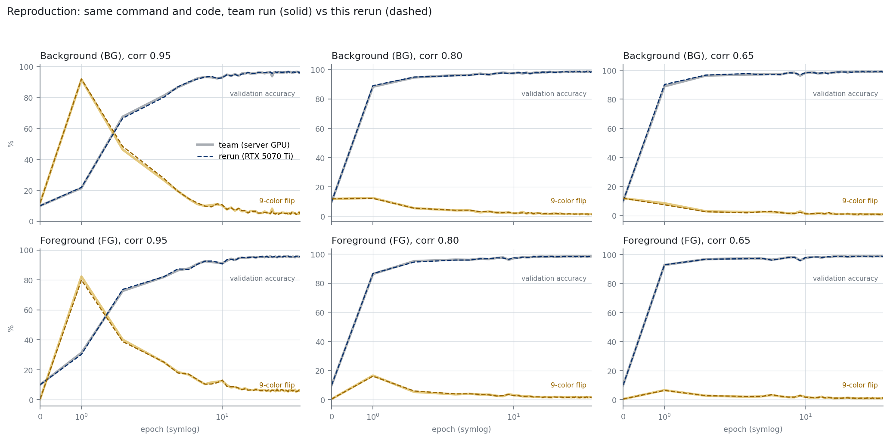

*실선: 팀 run(서버 GPU), 점선: 재실행. 위 BG, 아래 FG. 회색=Val 정확도, 노랑=9색 flip.*

| 조건 | Val 정확도 평균 차이 | 9색 flip 평균 차이 | WGA 평균 차이 |
|---|---:|---:|---:|
| BG .95 | 0.24pp | 0.29pp | 1.33pp |
| BG .80 | 0.14pp | 0.11pp | 0.56pp |
| BG .65 | 0.16pp | 0.14pp | 0.70pp |
| FG .95 | 0.21pp | 0.27pp | 0.75pp |
| FG .80 | 0.12pp | 0.11pp | 0.45pp |
| FG .65 | 0.08pp | 0.07pp | 0.47pp |

epoch 1–50의 절대 차이 평균이다([reproduction_diff.csv](reproduction_diff.csv)). Epoch 0(학습 전)은 완전히 같다. 이후 차이는 GPU가 달라 생기는 부동소수점 비결정성 때문이다.

WGA는 가장 약한 그룹 하나로 정해져서 흔들림이 크다. 대표 사례가 **BG .95 epoch 28**이다.

| | epoch 27 | epoch 28 | epoch 29 |
|---|---:|---:|---:|
| 팀 run WGA | 92.86 | **77.41** | 91.47 |
| 재실행 WGA | 92.81 | 92.36 | 92.86 |

팀 보고서가 "원인 미확정"으로 남긴 epoch 28 급락은 재실행에서 나타나지 않았다. 대신 재실행은 epoch 14에 WGA가 80.9%로 떨어진다. 따라서 이런 일시적 급락은 **특정 epoch에 고정된 현상이 아니라 실행마다 위치가 달라지는 흔들림**이다. 결론에는 장기 추세만 쓰는 것이 안전하다.

### Epoch 50 Test

| 조건 | Test 정확도 | WGA | 9색 flip | Shape bias |
|---|---:|---:|---:|---:|
| BG .95 | 96.78 | 93.35 | 4.47 | 97.4 |
| BG .80 | 98.74 | 96.97 | 1.30 | 99.4 |
| BG .65 | 99.15 | 97.80 | 0.71 | 99.7 |
| FG .95 | 96.07 | 92.96 | 5.50 | 97.0 |
| FG .80 | 98.55 | 96.75 | 1.54 | 99.3 |
| FG .65 | 98.98 | 97.72 | 0.87 | 99.6 |

*Shape bias = 모양 정답률 / (모양 정답률 + 색 클래스 예측률), 재색칠한 숫자 기준.* ([test_epoch50.csv](test_epoch50.csv), [그림](figures/05_epoch50_test.png))

## 3. 학습 곡선: 색 의존은 첫 epoch에 생기고 이후 줄어든다 (H1)

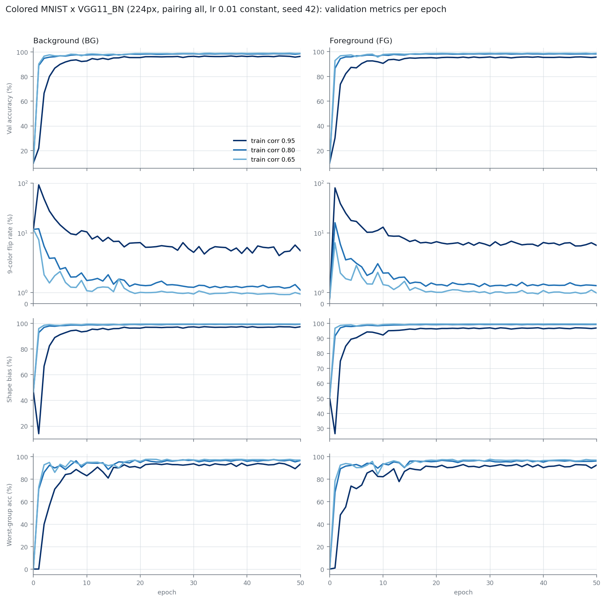

*위에서부터 Val 정확도, 9색 flip(로그축), shape bias, WGA.*

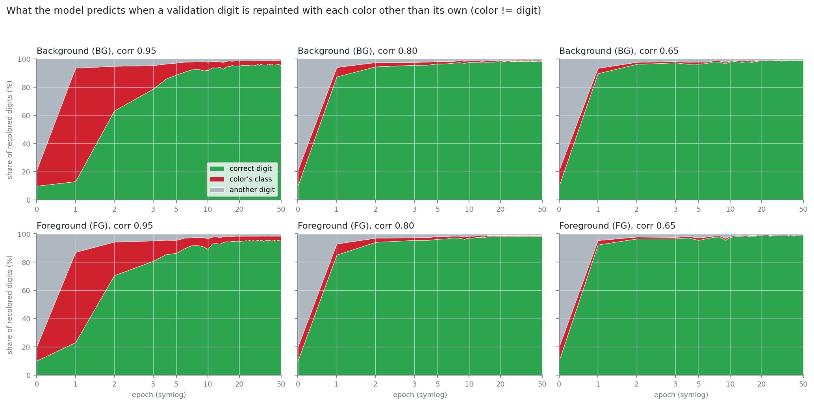

*Val 숫자를 자기 색이 아닌 9색으로 다시 칠했을 때의 예측. 초록=정답 숫자, 빨강=칠한 색에 해당하는 숫자, 회색=다른 숫자. x축 로그.*

재색칠한 숫자를 **칠한 색의 클래스로 예측한 비율**(%)은 다음과 같다. Test 1,000개 × 9색 기준이다.

| 조건 | epoch 1 | epoch 2 | epoch 10 | epoch 50 |
|---|---:|---:|---:|---:|
| BG .95 | **81.5** | 34.2 | 7.2 | 3.3 |
| FG .95 | **64.2** | 25.0 | 8.7 | 3.8 |
| BG .80 | 7.7 | 3.4 | 1.2 | 0.7 |
| FG .80 | 8.7 | 3.2 | 1.7 | 0.8 |
| BG .65 | 4.1 | 1.7 | 0.6 | 0.4 |
| FG .65 | 3.5 | 1.6 | 0.9 | 0.5 |

- **Epoch 0 → 1:** .95 모델은 첫 epoch에 사실상 "색 분류기"가 된다. 9색 flip이 BG 11.9% → 91.9%, FG 0.5% → 79.9%로 뛴다.
- **Epoch 1 → 10:** 빠르게 줄어든다.
- **Epoch 10 → 50:** 낮은 수준에서 오르내린다. 인접 epoch 49번 중 21–24번은 9색 flip이 오히려 증가했다.
- .80/.65는 epoch 1부터 색 의존이 10% 미만이다.

## 4. 색에 강건해지는 시점 (H2)

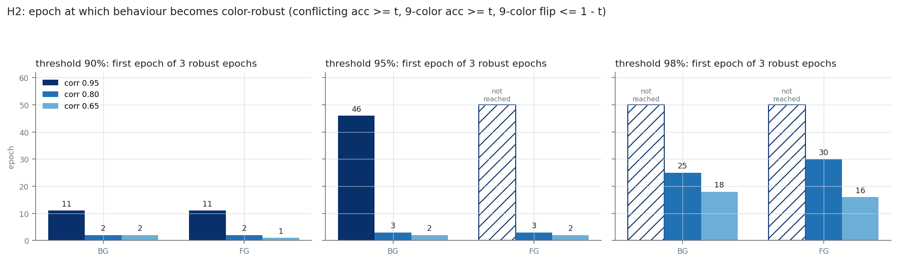

*기준 t: conflicting 정확도 ≥ t, 재색칠 정확도 ≥ t, 9색 flip ≤ 1−t를 3 epoch 연속 만족한 첫 epoch.*

| 기준 | BG .65 | BG .80 | BG .95 | FG .65 | FG .80 | FG .95 |
|---|---:|---:|---:|---:|---:|---:|
| 90% | 2 | 2 | 11 | 1 | 2 | 11 |
| 95% | 2 | 3 | 46 | 2 | 3 | 미도달 |
| 98% | 18 | 25 | 미도달 | 16 | 30 | 미도달 |

**세 기준 모두 .65 ≤ .80 < .95 순서가 유지된다.** 95% 기준 결과(2 / 3 / 46·미도달)는 팀 결과와 정확히 같다. 98% 기준에서는 .65와 .80의 차이도 드러난다.

## 5. 정보가 있는 것 ≠ 쓰는 것 (Decoded core correlation)

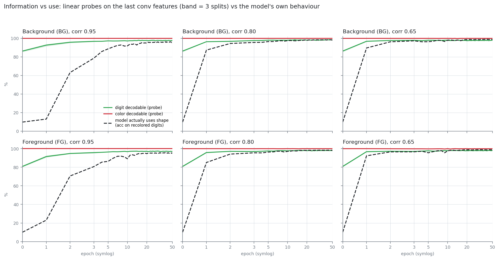

*마지막 conv 블록(features.28) feature에 ridge 선형 probe. 초록=숫자 해독, 빨강=색 해독, 검은 점선=모델이 실제로 모양으로 맞힌 비율(재색칠 정확도). 띠=3개 split 범위.*

| 조건 | 숫자 probe epoch 0 | epoch 1 | epoch 50 | 실제 재색칠 정확도 epoch 1 |
|---|---:|---:|---:|---:|
| BG .95 | 86.3 | 92.7 | 97.6 | **13.1** |
| FG .95 | 80.9 | 91.5 | 97.1 | **23.1** |
| BG .80 | 86.3 | 96.4 | 98.3 | 87.4 |
| BG .65 | 86.3 | 96.9 | 97.9 | 89.6 |

- **색은 모든 epoch·모든 조건에서 ~100% 해독된다.**
- **숫자도 학습 전부터 80% 이상, epoch 1에 90% 이상 해독된다.** .95도 마찬가지다.
- 그런데 .95 모델의 실제 판단은 epoch 1에 13–23%만 모양을 따른다. **숫자 정보는 이미 feature에 있는데 분류기가 색을 쓰고 있다.** 이 차이가 좁혀지는 데 .95는 20 epoch 이상 걸린다.

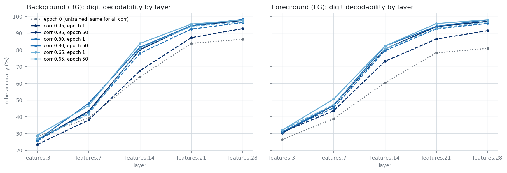

*층이 깊을수록 숫자 해독이 잘 된다. 학습 전(회색 점선)에도 features.21 이후는 80% 이상이다.*

## 6. 체크포인트로 본 예측

### 숫자 × 칠한 색 정확도

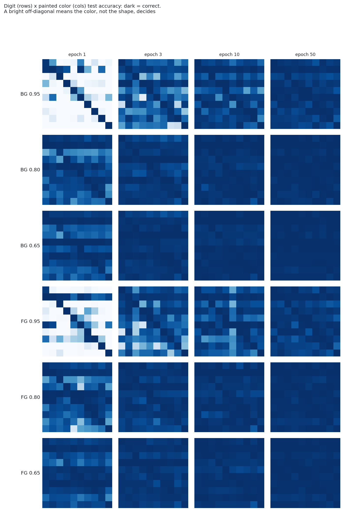

*행=숫자 0–9, 열=칠한 색 0–9. 진할수록 정답. 대각선(숫자=색)만 진하고 나머지가 밝으면 색으로 판단하는 것.*

- BG/FG .95의 epoch 1은 **대각선만 진하다.** 숫자 3을 어떤 색으로 칠하든 그 색의 숫자로 답한다.
- epoch 3–10에 대각선 밖이 채워지고, epoch 50에는 거의 균일해진다.
- .80/.65는 epoch 1부터 대부분 채워져 있다.

조건별 상세(epoch 0, 1, 2, 3, 5, 10, 25, 50): [BG .95](figures/08_digit_color_bg095.png) · [FG .95](figures/08_digit_color_fg095.png) · [BG .80](figures/08_digit_color_bg080.png) · [FG .80](figures/08_digit_color_fg080.png) · [BG .65](figures/08_digit_color_bg065.png) · [FG .65](figures/08_digit_color_fg065.png)

### 같은 숫자를 10색으로 칠했을 때

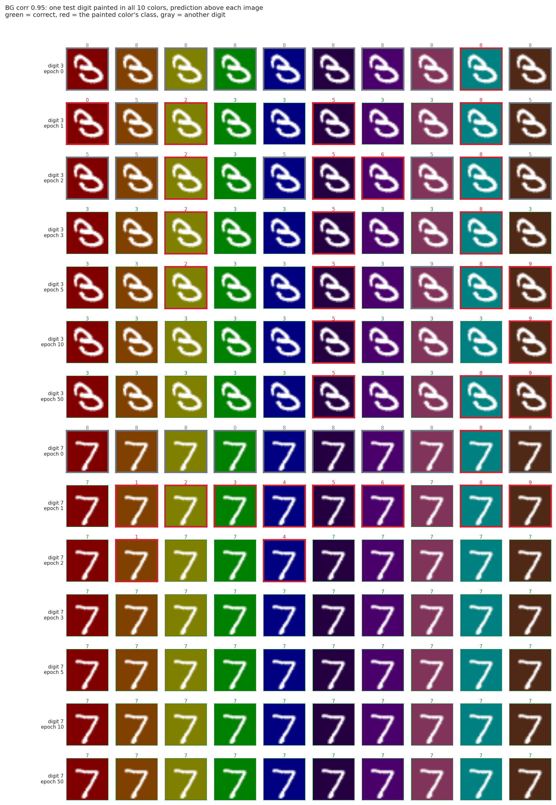

*BG .95, test 숫자 3과 7을 10색으로 칠한 뒤 epoch별 예측. 초록 테두리=정답, 빨강=칠한 색의 클래스, 회색=다른 숫자.*

- 숫자 7: epoch 1에는 10색 중 8색에서 색의 클래스로 답한다. epoch 3부터 모두 맞힌다.
- 숫자 3: **epoch 50에도 3개 색(→5, 8, 9)에서 색의 클래스로 답한다.** 모양이 비슷한 숫자로 색이 끌어당기는 경우가 끝까지 남는다.

다른 조건: [FG .95](figures/10_recolor_grid_fg095.png) · [BG .65](figures/10_recolor_grid_bg065.png) · [FG .65](figures/10_recolor_grid_fg065.png)

### Grad-CAM

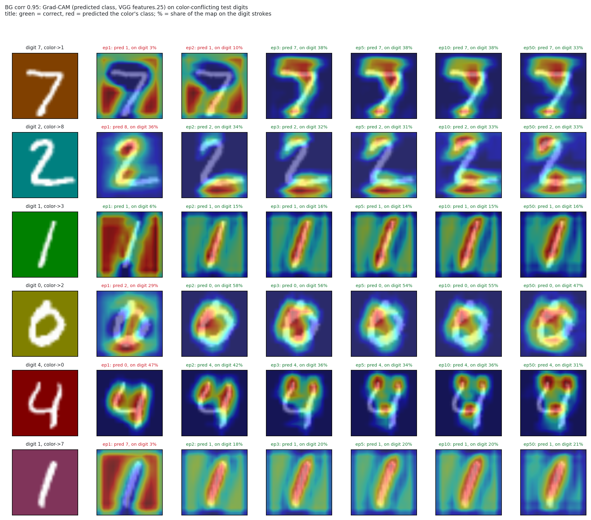

*BG .95, 색과 숫자가 맞지 않는 test 숫자. 예측 클래스 기준 Grad-CAM(features.25). 제목의 %는 heatmap 중 숫자 획 위에 있는 비율.*

- **BG에서는 색 위치(배경)와 모양 위치(획)가 분리되어 Grad-CAM이 읽힌다.** epoch 1에 색 클래스로 틀린 숫자 7과 1은 heatmap이 배경에 있다(획 위 3%). 정답으로 바뀌는 epoch부터는 획 쪽으로 모인다(숫자 7: 10% → 38%, 숫자 1: 3% → 18–21%).

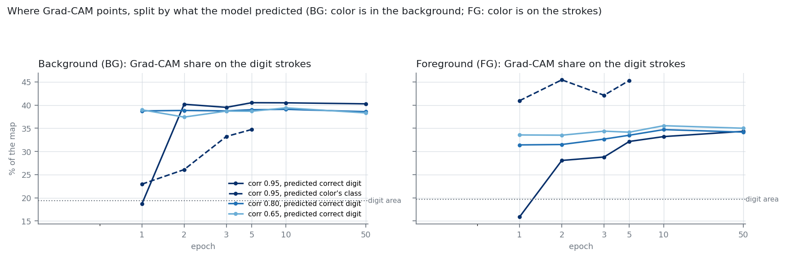

*예측이 맞았는지(실선)와 색 클래스로 답했는지(점선)에 따른 획 위 heatmap 비율. 20개 미만인 점은 뺐다. 점선 가로줄=숫자 획이 차지하는 면적(약 19%).*

- **BG:** 맞힌 예측은 획 위 비율이 약 40%로, 면적 대비 2배 집중된다. 색 클래스로 답한 예측은 23–35%로 낮다.
- **FG에서는 반대로 보인다.** 색이 획 위에 있으므로 색 클래스로 답할 때도 heatmap이 획 위에 있다(41–45%). 그래서 **FG에서는 "획을 본다 = 모양을 쓴다"가 성립하지 않는다.** 다른 조건: [FG .95](figures/12_gradcam_grid_fg095.png) · [BG .80](figures/12_gradcam_grid_bg080.png) · [FG .80](figures/12_gradcam_grid_fg080.png) · [BG .65](figures/12_gradcam_grid_bg065.png) · [FG .65](figures/12_gradcam_grid_fg065.png)

## 7. Stress test (proposal 6.1)

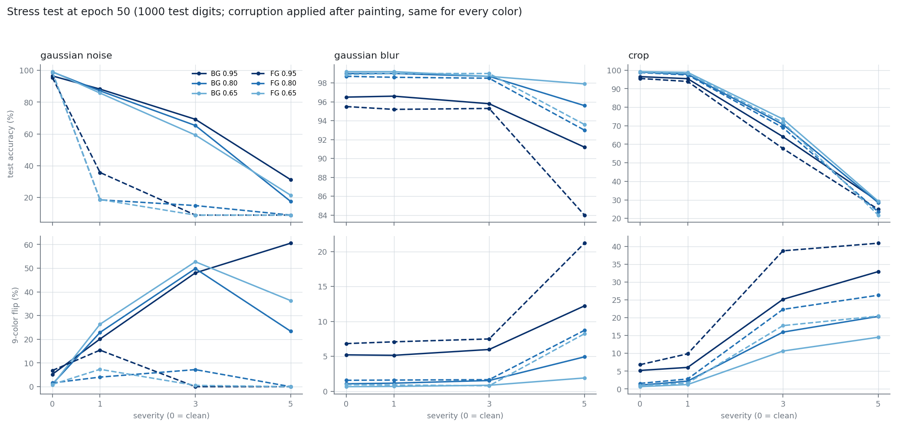

*Epoch 50 모델, test 숫자 1,000개를 10색으로 칠한 뒤 손상을 가했다. 위: 정확도, 아래: 9색 flip. 실선 BG, 점선 FG. severity 0 = 손상 없음.*

| 손상 | 강도 | BG .95 정확도 / flip | BG .80 | BG .65 | FG .95 | FG .80 | FG .65 |
|---|---|---|---|---|---|---|---|
| 없음 | 0 | 96.5 / 5.2 | 99.0 / 1.1 | 99.2 / 0.7 | 95.5 / 6.8 | 98.7 / 1.6 | 98.9 / 0.9 |
| Gaussian noise | 3 | 69.2 / **48.0** | 65.3 / **49.8** | 59.3 / **52.7** | 8.9 / 0.0 † | 14.9 / 7.2 † | 8.9 / 0.5 † |
| Gaussian blur | 5 | 91.2 / 12.2 | 95.6 / 4.9 | 97.9 / 1.9 | 84.0 / 21.2 | 93.0 / 8.7 | 93.6 / 8.2 |
| Crop | 3 | 64.1 / 25.2 | 70.7 / 16.0 | 73.6 / 10.7 | 57.7 / 38.8 | 69.0 / 22.3 | 71.8 / 17.8 |
| Crop | 5 | 29.2 / 33.0 | 28.5 / 20.4 | 29.3 / 14.5 | 24.9 / 40.9 | 23.5 / 26.3 | 21.8 / 20.5 |

† FG + noise는 모델이 거의 한 클래스만 예측하는 붕괴 상태다(정확도 8.9%). flip이 0인 것은 강건해서가 아니라 예측이 고정돼서다.

- **Noise(BG):** correlation과 상관없이 9색 flip이 50% 안팎으로 오른다. 모양 정보가 noise에 가려지면 **.65 모델조차 다시 색으로 판단한다.** 색 정보는 학습 내내 ~100% 남아 있었고(5절), 모양이 약해지면 그 정보가 다시 쓰인다.
- **Blur·crop:** correlation 순서가 그대로 드러난다. .95가 가장 많이 색으로 돌아간다(crop 5에서 BG 33%, FG 41%). .65가 가장 적다.
- 같은 correlation에서 FG가 BG보다 crop·blur 시 9색 flip이 더 크게 오른다. 원인은 이번 실험으로 확정할 수 없다.

수치: [stress_epoch50.csv](stress_epoch50.csv). 손상은 색을 칠한 뒤 적용했고, 10색 모두 같은 손상을 받는다.

### 손상 이미지 예시

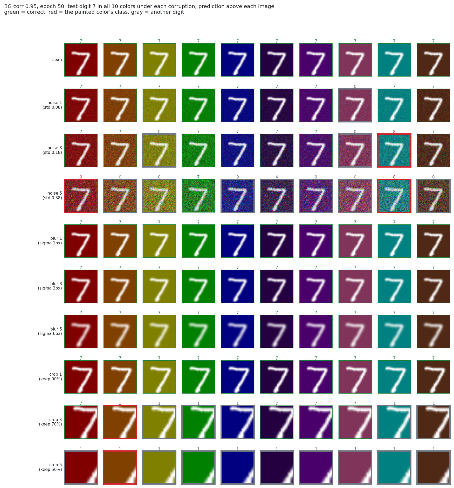

*BG .95, epoch 50. Test 숫자 7을 10색으로 칠하고 각 손상을 가한 이미지와 예측. 초록=정답, 빨강=칠한 색의 클래스, 회색=다른 숫자. 행 이름 괄호는 실제 강도(noise 표준편차, blur sigma, crop 후 남는 비율)다.*


*FG .95, epoch 50. 같은 숫자, 같은 손상.*

- **Noise:** BG에서는 같은 숫자인데 **배경색마다 예측이 달라진다**(noise 5에서 0, 4, 8, 9 등). 모양이 흐려지면 색이 판단을 좌우한다. FG에서는 noise 1부터 10색 모두 같은 숫자(0 또는 8)로 답한다. 이것이 표의 "한 클래스 붕괴"이며, 9색 flip이 낮게 나오는 이유다.
- **Blur:** sigma 6px까지 거의 모두 맞힌다. 획이 흐려져도 모양이 유지되기 때문이다.
- **Crop:** 무작위 위치를 잘라 확대하므로, 강도 3(70%)부터 숫자 일부가 잘려 7이 1처럼 보이고 1로 답한다. 강도 5(50%)에서는 숫자가 거의 화면 밖으로 나간다. 따라서 **crop 5의 정확도 하락은 색 의존이 아니라 모양 정보 자체가 사라진 결과**다. 이때의 9색 flip은 "모양이 없을 때 색에 얼마나 기대는가"로 읽어야 한다.

같은 숫자를 .65 모델에 넣으면 차이가 보인다.

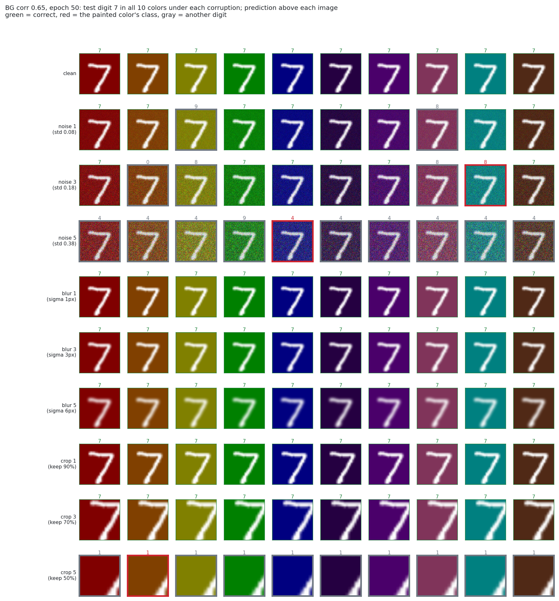

*BG .65, epoch 50. 위 BG .95와 같은 숫자, 같은 손상.*

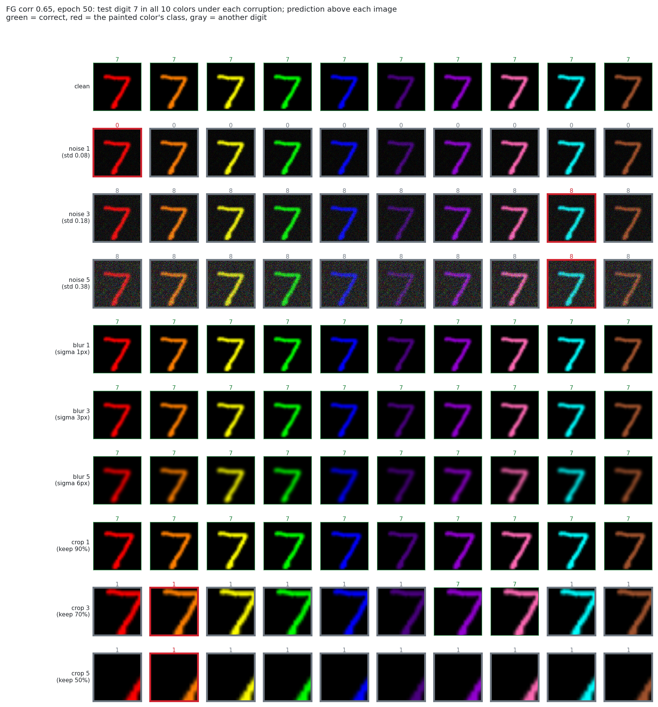

*FG .65, epoch 50. 위 FG .95와 같은 숫자, 같은 손상.*

- **Crop 3:** BG .95는 10색 중 6색에서 틀리는데(1로 답함), BG .65는 10색 모두 7로 맞힌다. 같은 손상에서도 상관이 강했던 모델이 더 쉽게 무너진다.
- **Noise 5:** BG .95는 색마다 다른 숫자로 답한다(색에 끌려감). BG .65는 대부분 4로 답한다(색과 무관하게 한 숫자로 쏠림). 둘 다 틀리지만 틀리는 방식이 다르다. 표에서 .65의 noise 5 flip(36%)이 .95(60%)보다 낮은 이유다.

## 8. Proposal 대비 정리

### 맞는 부분

| Proposal | 근거 |
|---|---|
| **H1** "초기에는 쉬운 shortcut을 쓰고, 이후 core를 배운다" | .95에서 epoch 1에 재색칠 숫자의 64–82%를 색 클래스로 예측하고, epoch 50에 3–4%로 줄어든다(3절). 6개 모두 epoch 1 → 50에서 9색 flip이 감소한다. |
| **H2** "correlation이 강할수록 core 학습에 더 많은 epoch" (행동 기준) | 강건 행동 도달(.65/.80/.95): 90% 기준 1–2/2/11, 95% 기준 2/3/46·미도달, 98% 기준 16–18/25–30/미도달(4절). 세 기준 모두 순서가 같다. |
| 6.2 데이터 분포 조작(low/med/high correlation) | .65/.80/.95 × BG/FG 6개로 수행. 재현성도 확인했다(2절). |
| 6.1 Gaussian noise / blur / crop | 수행(7절). correlation이 높을수록 손상 시 색으로 더 많이 돌아간다(blur·crop). |
| Flip rate가 shortcut 의존 지표로 유효 | 9색 flip은 색 의존 정도와 시점을 잘 드러낸다. 대체색 하나만 보던 기존 flip은 의존을 과소평가한다. |
| Grad-CAM으로 shortcut 확인 (BG) | BG에서는 색 클래스로 틀릴 때 배경, 맞힐 때 획을 본다(6절). |
| Qiu et al.: core와 spurious 표현이 공존 | 색 probe ~100%, 숫자 probe 90% 이상이 epoch 1부터 함께 존재한다(5절). |

### 맞지 않거나 보완이 필요한 부분

| Proposal | 실제 관찰 | 보고서에서의 표현 제안 |
|---|---|---|
| H1 "epoch가 늘수록 의존이 **감소**" | epoch 0 → 1에는 오히려 급증한다. 이후에도 49번 중 21–24번 재상승한다. 일시적 WGA 급락도 있다(팀 run e28, 재실행 e14). | "장기적으로는 감소하지만 단조 감소는 아니다" |
| H1 "결국 core를 학습" | .95는 epoch 50에도 재색칠 3–4%를 색으로 답한다. 팀의 100-epoch 연장(같은 설정)에서는 오히려 약간 악화했다. 숫자 3처럼 끝까지 색에 끌리는 사례도 있다. | "강한 상관에서는 잔류 의존이 남고, 더 학습해도 사라지지 않는다" |
| H2 "core feature를 **학습하는** 시점이 늦다" | 숫자는 학습 전부터 80% 이상, epoch 1에 90% 이상 해독된다. correlation과 무관하다. 늦어지는 것은 정보 획득이 아니라 **사용**이다. | "core를 의사결정에 쓰기 시작하는 시점이 늦다" |
| Decoded core correlation으로 core 학습 추적 | probe는 초반 2 epoch 안에 포화된다. 행동 변화(epoch 2–46)를 거의 반영하지 못한다. | probe는 "정보 존재"의 증거로만 쓰고, 사용 여부는 flip·재색칠 정확도로 판단한다 |
| Grad-CAM으로 shortcut 확인 (FG) | FG는 색이 획 위에 있어 색 클래스로 답할 때도 획을 본다. Grad-CAM으로 색과 모양을 구분할 수 없다. | Grad-CAM 근거는 BG에만 쓴다 |
| Stress test 결과 해석 | FG + noise는 한 클래스 예측 붕괴라 flip=0이 된다. 낮은 flip이 강건함이 아니다. | flip은 정확도와 함께 보고한다 |
| VGGNet·ResNet 두 모델 | 이번 6개 실험은 VGG11_BN만 사용했다. | ResNet 결과는 별도 실험이 필요하다 |
| Waterbirds | 이 폴더에는 없다. 팀 Waterbirds 결과는 [`../RESULTS_OVERVIEW_KO.md`](../RESULTS_OVERVIEW_KO.md) Part B에 있다. | — |

### 한계

- seed 42 하나다. 재실행은 같은 seed의 반복이라 GPU 비결정성만 반영한다. seed 간 변동은 아직 모른다.
- 체크포인트 기반 그림은 test 1,000개(Grad-CAM은 conflicting 최대 300개) 표본이다.
- .80 두 run은 중간에 resume했다. resume 이후(epoch 42–50)의 팀 대비 차이(정확도·9색 flip 평균 0.04–0.11pp)는 resume 이전(0.11–0.15pp)과 같은 수준이다. 다만 끊김 없는 학습과 bit 단위로 같지는 않다.

## 9. 다시 만들기

`runs/rerun50/`에 체크포인트가 있어야 한다.

```bash
cd reports/cmnist_rerun50/scripts
python3 figs_history.py          # 01–05: history.csv만 사용 (CPU, 수 초)
python3 probe_features.py        # 06–07: 저장된 feature로 probe (CPU, 약 3분)
python3 figs_checkpoints.py --n 1000 --runs bg095,fg095,bg080,fg080,bg065,fg065 --parts heat,grid,stress,cam  # 08–13 (GPU, 약 15분)
python3 figs_checkpoints.py --runs bg095,fg095,bg065,fg065 --parts stressgrid  # 14: stress 예시 이미지 (GPU, 1분 미만)
```

| 파일 | 내용 |
|---|---|
| [robust_epochs.csv](robust_epochs.csv) | 기준별 강건 행동 도달 epoch |
| [reproduction_diff.csv](reproduction_diff.csv) | 팀 run 대비 epoch별 차이 |
| [test_epoch50.csv](test_epoch50.csv) | epoch 50 test 지표 |
| [probe_curves.csv](probe_curves.csv) | 층·epoch·split별 probe 정확도 |
| [digit_color_summary.csv](digit_color_summary.csv) | 숫자×색 정확도 요약, 색 클래스 예측률 |
| [stress_epoch50.csv](stress_epoch50.csv) | stress test 정확도·9색 flip |
| [gradcam_digit_share.csv](gradcam_digit_share.csv) | Grad-CAM 획 위 비율 |
