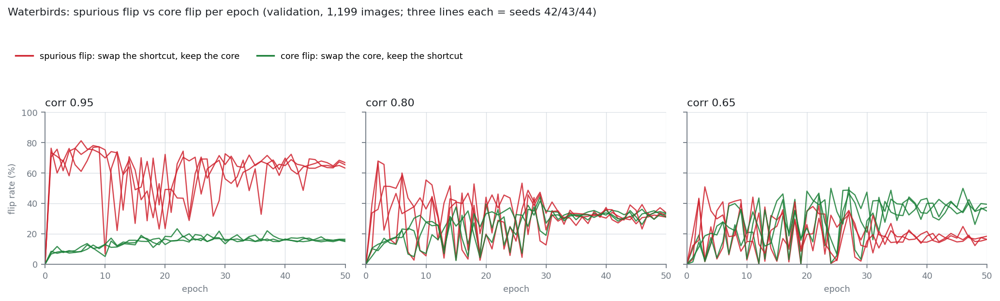
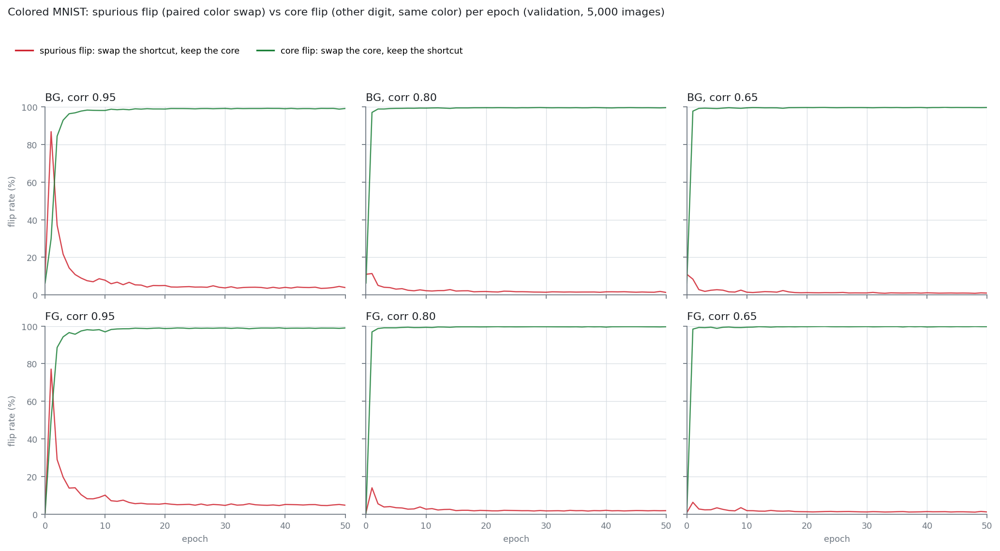
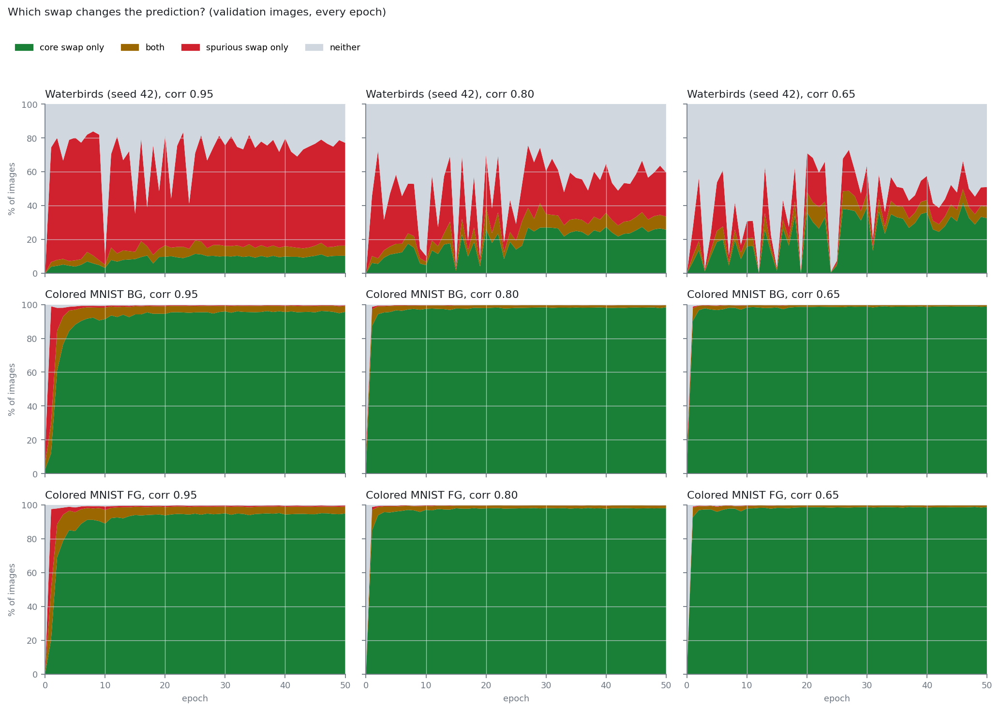
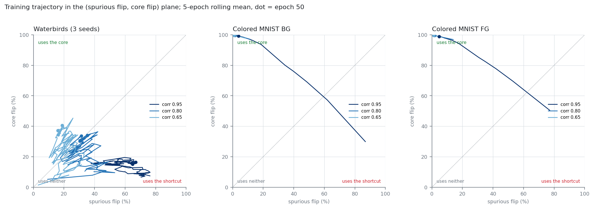

# Core flip: 모델이 core를 실제로 쓰는가

지금까지의 flip은 **spurious(배경·색)만 바꾸고** 예측이 바뀌는지를 본다. 이 값은 shortcut 의존을 재지만, 낮다고 core를 쓴다는 뜻은 아니다. 한 클래스로만 답하는 모델도 0%가 나온다. 이 폴더는 반대로 **core(새·숫자)만 바꾸고 spurious는 그대로 둔** 이미지로 같은 flip을 잰다. 저장된 체크포인트 전부(15 run × epoch 0–50)를 평가만 했고, 재학습은 하지 않았다.

## 요약

| | 결과 |
|---|---|
| 검증 | 이번 평가에서 다시 잰 val 정확도와 spurious flip이 학습 때 `history.csv`와 15개 run, 51 epoch 모두 **정확히 같다**(차이 0). |
| Waterbirds | 후기 core flip은 .65 36–37%, .80 32–33%, .95 16–17%다. core flip이 spurious flip보다 커지는 시점(3 epoch 연속)은 .65가 E7–15, .80이 E23–35 또는 미도달, .95는 세 seed 모두 미도달이다. **core 활용도 .65 < .80 < .95 순서로 늦다.** |
| Colored MNIST | core flip이 .65/.80은 epoch 1에 97–98%, .95는 epoch 1에 30–50%였다가 epoch 2에 85–89%가 된다. **core 활용은 모든 조건에서 epoch 1–2에 시작**하고, .95만 한 epoch 늦다. |
| 표현 vs 활용 | Waterbirds .65는 core 활용 시점(E7–15)이 probe 60% 도달(E8–13)과 거의 같다. Colored MNIST는 probe가 E1에 90%를 넘는데 .95의 core flip은 E1에 30–50%라, **정보가 있어도 epoch 1에는 덜 쓴다**. |

## 1. 무엇을 바꾸나

| | spurious flip (기존) | core flip (추가) |
|---|---|---|
| Waterbirds | 같은 새를 반대 장소의 배경에 붙인다 | **같은 배경**에 반대 클래스의 다른 새(val에서 무작위 1마리)를 붙인다 |
| Colored MNIST | 같은 숫자를 짝 색(main ↔ alternate)으로 다시 칠한다 | **같은 색**으로 다른 숫자(val에서 무작위 1개, 다른 클래스)를 칠한다 |
| 예측이 바뀌면 | spurious를 쓴다 | core를 쓴다 |

- 평가 이미지는 validation 전체다(Waterbirds 1,199장, Colored MNIST 5,000장). 짝은 고정 seed(0)로 한 번 정하고 모든 run에 같게 쓴다.
- 이미지마다 두 교체에서 예측이 바뀌는지를 보고 **core만 / spurious만 / 둘 다 / 둘 다 아님**으로 나눈다.
- `core_follow`(core 교체 이미지에서 새 core의 클래스로 답한 비율)도 기록했다. 다만 Waterbirds에서는 배경만 보는 모델도 약 50%가 나와서 기준으로 쓰지 않는다. 같은 쌍에서 예측이 바뀌었는지를 보는 **core flip을 주 지표로 쓴다**.
- 대상 run: Waterbirds VGG11_BN seed 42/43/44 × corr .95/.80/.65 (`runs/waterbirds_rerun50/`), Colored MNIST VGG11_BN BG/FG × corr .95/.80/.65, seed 42 (`runs/rerun50/`). 모두 SGD lr 0.01 고정(`scheduler none`), 50 epoch.

## 2. Waterbirds



*빨강 = spurious flip, 초록 = core flip. 선 세 개씩 = seed 42/43/44.*

| 구간 평균 (seed 42 / 43 / 44) | spurious flip | core flip |
|---|---|---|
| .95, epoch 1–10 | 66.7 / 71.2 / 71.5 | 8.2 / 10.0 / 9.7 |
| .95, 31–50 | 66.1 / 61.5 / 64.4 | 15.9 / 16.7 / 15.8 |
| .80, 1–10 | 33.2 / 39.3 / 37.5 | 14.5 / 19.5 / 15.2 |
| .80, 31–50 | 32.7 / 30.7 / 32.7 | 32.3 / 33.0 / 31.6 |
| .65, 1–10 | 20.6 / 21.5 / 26.8 | 16.3 / 17.2 / 20.4 |
| .65, 31–50 | 17.5 / 16.2 / 18.6 | 36.9 / 36.1 / 37.4 |

단위 %. 출처: [phase_means.csv](phase_means.csv), [core_flip_waterbirds.csv](core_flip_waterbirds.csv).

- **core flip은 세 조건 모두 학습이 진행될수록 커진다.** .95도 초기 8–10%에서 후기 16–17%로 두 배가 된다. .95의 spurious flip은 줄지 않으므로, spurious flip만 보면 이 변화가 보이지 않는다.
- 후기에 **.65는 core flip이 spurious flip의 약 2배, .80은 비슷, .95는 약 1/4**이다.
- seed 간 차이는 1–2pp로, spurious flip 기반 지표(시점이 10–20 epoch씩 달랐다)보다 훨씬 안정적이다.
- "둘 다 아님"이 후기에도 .65 50–53%, .80 42–44%로 크다. 배경을 바꿔도 새를 바꿔도 답이 그대로인 이미지가 많다는 뜻이다. 대부분 landbird로 답하는 경향(waterbird recall이 50% 아래)과 맞다.

### Core 활용 시점

| 첫 epoch (3 epoch 연속) | .65 | .80 | .95 |
|---|---|---|---|
| core flip > spurious flip (seed 42 / 43 / 44) | 7 / 10 / 15 | 35 / 23 / 미도달 | 미도달 ×3 |
| 참고: core probe ≥ 60% (팀 probe 방식) | 8 / 9 / 13 | 25 / 28 / 26 | 미도달 ×3 |
| 참고: core flip ≥ 30% | 20 / 7 / 26 | 26 / 36 / 20 | 미도달 ×3 |

출처: [onset.csv](onset.csv). probe 행은 [`../waterbirds_rerun50/seeds/probe_team_protocol.csv`](../waterbirds_rerun50/seeds/probe_team_protocol.csv)에서 계산했다.

- "core flip > spurious flip"으로 정의하면 **.65 < .80 < .95 순서가 세 seed 모두에서 나온다**. 기존 강건 기준(WGA ≥ 20% & 균형 conflicting ≥ 50%)은 .80/.95가 모두 미도달이라 순서를 비교할 수 없었다.
- .65에서는 활용 시점이 probe 도달 시점과 거의 같다. 새 정보가 생기는 시점에 바로 쓰기 시작한다.
- 절대 기준(core flip ≥ 30%)은 순서가 흐려진다. 출렁임이 커서 연속 조건이 쉽게 끊긴다. spurious flip과의 비교가 더 안정적이다.

## 3. Colored MNIST



| | epoch 1 | epoch 2 | 31–50 평균 |
|---|---|---|---|
| BG .95 spurious / core flip | 86.9 / 29.9 | 37.1 / 84.5 | 3.9 / 99.2 |
| FG .95 | 77.1 / 50.5 | 29.0 / 88.6 | 4.9 / 98.9 |
| BG .80 | 11.4 / 97.1 | 5.1 / 98.9 | 1.6 / 99.6 |
| FG .80 | 14.0 / 96.9 | 5.5 / 98.7 | 1.8 / 99.6 |
| BG .65 | 8.4 / 97.8 | 2.8 / 99.3 | 1.0 / 99.7 |
| FG .65 | 6.3 / 98.4 | 2.7 / 99.3 | 1.2 / 99.7 |

단위 %. 출처: [core_flip_cmnist.csv](core_flip_cmnist.csv).

- .65/.80은 epoch 1부터 core flip이 97–98%다. 숫자를 바꾸면 거의 항상 답이 바뀐다.
- .95는 epoch 1에 spurious flip이 core flip보다 크다(BG 87 vs 30). epoch 2에 뒤집힌다. **core > spurious 시점은 .65/.80 = E1, .95 = E2**다.
- 이후 core flip은 99% 근처, spurious flip은 1–5%에서 유지된다. 팀 보고서의 "98% 강건 행동 기준에서 .95 미도달"은 core를 쓰지 않아서가 아니라, **core를 쓰면서도 남아 있는 4–5%의 색 의존** 때문이다.
- 체크포인트가 epoch 단위라 epoch 1 안의 변화는 볼 수 없다. Colored MNIST에서는 시점 차이가 1 epoch 안에 몰려 있다.

## 4. 어느 교체가 예측을 바꾸나



*초록 = core 교체에서만 바뀜, 갈색 = 둘 다, 빨강 = spurious 교체에서만, 회색 = 둘 다 아님.*



*가로 = spurious flip, 세로 = core flip. 왼쪽 위로 갈수록 core를 쓴다. 5 epoch 이동평균, 점 = epoch 50.*

- Waterbirds .95는 끝까지 오른쪽 아래(shortcut)에 머문다. .80은 대각선 위로 올라오고, .65는 대각선을 넘어 왼쪽 위로 간다.
- Colored MNIST는 세 조건 모두 epoch 1–2 안에 왼쪽 위 끝으로 간다. .95만 오른쪽 아래(epoch 1)에서 출발한다.

## 5. H2에 대한 의미

| | 표현 (probe) | 활용 (core flip > spurious flip) |
|---|---|---|
| Colored MNIST | 모든 조건 E1에 90% 이상: 차이 없음 | .65/.80 E1, .95 E2: **순서 있음, 1 epoch 차이** |
| Waterbirds VGG | .65 E8–13 < .80 E25–28 < .95 미도달 | .65 E7–15 < .80 E23–35·미도달 < .95 미도달 |

- 두 데이터셋 모두 **core 활용이 corr이 강할수록 늦다(H2b)**. Colored MNIST는 그 차이가 epoch 1–2에 몰려 있고, Waterbirds는 수십 epoch에 걸친다.
- Waterbirds는 표현과 활용이 거의 같은 시점에 나타난다. Colored MNIST는 표현이 먼저 있고, .95에서만 활용이 한 epoch 늦다.

## 6. 한계

- core 교체 짝은 무작위 1개다. Waterbirds는 새의 크기·자세·마스크 모양도 함께 바뀐다. Colored MNIST는 숫자 모양이 통째로 바뀐다. 짝을 바꿔 반복하지는 않았다.
- Waterbirds는 새 마스크 밖이 같은 배경이지만, 새 크기가 다르면 가려지는 배경 영역도 달라진다.
- Colored MNIST는 seed 42 하나다. Waterbirds는 seed 3개다. ResNet18과 팀 서버 run은 이 PC에 체크포인트가 없어 평가하지 않았다.
- validation으로 평가했다(학습 곡선·probe와 같은 split). test는 하지 않았다.
- core flip은 "core 교체에 반응한다"를 보여 줄 뿐, 모델 내부에서 어떤 특징을 쓰는지까지 증명하지는 않는다.

## 7. 다시 만들기

```bash
python3 reports/core_flip/scripts/core_flip.py --dataset waterbirds   # 9 run × 51 epoch, 약 17분 (RTX 5070 Ti)
python3 reports/core_flip/scripts/core_flip.py --dataset cmnist       # 6 run × 51 epoch, 약 33분
python3 reports/core_flip/scripts/analyze.py                          # 표와 그림 (CPU, 수 초)
```

`runs/`의 체크포인트와 `data/`의 데이터가 필요하다(둘 다 gitignore). `analyze.py`의 probe 행은 `reports/waterbirds_rerun50/seeds/probe_team_protocol.csv`가 있을 때만 채워진다.

| 파일 | 내용 |
|---|---|
| [core_flip_waterbirds.csv](core_flip_waterbirds.csv), [core_flip_cmnist.csv](core_flip_cmnist.csv) | run·epoch·subset(all/aligned/conflicting)별 정확도, spurious flip, core flip, core_follow, 4분할 비율 |
| [check_waterbirds.csv](check_waterbirds.csv), [check_cmnist.csv](check_cmnist.csv) | 정확도·spurious flip을 `history.csv`와 대조 |
| [phase_means.csv](phase_means.csv) | 초기·중기·후기 평균 |
| [onset.csv](onset.csv) | core 활용 시점(여러 기준)과 probe 도달 시점 |
