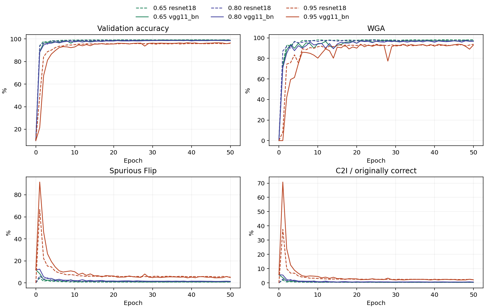
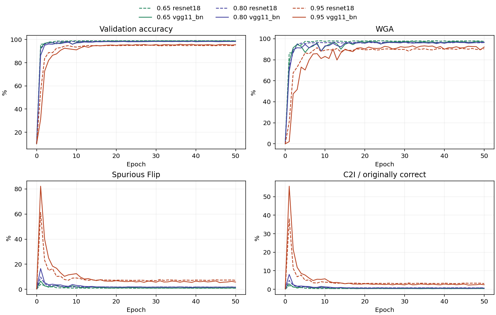
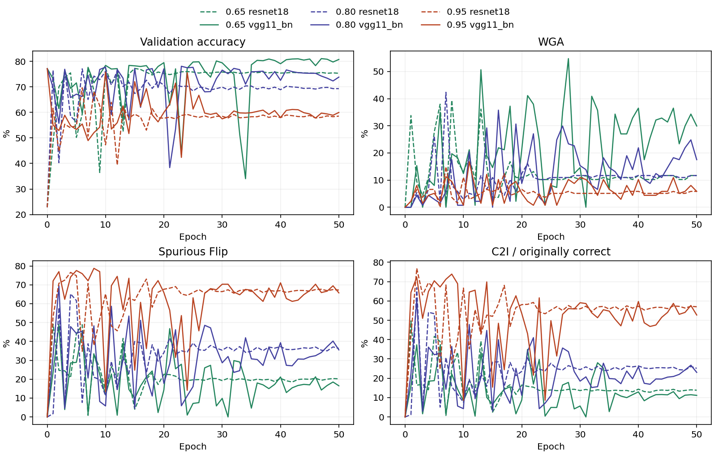
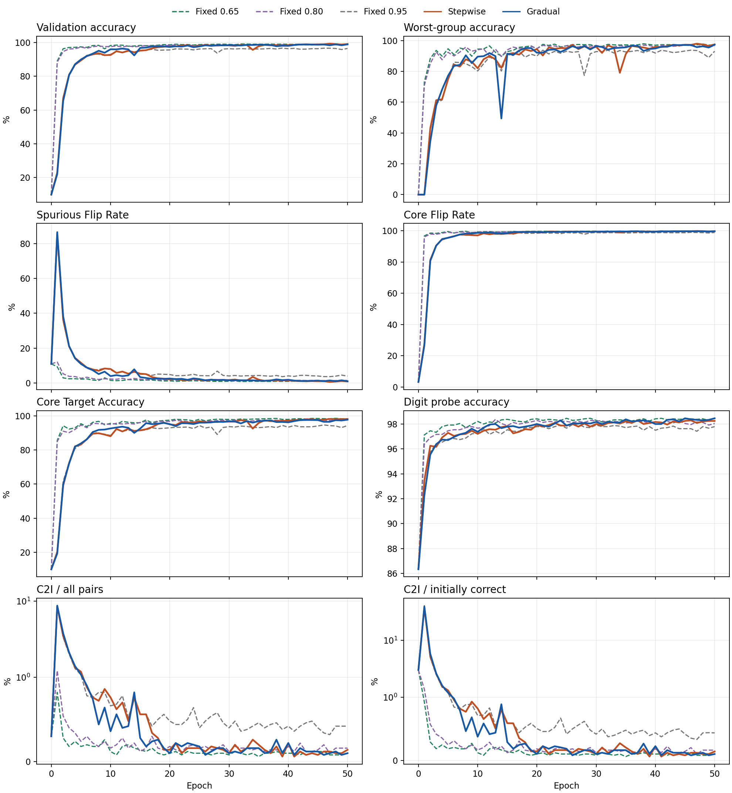
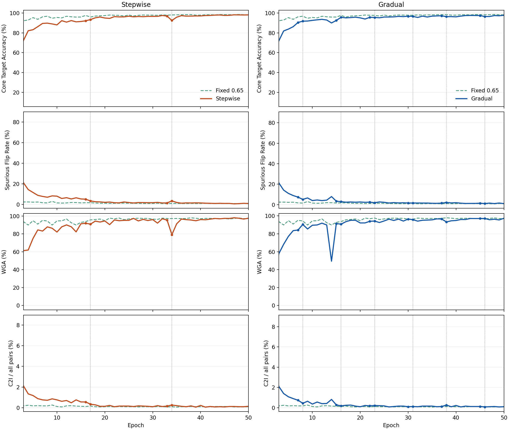

# Shortcut Learning Dynamics 최종 연구 보고서

## 1. 초록 · Abstract

Colored MNIST와 Waterbirds에서 VGG11_BN과 ResNet18의 학습 중 shortcut 민감도와 core 해독 및 예측 행동을 비교했다. 고정 상관 0.65/0.80/0.95의 18개 기본 run을 공통 E0–E50에서 평가하고, 후기 학습·레거시·Dynamic 실험을 해당 프로토콜에서 검토했다. Colored MNIST의 후기 Flip과 C2I는 낮아졌지만 Waterbirds에는 반등과 최저 그룹 정확도 하락이 있어 **H1은 부분 지지**됐다. **H2-a는 probe 기준과 백본에 의존**했다. **H2-b는 일부 조건에서 지지**됐다. Colored MNIST Background VGG11_BN에서 Core Target ≥90% 및 Spurious Flip ≤10%를 3 epoch 유지한 시작은 0.65/0.80/0.95에서 E2/E2/E11이었다. Dynamic의 E50 WGA는 Stepwise 97.53%, Gradual 97.33%로 Fixed 0.95의 93.09%를 상회했다. Fixed 0.65의 97.11%와 차이는 작았고 Core Target에서는 Fixed 0.65가 높았다. 이 결과는 seed 42의 기술적 비교다.

[핵심 결과 요약](RESULT_SUMMARY.ko.md) · [실험 인벤토리](EXPERIMENT_INVENTORY.csv) · [검증 기록](VALIDATION.ko.md)

## 2. 서론 · Introduction

훈련 레이블과 함께 나타나는 색과 배경은 훈련 분포에서 정답을 맞히는 데 도움이 될 수 있다. 그 관계가 바뀌면 평균 정확도가 높았던 모델도 특정 그룹에서 실패할 수 있다. 여기서는 체크포인트별 성능과 이미지의 일부 조건을 바꾼 전후 예측을 추적한다. 숫자 교체 실험은 원래 모델이 새 정답을 따라가는지도 관찰한다.

## 3. 연구 질문과 가설

**연구 질문.** 학습 중 shortcut 의존성과 core 활용은 어떻게 변하고, 훈련 상관 강도는 변화의 시점 및 경로와 어떤 관련이 있는가? 학습 도중 상관을 낮추면 전환 직후와 최종 행동은 어떻게 달라지는가?

| 가설 | 조작적 관측 |
| --- | --- |
| H1 · 학습이 진행되면 shortcut 의존성이 줄어든다 | 동일 core의 색·배경 개입 Flip 및 C2I 감소, WGA와 일시적 반등 |
| H2-a · 상관이 강하면 core 해독 가능성이 늦게 나타난다 | 고정 feature에 학습한 선형 probe의 최초 충족과 연속 유지 |
| H2-b · 상관이 강하면 강건 행동과 core 활용이 늦게 나타난다 | 그룹 성능과 반사실 안정성, 원래 모델의 예측이 새 숫자를 따라가는 시점 |

기존 H2를 나눈 이유는 고정 feature에 존재하는 정보와 원래 head가 예측에 사용하는 정보가 다를 수 있기 때문이다. **해독 가능성(decodability)**은 별도로 학습한 readout의 복원 능력이다. **Core 활용**은 core 교체 후 원래 head의 예측 변화를 통해 조사한다. **Spurious 민감도**는 주어진 색·배경 변경의 반응이며, **강건 행동**은 주어진 평가 분포에서 그룹 성능과 안정성 기준을 함께 만족하는 상태다.

## 4. 관련 근거 · Related Work

저장소가 참조한 Sagawa, Koh, Hashimoto와 Liang의 group DRO 연구와 구현은 그룹 이동에서 평균 성능과 최악 그룹 성능을 구분하는 배경이며, CUB 새와 Places 장면을 합성하는 Waterbirds 생성의 출처다. 본 실험은 그 생성 방식을 참고해 content-v3 분할로 SGD 학습을 진행했다. 원 논문의 group DRO 최적화 결과나 가중 Test 집계를 이 프로젝트의 실험 결과에 포함하지 않았다. [저장소가 참조한 group_DRO 원본](https://github.com/kohpangwei/group_DRO)

## 5. 실험 설정

| 데이터 | Core / Spurious | Train / Val / Test | 상관과 입력 |
| --- | --- | --- | --- |
| Colored MNIST 주 실험 | 숫자 0–9 / 색상 0–9 | 55,000 / 5,000 / 10,000 | Train 0.65/0.80/0.95, Val/Test 0.10. 공식 train에서 seed 분할로 Val을 떼고 공식 Test를 사용한다. 숫자와 색이 일치할 확률이 상관이다. 불일치에서는 나머지 아홉 색을 사용한다. Background와 Foreground를 별도로 학습했다. |
| Waterbirds Condition A content-v3 | Landbird/Waterbird / Land/Water 배경 | 4,795 / 1,199 / 5,794 | Train 0.65/0.80/0.95, Val/Test 목표 0.50. 실제 Val 일치율 0.500417. 새 원본과 두 배경 후보를 유지하고 Train 배경을 배정한다. |
| Colored MNIST 초기 E100 | 숫자 / 색상 | 55,000 / 5,000 / 10,000 | Train 0.95, Val/Test 0.50, Foreground, 숫자마다 두 색을 허용하는 next pairing. |

Colored MNIST는 회색조 alpha로 숫자와 색을 합성한다. Waterbirds는 CUB 새와 soft segmentation mask를 Places365 배경에 합성한다. content-v3에서 새·배경의 콘텐츠 해시로 split 간 중복을 막는다. Validation의 Landbird/Waterbird는 925/274이며, 배경 상관 0.5는 클래스 균형을 뜻하지 않는다. RGB resize·tensor 변환 후 ImageNet mean/std를 적용했다. augmentation 및 ImageNet 사전학습은 껐다.

VGG11_BN은 1×1 adaptive average pool과 512차원 입력의 선형 head를 사용하고, ResNet18은 마지막 FC 출력을 교체한다. 숫자와 새의 출력 수는 각각 10과 2다.

| 학습 계열 | Epoch | Optimizer / LR / Scheduler | Momentum / decay | Batch / workers | Seed / AMP / 크기 |
| --- | --- | --- | --- | --- | --- |
| Colored MNIST BG·FG × 두 백본 × 세 상관 | 50 | SGD / 0.01 / 고정 | 0.9 / 0.0001 | 128 / 4 | 42 / 사용 / 224 |
| Waterbirds VGG11_BN × 세 상관 | 50 | SGD / 0.01 / 고정 | 0.9 / 0.0001 | 128 / 4 | 42 / 사용 / 224 |
| Waterbirds ResNet18 × 세 상관 | 100, 공통 백본 비교는 E50까지 | SGD / 0.01 / 고정 | 0.9 / 0.0001 | 128 / 4 | 42 / 사용 / 224 |
| Colored MNIST VGG11_BN BG·FG 0.95 연장 | E50에서 E100 | SGD / 0.01 / 고정 | 0.9 / 0.0001 | 128 / 4 | 42 / 사용 / 224 |
| Colored MNIST BG VGG11_BN Dynamic × 2 | 50 | SGD / 0.01 / 고정 | 0.9 / 0.0001 | 128 / 4 | 42 / 사용 / 224 |
| 초기 Colored MNIST E100 × 두 백본 | 100 | SGD / 0.01 / 고정 | 0.9 / 0.0001 | 128 / 4 | 42 / 사용 / 64 |

E0은 학습 전이다. **22개 로컬 완료 기록**은 Fixed 18개, 연장 2개와 Dynamic 2개다. 초기 외부 E100 2개는 저장된 기록 및 평가로 검토했다. 파일럿과 중단된 연장 시도는 인벤토리에 보존하되 본 비교에서 제외했다. 연장은 부모 run과 같은 계열이며 독립 seed 반복이 아니다. Waterbirds content-v3 준비·2-epoch 파일럿, ResNet18 파일럿, 406-checkpoint 평가 및 paired CPU smoke test는 경로·지표·입력 확인에 사용했고 학습 반복 수로 합산하지 않았다.

## 6. 평가 지표

| 지표 | 산식과 분모 | 해석 범위 |
| --- | --- | --- |
| Accuracy | 해당 split 정답 수 / 평가 표본 수 | 전체 정답률. 업데이트 중 online train과 고정 모델 eval을 구분한다. |
| Worst-Group Accuracy (WGA) | 그룹별 정답률의 최솟값. Colored MNIST all pairing은 숫자별 main/other 20그룹, Waterbirds는 새 유형×배경 4그룹 | 최저 그룹 성능. 그룹이 빠지면 결측이다. core 사용량을 나타내지는 않는다. |
| Spurious Flip | 같은 core의 색·배경만 바꿨을 때 argmax 변경 수 / 유효 쌍 수 | Paired와 반대 배경은 원본당 1쌍, All9은 9쌍이다. 상수 예측도 낮은 Flip을 만든다. |
| Core Flip | 고정 색상에서 숫자를 바꿨을 때 argmax 변경 수 / 유효 core 쌍 수 | 교체 민감도. 새 정답이 아닌 다른 예측도 포함한다. |
| Core Target / Switched-to-Target | 각각 donor 정답을 맞힌 쌍, 예측까지 바꾸며 donor를 맞힌 쌍 / 전체 core 쌍 | 새 숫자를 따라가는 행동. 원래부터 donor 숫자를 예측한 경우는 Target에만 들어간다. |
| Correct-to-Incorrect (C2I) | 원본 정답에서 배경·색 변경 후 오답으로 바뀐 수 C. 전체형 C/N, 조건부 C/A. N은 유효 쌍, A는 원본 정답인 유효 쌍 | 개입으로 깨진 정답. 분모 0은 결측이다. All9 분모는 원본 수 및 원본 정답 수의 9배다. 고유 이미지 any-harm 및 오답→정답(I2C)과 구분한다. |
| Core / Spurious Linear Probe | 별도 선형 분류기의 holdout 정확도 | 숫자·새 또는 색·배경의 해독 정도. 원래 head의 인과적 의존도를 나타내지 않는다. 2×accuracy−1 기록은 Pearson 상관이 아니다. |
| Grad-CAM | target logit gradient 기반 공간 heatmap. 영역 질량은 영역 내 활성 합 / 전체 활성 합. 짝 변화는 정규화 heatmap의 평균 절대 차이 | 지정 layer와 target의 공간 패턴. 보간, 마스크 면적, zero map, 레이어 해상도의 영향을 받는다. |
| Confidence 변화 | 최대 softmax 확률 및 지정 클래스 확률의 개입 후−전 차이 | 모델 점수 변화다. 확률 보정이나 인과 기여 크기를 보장하지 않는다. |

All-color accuracy는 바뀐 색이 정답과 충돌하는 쌍만 집계한다. All9 Flip은 모든 유효 recolor 쌍을 센다. Fixed–Dynamic core 비교는 **동일한 Validation 5,000쌍, pair seed 42, batch 16, FP32**다. 기존 강건 행동의 9색 항목은 신규 paired FP32에 없으므로 해당 다섯 조건의 행동 기준에는 공통 AMP history를 사용한다.

## 7. Fixed Correlation 결과

다음은 공통 Validation E50의 % 수치다. Colored MNIST 반사실 열은 **All9**, Waterbirds는 **반대 배경**이다. Waterbirds 전이는 저장된 이진 집계에서 복원했다. 개입의 종류가 다른 두 데이터셋에서 절대 Flip을 같은 종류의 순위로 비교할 수 없다.

| 데이터 / 조건 | 모델 | 상관 | Val Accuracy | WGA | Flip | C2I 전체 | C2I 원본 정답 |
| --- | --- | ---: | ---: | ---: | ---: | ---: | ---: |
| Colored MNIST BG | resnet18 | 0.65 | 99.28 | 98.16 | 0.73 | 0.44 | 0.45 |
| Colored MNIST BG | vgg11_bn | 0.65 | 98.88 | 97.11 | 0.87 | 0.35 | 0.36 |
| Colored MNIST BG | resnet18 | 0.80 | 98.80 | 97.00 | 1.20 | 0.52 | 0.52 |
| Colored MNIST BG | vgg11_bn | 0.80 | 98.54 | 96.67 | 1.36 | 0.57 | 0.58 |
| Colored MNIST BG | resnet18 | 0.95 | 96.06 | 93.78 | 5.39 | 2.20 | 2.29 |
| Colored MNIST BG | vgg11_bn | 0.95 | 96.40 | 93.09 | 4.82 | 2.05 | 2.12 |
| Colored MNIST FG | resnet18 | 0.65 | 98.94 | 97.47 | 0.90 | 0.39 | 0.39 |
| Colored MNIST FG | vgg11_bn | 0.65 | 98.86 | 96.54 | 0.94 | 0.43 | 0.44 |
| Colored MNIST FG | resnet18 | 0.80 | 98.36 | 96.40 | 1.77 | 0.78 | 0.79 |
| Colored MNIST FG | vgg11_bn | 0.80 | 98.34 | 96.77 | 1.63 | 0.63 | 0.64 |
| Colored MNIST FG | resnet18 | 0.95 | 94.88 | 90.56 | 7.16 | 2.96 | 3.12 |
| Colored MNIST FG | vgg11_bn | 0.95 | 95.56 | 92.13 | 5.77 | 2.38 | 2.49 |
| Waterbirds A | resnet18 | 0.65 | 75.31 | 11.68 | 20.18 | 10.43 | 13.84 |
| Waterbirds A | vgg11_bn | 0.65 | 80.73 | 29.93 | 16.51 | 9.01 | 11.16 |
| Waterbirds A | resnet18 | 0.80 | 69.31 | 11.68 | 36.28 | 17.43 | 25.15 |
| Waterbirds A | vgg11_bn | 0.80 | 73.81 | 17.52 | 35.53 | 17.01 | 23.05 |
| Waterbirds A | resnet18 | 0.95 | 58.55 | 5.84 | 67.22 | 33.36 | 56.98 |
| Waterbirds A | vgg11_bn | 0.95 | 59.97 | 5.84 | 65.72 | 31.61 | 52.71 |

**Colored MNIST.** E1–E5 대비 E26–E50 평균에서 12개 조건 모두 WGA가 높아졌고 Flip과 두 C2I가 낮아졌다. BG 0.95 VGG는 WGA +44.52%p, All9 Flip −34.38%p였다. 그러나 이 모델의 E27→28→29 WGA는 92.86→77.41→91.47%, All9 Flip은 4.97→8.05→5.20%였다. 특정 숫자·충돌 그룹에 오류가 집중됐으며 원인은 확인되지 않았다. E50 BG 0.65의 WGA는 ResNet18이 높지만 FG 0.95에서는 VGG가 높았다.

**Waterbirds.** 같은 구간 비교에서 6개 조건 중 5개가 동시 개선을 보였다. ResNet18 0.65는 Flip과 C2I가 감소했지만 WGA가 17.26→10.80%로 하락했다. ResNet18 0.80과 0.95의 평균 Flip은 중기보다 후기에 반등했고, E1–E10 대 E31–E50을 비교하면 각각 +7.14/+6.06%p였다. ResNet18 0.65의 I2C도 16.73→9.43%로 감소해, 총 Flip 감소에는 정답으로의 전이 감소도 포함됐다. VGG 0.65 E31에는 단일 클래스 예측이 나타났다. E50 WGA는 0.65/0.80에서 VGG가 높았고 0.95에서는 두 백본이 5.84%였다.

[고정 시계열과 분모](tables/fixed_validation.csv) · [초기·후기 차이와 구간 민감도](tables/h1_phase_contrasts.csv)

### 후기 연장과 초기 E100

- **224 px VGG 0.95 연장.** BG/FG의 WGA는 E50→E100에서 각각 93.09→90.71% 및 92.13→88.48%였다. All9 Flip과 전체 쌍 C2I도 증가했다. 기존 406-checkpoint 평가에는 여섯 Fixed 계열의 E0–E50 306개와 두 E51–E100 연장 100개가 포함됐다. 연장은 optimizer·scheduler·AMP 상태를 복원했으나 원래 RNG와 snapshot 경계 때문에 uninterrupted run과 bitwise 동등성은 확인되지 않았다. [연장 끝점 원본 대조표](tables/vgg_e100_endpoints.csv) · [연장 구간 그래프](figures/cmnist_vgg_e100.png)
- **Waterbirds ResNet18 E51–E100.** 0.95의 평균 WGA는 E26–E50의 5.31%에서 5.12%, 평균 Flip은 66.86%에서 66.41%였다. 다른 두 상관에도 뚜렷한 동시 개선이 없었다. 0.80은 후기 Flip 반등을 회복했지만 조건부 C2I는 E100까지 직전 최저 수준을 회복하지 않았다. 동일 길이의 Waterbirds VGG가 없어 이 구간에서 백본 우열을 판단하지 않았다. [후기 표](tables/waterbirds_resnet_late.csv) · [후기 그래프](figures/waterbirds_resnet_e000_e100.png)
- **64 px next-pairing 외부 E100.** Validation 5,000개로 학습하고 Test 10,000개로 평가한 AdamW probe의 숫자 정확도는 ResNet18 99.66%, VGG 99.81%였다. 별도의 균형 재색칠 Validation/Test probe에서는 E100 avgpool 숫자가 81.03%/87.12%였다. 두 값은 평가 분포와 샘플이 달라 시점 변화로 해석할 수 없다. Probe·CAM은 E100만 관측했다. 기존 history E1→E100 paired Flip은 ResNet18 4.64→2.36%, VGG 7.22→1.42%였지만 인접 증가가 각각 48회와 43회 있었다. [초기 E100 평가](../epoch100/report_ko.md) · [교차 색상 후속](../followup_v1/report_ko.md)

### Probe와 Grad-CAM

Colored MNIST 공통 비교는 classifier-input pooled feature의 표준화 Ridge(alpha=1)를 사용했다. 균형 Validation의 fit 2,400개와 score 800개를 세 seed의 split으로 나눴다. 숫자·색 10-way의 균등 추측은 10%, 숫자 0–4/5–9의 이진 probe는 50%다. Waterbirds는 콘텐츠를 분리한 균형 Validation 56/56에서 binary readout을 평가했다. 독립 Test probe 결과는 없다. 두 데이터셋의 probe 정확도는 같은 프로토콜이 아니다. [avgpool 시계열](tables/fixed_probe_avgpool.csv)

E50 Colored MNIST 색 probe의 정확도는 VGG 99.88–100%, ResNet18 97.75–100%였다. Flip이 낮아진 뒤에도 색 정보는 표현에 남았다. Waterbirds 0.65 E50의 새 probe는 VGG 71.43%, ResNet18 57.14%였다. ResNet18에서 낮은 배경 Flip과 낮은 WGA가 공존했다.

Grad-CAM은 고정 정답과 예측 class target을 별도 집계했다. 통합 CAM의 원본·개입 패널은 관측 epoch마다 Colored MNIST 10쌍과 Waterbirds 8쌍을 사용했으며, Waterbirds 일부 패널은 유효 heatmap 7개였다. Colored MNIST 0.95 ResNet18의 원본 예측 class에서 shortcut 영역 질량은 E0→E50 BG 70.9→66.2%, FG 26.7→29.1%였으나 두 조건 모두 행동 Flip은 낮아졌다. FG에서는 숫자와 색 영역이 겹치며, Waterbirds 새 영역 질량도 마스크 면적과 target에 의존한다. 표본 수, zero map, target과 분석 epoch를 확인해야 한다. [CAM 집계](tables/fixed_cam_summary.csv) · [Colored MNIST CAM 공간 지표](figures/cmnist_cam_spatial.png) · [Waterbirds Probe와 행동](figures/waterbirds_probe_behavior.png)

## 8. Core / Spurious Intervention

Spurious 개입은 같은 숫자의 기존 main/alternate 색을 교체한다. Core 개입은 원래 색에서 다른 숫자를 렌더링하며, 원본과 donor는 0–4/5–9 구간도 다르다. 질량과 위치가 비슷한 Validation donor를 고정 후보에서 선택했다. 숫자 레이블의 변경과 원래 색, 두 glyph 마스크 바깥 픽셀을 5,000쌍 전체에서 검증했다. 바뀐 획이 덮는 배경의 면적과 획 모양은 달라진다. Waterbirds에서는 실제 새·마스크를 유지한 배경 합성 자료를 평가했으며, 실데이터 Core-only 교체 유효성은 확인되지 않았다.

Core-dominant는 core만 Flip, Spurious-dominant는 색만 Flip, Both-sensitive는 둘 다, Neither-sensitive는 둘 다 없는 쌍이다. Epoch 단위 분석은 두 aggregate Flip에 0.10/0.25/0.50/0.75 임곗값을 적용한 별도 요약이다. 이 범주는 관측한 민감도를 나타낸다.

| 조건 | Epoch | Core-dominant | Spurious-dominant | Both-sensitive | Neither-sensitive |
| --- | ---: | ---: | ---: | ---: | ---: |
| fixed065 | 1 | 88.52% | 1.20% | 8.12% | 2.16% |
| fixed065 | 50 | 98.72% | 0.12% | 0.92% | 0.24% |
| fixed080 | 1 | 85.80% | 1.92% | 10.14% | 2.14% |
| fixed080 | 50 | 98.14% | 0.14% | 1.30% | 0.42% |
| fixed095 | 1 | 10.60% | 71.52% | 15.74% | 2.14% |
| fixed095 | 50 | 95.28% | 0.40% | 3.56% | 0.76% |
| stepwise | 1 | 12.08% | 70.18% | 15.42% | 2.32% |
| stepwise | 50 | 98.90% | 0.12% | 0.78% | 0.20% |
| gradual | 1 | 11.28% | 71.24% | 15.30% | 2.18% |
| gradual | 50 | 98.72% | 0.08% | 0.90% | 0.30% |

Fixed 0.95 E3에서 Core Flip 90.74%와 Target 72.64%가 공존했다. E0에는 Target이 10.06%였지만 새 숫자로 예측이 바뀐 쌍은 0.38%였다. 높은 Flip과 높은 Target의 해석을 분리하고, 새 정답 적중에 낮은 색 Flip을 더한 기준과 Switched-to-Target을 사용했다. [표본 민감도 시계열](tables/pair_sensitivity.csv) · [쌍 지표와 confidence](tables/paired_epochwise.csv)

## 9. H2-a / H2-b

E값은 **3 epoch 연속 유지의 시작**이다. 최초 단일 충족과 분리하며 미도달을 종료 epoch로 대체하지 않는다.

| 조건 · 기준 | VGG11_BN 0.65 / 0.80 / 0.95 | ResNet18 0.65 / 0.80 / 0.95 |
| --- | --- | --- |
| Colored MNIST BG·FG 숫자 probe ≥90%, split 최솟값 | E1/E1/E1 | E1/E1/E1 |
| Colored MNIST BG 숫자 probe ≥95%, split 최솟값 | E1/E1/E2 | E1/E1/E2 |
| Colored MNIST FG 숫자 probe ≥95%, split 최솟값 | E1/E1/E3 | E1/E1/E3 |
| Colored MNIST BG 역사적 All9 행동 기준 | E2/E3/E46 | E2/E4/미도달 |
| Colored MNIST FG 역사적 All9 행동 기준 | E2/E3/미도달 | E1/E2/미도달 |
| Waterbirds core probe ≥60% | E7/E20/E46 | 세 조건 미도달 |
| Waterbirds core probe ≥55% | E3/E15/E30 | E14/미도달/미도달 |
| Waterbirds 공동 행동 기준 | E16/미도달/미도달 | 세 조건 미도달 |

Colored MNIST 역사적 표는 세 probe split의 **최솟값**을, 후속 BG 5조건 표는 동일 split의 **평균**을 썼다. 두 집계의 BG 도달값은 90%와 95%에서 일치한다. 이진 probe는 55–70%에서 E0부터 통과했다. Waterbirds 공동 기준은 WGA ≥20%와 균형 conflicting accuracy ≥50%다. VGG 0.65는 유지를 5 epoch 요구하면 E36, 10 epoch에서는 미도달이다.

역사적 Colored MNIST 행동은 conflicting accuracy ≥95%, 충돌 9색 recolor accuracy ≥95%, **All9 Flip ≤5%**다. 후속 BG 기준의 마지막 항은 **paired Flip ≤5%**다. 이 때문에 BG 0.95 VGG의 E46과 E20은 각각 유효하다. 후속 기준의 BG VGG 강건 행동은 0.65/0.80/0.95 **E2/E3/E20**이고, 개입 기반 Target ≥90% 및 Spurious Flip ≤10%는 **E2/E2/E11**이다. 동일 run의 90% 숫자 probe E1과 개입 행동의 간격은 1/1/10 epoch다. 95% Target과 5% Flip을 함께 요구하면 E10/E7/미도달로 낮은 두 상관의 순서가 바뀐다.

**H2-a**는 높은 임곗값의 일부 조건 및 Waterbirds VGG에서 지연 방향이 맞지만 Colored MNIST 90%나 Waterbirds ResNet18까지 포괄하지 못한다. **H2-b**는 강한 0.95 배경색 조건의 강건 행동 지연과 직접 개입 결과에서 지지를 얻는다. 다른 백본 및 Waterbirds에는 직접 Core 교체 자료가 없어 같은 크기나 방향의 지연은 확인되지 않았다. [기존 도달표](tables/h2_timing.csv) · [후속 도달표](tables/paired_onset.csv)

## 10. Dynamic Correlation

### 스케줄과 최종 평가

Fixed 0.95에서 사용한 데이터·학습 설정을 기준으로 두 run의 Train color assignment를 단계마다 바꿨다. 원본 55,000개와 클래스별 수, 색상 정의, Val/Test를 유지했다. 첫 단계에는 Fixed와 같은 배정을 유지했다. 이후에는 seed 고정 클래스별 순위에서 정렬 수를 바꿨다.

| 조건 | 단계 시작 epoch | 목표 상관 | E1–E50 평균 실현 상관 |
| --- | --- | --- | ---: |
| Fixed 0.95 | E1 | 0.95 유지 | 초기 배정 0.949818 유지 |
| Stepwise | E1/E17/E34 | 0.95/0.80/0.65 | 0.796936 |
| Gradual | E1/E8/E16/E23/E31/E38/E46 | 0.95/0.90/0.85/0.80/0.75/0.70/0.65 | 0.805972 |

E50 표는 공통 paired FP32 Validation의 %다. C2I 두 분모를 별도로 표시한다. [원시 표](tables/paired_e50.csv)

| 조건 | Accuracy | WGA | Spurious Flip | Core Flip | Core Target | C2I 전체 | C2I 원본 정답 |
| --- | ---: | ---: | ---: | ---: | ---: | ---: | ---: |
| Fixed 0.65 | 98.88 | 97.11 | 1.04 | 99.64 | 98.24 | 0.10 | 0.101 |
| Fixed 0.80 | 98.54 | 96.67 | 1.44 | 99.44 | 97.54 | 0.16 | 0.162 |
| Fixed 0.95 | 96.40 | 93.09 | 3.96 | 98.84 | 94.32 | 0.42 | 0.436 |
| Stepwise | 99.02 | 97.53 | 0.90 | 99.68 | 98.16 | 0.14 | 0.141 |
| Gradual | 98.84 | 97.33 | 0.98 | 99.62 | 97.78 | 0.10 | 0.101 |

Fixed 0.95보다 WGA는 Stepwise +4.44%p, Gradual +4.25%p였고 Core Target도 +3.84/+3.46%p였다. Fixed 0.65보다 WGA가 높기는 했지만 차이는 +0.42/+0.22%p였고, Core Target은 −0.08/−0.46%p였다. C2I 전체형은 Fixed 0.65보다 Stepwise에서 +0.04%p, Gradual은 같았다. 최종 상관이 같아도 상관 노출 이력은 다르다. 다섯 조건은 같은 Val 짝과 FP32를 사용했다.

C2I 축은 작은 값과 큰 값을 함께 보여주는 대칭 로그다. [공통 Epoch별 지표](tables/paired_epochwise.csv) · [동일 분할의 probe](tables/paired_probe_avgpool.csv)

### 전환 직전·직후·회복

셀은 직전→직후의 % 값과 복귀 시작 epoch다. 같은 단계 안에서 WGA·Target은 직전 값 이상, Flip·C2I는 이하를 복귀로 본다. 이미 충족한 경우 전환 epoch를 적었다. C2I는 전체 쌍 분모다.

| 전환 | 실현 상관 전→후 | WGA | Core Target | Spurious Flip | C2I |
| --- | ---: | ---: | ---: | ---: | ---: |
| Stepwise E17 | 0.949818→0.799982 | 91.91→90.89 / E18 | 92.18→93.44 / E17 | 5.10→3.40 / E17 | 0.56→0.34 / E17 |
| Stepwise E34 | 0.799982→0.650000 | 95.39→79.11 / E36 | 96.96→92.54 / E36 | 1.48→3.46 / E36 | 0.16→0.26 / E36 |
| Gradual E8 | 0.949818→0.900000 | 84.23→90.44 / E8 | 90.52→91.82 / E8 | 7.32→5.12 / E8 | 0.74→0.44 / E8 |
| Gradual E16 | 0.900000→0.850018 | 91.47→90.79 / E17 | 92.56→95.76 / E16 | 3.36→2.88 / E16 | 0.28→0.18 / E16 |
| Gradual E23 | 0.850018→0.799982 | 94.00→94.24 / E23 | 95.70→95.62 / E25 | 2.40→1.82 / E23 | 0.18→0.22 / E25 |
| Gradual E31 | 0.799982→0.749982 | 96.45→95.78 / E36 | 96.80→96.68 / E33 | 1.54→1.58 / E33 | 0.10→0.12 / E32 |
| Gradual E38 | 0.749982→0.700000 | 96.54→93.26 / E43 | 97.28→96.38 / E42 | 1.44→2.08 / E41 | 0.12→0.26 / E39 |
| Gradual E46 | 0.700000→0.650000 | 97.12→97.11 / E50 | 97.52→96.52 / E50 | 1.38→1.04 / E46 | 0.12→0.08 / E46 |

Stepwise E34에서 WGA는 −16.28%p, Core Target은 −4.42%p로 떨어졌고 Flip과 C2I는 늘었다. 네 지표가 E36에 직전 수준으로 회복했다. Gradual E38도 네 지표가 악화됐으며 복귀는 E39–E43에 걸쳤다. Core Target 상승과 Spurious Flip 감소가 동시에 나타난 전환은 Stepwise E17, Gradual E8·E16의 **3/8(37.5%)**이었다. Gradual E23·E46처럼 Flip이 줄어도 Target이 낮아진 경우가 있었다. C2I의 조건부 분모와 복귀 시점은 전환 CSV에 별도로 기록했다.

[실제 전환 상관](tables/actual_transition_schedule.csv) · [모든 지표의 전후 변화와 복귀](tables/paired_transitions.csv)

### Dynamic의 Core 활용 시점

| 기준의 3-epoch 유지 시작 | Fixed 0.65 | Fixed 0.80 | Fixed 0.95 | Stepwise | Gradual |
| --- | ---: | ---: | ---: | ---: | ---: |
| 숫자 probe ≥90% | E1 | E1 | E1 | E1 | E1 |
| 숫자 probe ≥95% | E1 | E1 | E2 | E2 | E2 |
| Core Target ≥90% 및 Spurious Flip ≤10% | E2 | E2 | E11 | E11 | E7 |
| 기존 paired 강건 행동 | E2 | E3 | E20 | E17 | E10 |

공동 Core/Flip 기준의 최초 단일 충족은 Fixed 0.95가 E7이며 E11부터 3회 유지되었다. Stepwise는 최초와 유지 시작 모두 E11, Gradual은 모두 E7이었다. 두 Dynamic의 최초 충족은 첫 상관 전환 전이다. Gradual의 유지 구간은 첫 전환을 포함한다. 따라서 최종 개선에도 불구하고 이 기준의 최초 달성을 전환으로 설명할 수 없다. Stepwise 최종 WGA는 Gradual보다 0.19%p 높았고 공동 기준 유지 시작은 Gradual이 4 epoch 빨랐다. [최초·유지 및 기준 민감도](tables/paired_onset.csv)

## 11. 종합 Discussion

**관측.** Colored MNIST에서 후기 색 민감도는 낮아졌지만 색 자체의 해독 정확도는 높게 남았다. Core에 대한 반응이 높은 시점과 WGA 또는 C2I가 개선되는 시점에도 차이가 있었다. Waterbirds ResNet18 0.65에서는 낮아진 Flip이 WGA 하락과 공존했다. FG나 새·배경의 공간 지표는 배경색 BG와 같은 방식으로 해석하기 어렵다.

**해석.** 표현에 숫자 정보가 있다는 사실은 원래 head가 그 정보를 우선 사용하는 시점을 정하지 않는다. 강한 고정 상관에서 숫자 해독이 이미 가능한데도 반사실 행동이 따라오지 않는 구간을 직접 관측했다. Dynamic의 전환은 항상 즉시 개선을 만들지 않았고, 큰 배정 변화 직후 평가 성능이 악화됐다가 돌아오는 구간도 있었다. C2I와 I2C를 따로 보면 총 Flip이 줄어든 이유를 더 구체적으로 확인할 수 있다.

**비교 범위.** Colored MNIST에서는 두 모델·두 색 위치에서 후기 개선이 일관됐으나 최종 백본 순위는 조건에 따라 바뀌었다. Waterbirds에서는 구간, 상관, 백본에 따라 경향이 달랐다. 데이터 구성, 클래스 불균형, 개입 종류, 학습 길이가 함께 달라 데이터셋 차이나 백본의 인과적 상호작용을 분리할 수 없다.

## 12. 한계와 추가 검증

- 주 실험은 seed 42다. epoch, 재색칠, probe split과 반복 donor는 독립적인 학습 반복이 아니다. 통계적 유의성과 모집단 일반화를 주장하지 않는다.
- 직접 Core 교체는 Colored MNIST Background × VGG11_BN에서 수행했다. Waterbirds의 Core-only는 검증이 끝나지 않았다. 합성 경계와 크기, 마스크 바깥 픽셀 및 같은 클래스 교체 대조가 필요하다.
- Core Target은 색을 고정한 숫자 교체에 대한 반응이다. 특정 내부 표현의 기여나 실제 Feature 활용 전체를 증명하지 않는다. Probe와 CAM에도 각각 평가 분할, target, 레이어 대응의 한계가 있다.
- 공통 Val 이외에는 자료 범위가 다르다. 특히 기존 Colored MNIST VGG에 전 epoch frozen Train/Test와 Test 쌍별 전이가 없고, Waterbirds independent Test probe와 VGG E100이 없다. 다른 프로토콜의 결과는 그대로 비교하지 않았다.
- Dynamic의 평균 상관 노출량과 전환 시점은 다르다. Stepwise/Fixed는 RTX A2000, Gradual은 RTX 2080 Ti에서 학습했다. 공통 FP32 평가는 이 학습 환경 차이를 없애지 못한다.
- 임곗값과 유지 기간을 바꾸면 결론의 강도가 달라진다. 90%와 95% probe, paired와 All9 행동, 1·3·5 epoch 유지를 각각 표에서 확인할 수 있다.

**추가 검증 우선순위.** 먼저 같은 GPU와 여러 seed에서 Fixed 0.65/0.95와 두 schedule을 반복해 작은 E50 차이와 전환 직후 하락의 재현성을 확인한다. 다음으로 평균 노출이 동일한 Fixed 및 Dynamic을 두고 배정 순서와 평균 상관을 분리한다. 마지막으로 FG·ResNet18에 Core 개입을 확장하고 Waterbirds의 객체 교체 품질을 별도로 검증한다.

## 13. 결론

- **H1 부분 지지.** Colored MNIST의 후기 shortcut 민감도는 낮아졌지만 단조 감소는 관측되지 않았다. Waterbirds에서는 구간과 그룹 성능에 따라 예외가 있었다.
- **H2-a 기준·모델 의존.** Colored MNIST 90% probe는 지연이 없고 95%에서는 일부 지연이 있었다. Waterbirds VGG에서는 순서가 관측됐지만 ResNet18에는 같은 근거가 없다.
- **H2-b 일부 조건에서 지지.** 강한 고정 배경 상관에서 같은 probe 대비 실제 새 숫자를 따르는 강건 행동이 늦었다. H2-a와 H2-b의 시점은 서로 대신할 수 없다.
- **Dynamic.** Fixed 0.95 대비 E50에서 WGA·Flip과 Core Target이 유리했다. Fixed 0.65와 비교하면 차이는 작고 Core Target의 방향도 달랐다. 전환 방식 자체의 효과는 별도 대조가 필요하다.

## 14. 재현성 · Reproducibility

[실험 인벤토리](EXPERIMENT_INVENTORY.csv)는 로컬 config, 체크포인트 수와 마지막 epoch, history 및 결과 경로를 저장한다. 공개용 표는 원자료 파일을 변경하지 않고 만든 집계다. [소스 SHA-256](tables/source_hashes.csv)에는 참조한 로컬 원본과 이미지의 경로 및 해시가 있다. Git에 포함하지 않는 run·feature·체크포인트 경로는 자료 위치를 나타내며 GitHub 다운로드 링크가 아니다.

- **기존 백본 결과.** [기존 통합 보고서](../final_integrated_comparison/analysis_report.md)의 Validation CSV, 원본 설정과 history를 사용했다. 공통 E0–E50과 Waterbirds ResNet 후기 scope는 유지했다.
- **추가 개입과 Dynamic.** 원본은 저장소 내 reports/shortcut_followup/full_cmnist_bg065, full_cmnist_bg080, full_cmnist_bg095, dynamic_core_20261123/evaluation 및 final_dynamic_core_20261123이다. paired 요약은 공개용 tables에 포함했다. paired 평가 진입점은 scripts.shortcut_followup.intervention, 비교는 scripts.shortcut_followup.compare_dynamic_core다. 동일한 MNIST cache와 체크포인트가 필요하다.
- **기존 학습 자료.** 스케줄과 파일럿은 configs/shortcut_followup 및 scripts/shortcut_followup, Waterbirds split과 파일럿은 reports/waterbirds_vgg50, 406평가와 VGG 연장은 reports/metric_final_analysis_406에서 확인했다. 이 자료의 대용량 바이너리는 이 공유본에 포함하지 않는다.
- **감사.** [검증 기록](VALIDATION.ko.md)에 분모, 원본 대조, 차이가 남은 프로토콜 및 누락 범위를 정리했다. 이번 통합에서는 저장된 결과만 읽었으며 GPU 학습·평가를 다시 실행하지 않았다.
