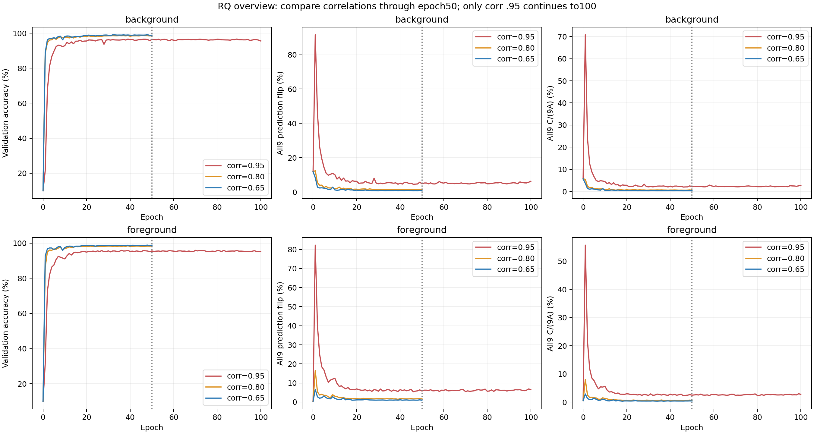
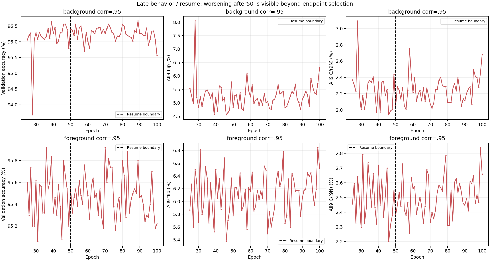

# Colored MNIST 후속406 Checkpoint 최종 분석

- **먼저 읽기:** [회의용 요약](meeting_summary.md)
- [전체 한국어 보고서](analysis_report.md)
- [완료·무결성 검증](integrity_report.md)
- [핵심 비교 표](summary_table.csv)
- [Grad-CAM 분석](gradcam_analysis.md)
- [공유 범위와 재현성 안내](PUBLICATION_NOTES.md)

## 핵심 결과

406개 평가와 저장 지표2,436개 대조가 모두 통과했다. Epoch1→50에서는 여섯 조건 모두 C2I가 감소했지만 단조 감소는 아니었다. Corr .95의 Epoch50→100에서 All9 C2I는 BG2.0467→2.6800%, FG2.3800→2.6556%로 증가했다. 높은 correlation에서 강건 행동 도달이 늦었지만 Core 학습 시작 지연은 확정하지 못했다.

이 자료는 **10-class Colored MNIST / VGG11_BN /224px /all-pairing /Seed42**의 후속 실험 결과다. .95 두 조건은Resume로100까지, .80/.65는50까지다. 과거 원본100 실험 및 저장소의 예전2-class 실행 예제와 구분한다.

## 그래프

figures/에는13종 PNG/PDF가 있다. 원본 데이터셋, Checkpoint, Feature NPZ, 전체 개별 예측 NPZ, SLURM 원본 로그는 포함하지 않는다. CSV는 분석을 위한 집계 지표와 선정된 오류/CAM 메타데이터다.
