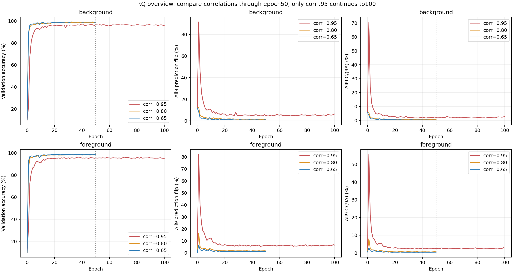
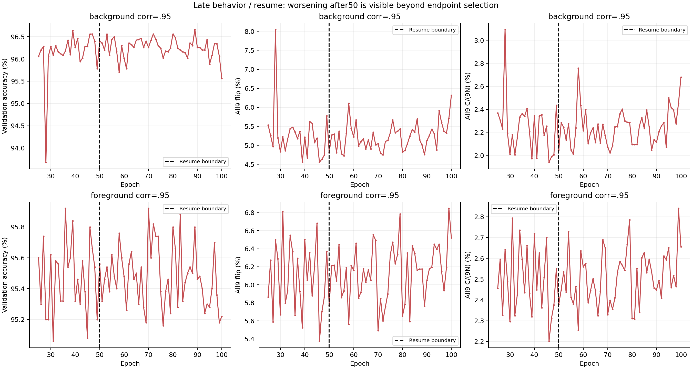
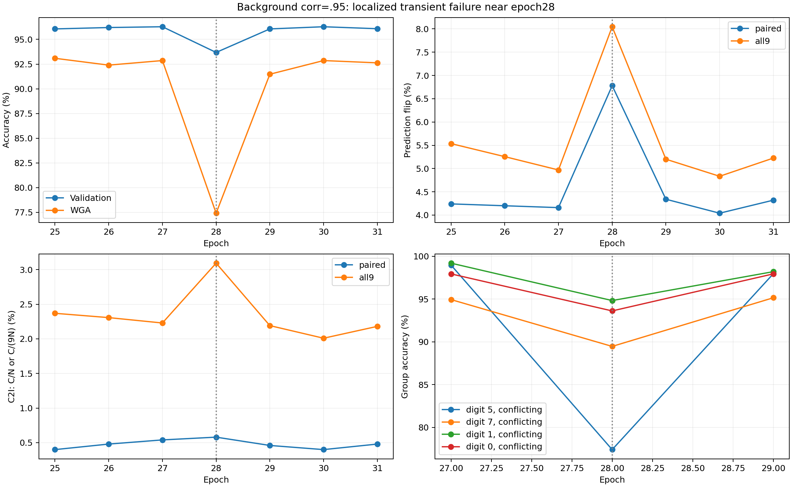

# Colored MNIST × VGG11_BN: 406 Checkpoint 최종 분석

**핵심 결론:** Epoch 1→50에서는 여섯 조건 모두 Flip Rate와 C2I가 감소했지만, 감소 과정은 단조적이지 않았다. Corr .95의 추가 50 Epoch 학습은 강건성을 개선하지 않았고 일부 지표는 악화했다. 높은 correlation에서 강건 행동에 도달하는 시점은 늦었지만, 이를 Core Feature의 실제 학습 시작 지연으로 확정할 수는 없다.

이번 작업은 기존 예측·지표·Probe·CAM의 CPU 분석이다. 새 학습·추론·GPU 실행·SLURM 제출 및 취소는 하지 않았다. 기존 코드와 결과도 수정하지 않았다. 본문의 비율 표는 %, CSV의 비율은 0–1이다.

## 1. 실험 설정과 분석 범위

이번 분석은 **후속 Colored MNIST 실험**이다. 과거 별도로 진행한 ResNet18/VGG11_BN 원본 100-Epoch 실험은 포함하지 않는다.

| 항목 | 실제 설정 |
|---|---|
| 모델·입력 | VGG11_BN, 224px |
| 데이터 | Colored MNIST, color pairing all |
| 조건 | Background/Foreground × Train correlation .95/.80/.65 |
| Validation/Test | correlation .1, 각각 5,000/10,000개 |
| 학습 | Seed42, SGD LR .01, momentum .9, weight decay .0001, scheduler none |
| 실행 | batch128, AMP, workers4, CF chunk128 |
| 평가 범위 | .95 두 조건 0–100, 나머지 네 조건 0–50 |

Validation은 Seed42로 섞은 MNIST train의 첫 5,000개이며 모델 학습 집합 55,000개와 분리된다. 모든 조건·Epoch에서 Validation 인덱스, 정답, 원본 색상 및 paired CF 색상이 동일함을 확인했다.

`pairing=all, correlation=.1`은 **10색 균등 독립 기준**이다. 특정 대체색에 대한 이진 역상관으로 해석하면 안 된다. Background는 흰 digit와 밝기를 .5배 줄인 색상 배경, Foreground는 검정 배경의 색상 digit다. 따라서 mode 비교에는 위치 외에 명도·합성 방식 차이도 포함된다.

## 2. 406개 평가 완료 및 무결성

| Task| 조건 | Checkpoint | Epoch | State / ExitCode | 시간 |
| --- | --- | --- | --- | --- | --- |
| 0 | BG .95 | 101 | 0–100 | COMPLETED / 0:0 | 02:16:52 |
| 1 | BG .80 | 51 | 0–50 | COMPLETED / 0:0 | 01:12:05 |
| 2 | BG .65 | 51 | 0–50 | COMPLETED / 0:0 | 01:11:44 |
| 3 | FG .95 | 101 | 0–100 | COMPLETED / 0:0 | 02:17:12 |
| 4 | FG .80 | 51 | 0–50 | COMPLETED / 0:0 | 01:12:19 |
| 5 | FG .65 | 51 | 0–50 | COMPLETED / 0:0 | 01:12:18 |

총 406개 결과에 누락·중복이 없다. Paired/All9 Metric 812행과 그룹 Metric 16,240행을 확인하고, 개별 예측에서 C2I를 다시 계산했다. 기존 저장 지표와의 **2,436개 비교에서 차이는 모두 0**이다. OOM, Traceback, 비정상 종료도 없었다.

Checkpoint의 GPU full-file SHA256 audit 406개와 manifest/성공 marker를 대조했고, 현재 파일의 ZIP metadata도 406개 모두 확인했다. 마스터에서 약 28GiB의 tensor 파일을 다시 전량 읽지는 않았으므로, GPU audit 기록과 현재 전체 파일 재해시를 구분해야 한다.

Grad-CAM은 96시점 × 20개 = 1,920개다. 모두 유한한 224×224 map이며 PNG와 파일 해시도 정상이다. 그중 6개는 정상적으로 기록된 zero-CAM이어서 영역 비율·cosine이 정의되지 않는다. 이를 0% 중요도로 바꾸지 않았다. 그룹별 C/A 역시 A=0인 208행에서 결측을 유지했다.

자세한 근거는 [완료 검증 보고서](integrity_report.md)와 [검증 JSON](integrity_validation.json)에 있다. 원본 평가 폴더의 준비 상태 JSON은 덮어쓰지 않았으며, 실제 완료 판정은 조건별 성공 marker와 이번 검증 결과에 근거한다.

## 3. Metric 정의: 서로 다른 지표를 합치지 않기

| Metric | 정의와 주의점 |
|---|---|
| Decoded Core/Spurious | Probe Accuracy a의 변환 D=2a−1. Pearson correlation이 아니며 동일 Probe Accuracy와 독립된 증거도 아님 |
| Prediction Flip | 원본 예측 p와 CF 예측 q의 불일치. C2I, I2C, 오답→다른 오답을 모두 포함 |
| Paired C2I | C=Σ1[p=y,q≠y]. 전체 분모 C/N과 원본 정답 분모 C/A를 구분 |
| All9 C2I | 원본×9대체색 쌍 기준 C/(9N), C/(9A). 고유 이미지의 any-harm 비율과 다름 |
| Accuracy | Train은 학습 중 online 측정, Validation은 Epoch별 고정 모델 평가, Test는 저장된 끝점만 사용 |
| 그룹 Accuracy | aligned는 s=y, conflicting은 s≠y. WGA는 digit×alignment 20그룹의 최소 |
| Grad-CAM | 정답 Target/features.25/FP32 공간 설명. 실제 Feature 사용의 인과적 증거는 아님 |

단일 CF는 원본이 aligned이면 예제별 고정 대체색으로, conflicting이면 정답 색상으로 바뀐다. All9는 원본 색상을 제외한 9색을 모두 평가한다. **기존 All-color Accuracy는 그중 개입 색상≠정답인 recolor만 집계**한다. All9 전체 Accuracy와 분모가 다르다.

예를 들어 BG .95 Epoch50에서 paired는 C2I 21건, I2C 177건, Flip 198건이다. CF Accuracy가 원본 96.40%보다 높은 99.52%여도 해로운 변경은 남는다. All9에서는 C2I 921쌍, I2C 929쌍, 오답→다른 오답 320쌍이다. 전체 All9 Accuracy가 96.4178%로 원본과 거의 같아도 C/(9N)은 2.0467%다. 순 Accuracy 차이만으로 강건성을 판단할 수 없다.

이때 적어도 한 색상에서 오답으로 바뀌는 고유 원본은 510개, 즉 10.20%다. 쌍 기준 2.0467%와 이미지 기준 10.20%를 같은 의미로 쓰지 않는다.

## 4. 공통 Epoch50에서의 조건 비교

아래는 모두 같은 Epoch50의 Validation 결과다. Correlation 간 비교는 이 공통 범위에서 수행한다.

| 조건 | Val Acc | Conflicting | WGA | Paired Flip | All9 Flip | Paired C/N | All9 C/(9N) | All9 C/(9A) |
| --- | --- | --- | --- | --- | --- | --- | --- | --- |
| BG .95 | 96.40 | 96.00 | 93.09 | 3.96 | 4.82 | 0.4200 | 2.0467 | 2.1231 |
| BG .80 | 98.54 | 98.38 | 96.67 | 1.44 | 1.36 | 0.1600 | 0.5667 | 0.5751 |
| BG .65 | 98.88 | 98.75 | 97.11 | 1.04 | 0.87 | 0.1000 | 0.3533 | 0.3573 |
| FG .95 | 95.56 | 95.06 | 92.13 | 4.82 | 5.77 | 0.4400 | 2.3800 | 2.4906 |
| FG .80 | 98.34 | 98.15 | 96.77 | 1.68 | 1.63 | 0.1600 | 0.6311 | 0.6418 |
| FG .65 | 98.86 | 98.75 | 96.54 | 1.04 | 0.94 | 0.1200 | 0.4333 | 0.4383 |

.95는 두 mode 모두 .80/.65보다 민감도가 높고 Conflicting Accuracy와 WGA가 낮다. .80과 .65 사이 차이는 상대적으로 작다. BG .80과 FG .80의 paired C/N은 모두 .16%다. WGA는 FG .80이 BG .80보다 약 .11pp 높으므로 “Foreground가 모든 지표에서 나쁘다”는 주장은 맞지 않는다.

Epoch50의 All9 C/(9N)은 동일 correlation에서 FG가 BG보다 높다. 다만 Epoch100에서는 BG .95 2.6800%, FG .95 2.6556%로 순위가 작게 뒤집힌다. Mode의 우열은 지표와 시점에 따라 달라지며 단일 Seed 차이를 일반화하지 않는다.

### 실제 저장된 최종 평가(%)

| 조건 | 실제 최종 Epoch | Train online | Validation | Test | WGA |
|---|---:|---:|---:|---:|---:|
| BG 0.95 | 100 | 100.00 | 95.56 | 96.13 | 90.71 |
| BG 0.80 | 50 | 100.00 | 98.54 | 98.66 | 96.67 |
| BG 0.65 | 50 | 100.00 | 98.88 | 99.08 | 97.11 |
| FG 0.95 | 100 | 100.00 | 95.22 | 95.85 | 88.48 |
| FG 0.80 | 50 | 100.00 | 98.34 | 98.55 | 96.77 |
| FG 0.65 | 50 | 100.00 | 98.86 | 99.01 | 96.54 |

최종 Epoch가 조건별로 다르므로 이 표를 동일 Epoch의 correlation 효과 비교에 사용하지 않는다. 해당 비교는 위의 공통 Epoch50 표를 사용한다.

## 5. Epoch Dynamics와 H1

Epoch0의 Validation Accuracy는 BG 9.94%, FG 10.04%로 chance 수준이다. All9 Flip은 BG 11.85%, FG .44%인데 Epoch1의 .95 조건에서는 각각 91.61%, 82.25%로 크게 증가한다. 즉 **초기 학습이 먼저 색상 민감도를 높이고, 이후 낮추는 구간**이 있다. 무학습 모델의 낮은 Flip을 Core 학습의 증거로 볼 수 없다.

Epoch1→50에서는 모든 조건의 paired/All9 C2I가 감소했다. 이전 집계 범위만으로 불분명했던 .65 조건도 이번 정확한 예측값으로 감소를 확인했다. 그러나 All9 C/(9N)은 인접 49전환 중 18–23번 증가했다.

| 조건 | E1 All9C/(9N) | E50 | 증가 횟수 /49 | 기술적 Spearman |
| --- | --- | --- | --- | --- |
| BG .95 | 15.1600 | 2.0467 | 21 | -0.812 |
| BG .80 | 4.8644 | 0.5667 | 21 | -0.803 |
| BG .65 | 3.2956 | 0.3533 | 22 | -0.853 |
| FG .95 | 17.4244 | 2.3800 | 19 | -0.824 |
| FG .80 | 6.9356 | 0.6311 | 18 | -0.747 |
| FG .65 | 2.7089 | 0.4333 | 23 | -0.685 |

Spearman은 Epoch 순서와 고정 곡선의 기술적 rank 상관일 뿐, 독립 반복에 대한 유의성 검정이 아니다. [추세 CSV](trend_statistics.csv)는 증가·감소·동률을 구분한다.

**H1 판정:** “초기 Shortcut 획득 이후 후기 의존성이 약해지는 경향”은 지지한다. “Epoch가 늘수록 지속적으로 감소한다”는 강한 주장은 지지하지 않는다. 초기 증가, Epoch28 재상승, .95의 50 이후 악화가 반례다. C/A의 변화에는 정답 집단 구성 변화도 포함되므로 C/N과 함께 봐야 한다.

[Accuracy](figures/01_accuracy.png), [그룹 성능](figures/02_group_accuracy.png), [Flip](figures/03_prediction_flip.png), [Paired C2I](figures/04_c2i_paired.png), [All9 C2I](figures/05_c2i_all9.png)를 분리해 제시했다. Train online−Val 차이는 고정 모델의 IID generalization gap과 다르며 [별도 CSV](generalization_gap_descriptive.csv)에 기술 통계로 저장했다.

## 6. Probe 정보와 강건 행동의 시점: H2

기존 avgpool Probe는 512차원 Feature, 숫자/색상 각 10class, train-only 표준화 Ridge(alpha1)다. 저장 Validation Feature 3,200개를 digit×color 균형에 맞춰 train2,400/held-out800으로 나누고 3개 고정 split을 재사용했다. 원본 단위 분리, 현재 공식 캐시 기준 pixel 중복 검사, train-only 표준화를 기존 검증 자료에서 확인했다.

이번에는 기존 Epoch0–50 결과만 재사용했다. 새 Probe 학습은 없으며, 프로토콜이 다른 원본100 실험의 결과도 합치지 않았다. D=2a−1은 10class chance a=.1에서 −.8이다. Pearson이 아니며 chance-adjusted (a−.1)/.9와도 다르다. [Probe 그림](figures/09_probe_decodability.png)의 띠는 3split의 최소–최대이며 신뢰구간이 아니다.

Epoch50의 기존 Probe 결과를 같은 척도로 변환하면 다음과 같다. D는 Pearson이 아닌 affine agreement다.

| 조건 | Core Accuracy(%) | Core D | Spurious Accuracy(%) | Spurious D |
|---|---:|---:|---:|---:|
| BG 0.65 | 98.21 | 0.9642 | 100.00 | 1.0000 |
| BG 0.80 | 98.04 | 0.9608 | 100.00 | 1.0000 |
| BG 0.95 | 97.79 | 0.9558 | 100.00 | 1.0000 |
| FG 0.65 | 97.88 | 0.9575 | 99.92 | 0.9983 |
| FG 0.80 | 98.08 | 0.9617 | 100.00 | 1.0000 |
| FG 0.95 | 97.21 | 0.9442 | 100.00 | 1.0000 |

Spurious 정보는 약99.92–100% 해독 가능해도 원분류기의 All9 민감도는 조건별로 크게 다르다. 이는 정보의 존재와 사용을 구분해야 하는 근거다.

| 조건 | Core Probe90% | Core Probe95% | 강건 행동95% |
|---|---:|---:|---|
| BG .95 | 1 | 2 | 46: 46–48만 3연속 |
| FG .95 | 1 | 3 | Epoch100까지 미충족 |
| BG/FG .80 | 1 | 1 | 3 |
| BG/FG .65 | 1 | 1 | 2 |

Probe 기준은 모든 3split에서 threshold를 3 Epoch 연속 넘는 구간의 첫 Epoch다. 기존 분석의 주 판정은90%,95%는 민감도 기준이므로95% 결과만 선택해 H2 지지로 해석하지 않는다. 행동 기준은 Conflicting Accuracy≥95%, 기존 All-color Accuracy≥95%, All9 Flip≤5%를 3 Epoch 연속 만족하는 구간의 첫 Epoch다. 어느 기준도 실제 Core 학습 시작을 직접 관측한 것은 아니다.

무학습 Epoch0부터 Core Probe는 BG 평균86.38%, FG80.83%이며 Shortcut은 100%다. Epoch50의 Core Probe가 BG .95 97.79%, FG .95 97.21%로 높아도 행동 기준은 늦거나 미충족이다. **정보의 선형 접근 가능성과 모델의 실제 의사결정 사용은 구분해야 한다.** Probe51–100은 미저장이라 후기 행동 악화를 representation 변화와 직접 연결하지 못한다.

**H2 판정:** 높은 correlation에서 Core95% Proxy와 강건 행동 도달이 늦다는 관찰은 있다. 하지만 Core90% 기준은 모두 Epoch1이고 무학습부터 정보가 분리 가능하다. 따라서 “Core 학습 시작 지연”은 미확정이며, 직접 관찰한 결론은 **강건 행동 도달 지연과 높은 잔류 민감도**다.

## 7. Corr .95의 Epoch50→100 Resume 효과

| 조건 | Epoch | Val Acc | Test Acc | WGA | Paired Flip | All9 Flip | Paired C/N | All9 C/(9N) |
| --- | --- | --- | --- | --- | --- | --- | --- | --- |
| BG .95 | 50 | 96.40 | 96.71 | 93.09 | 3.96 | 4.82 | 0.4200 | 2.0467 |
| BG .95 | 100 | 95.56 | 96.13 | 90.71 | 4.86 | 6.32 | 0.5000 | 2.6800 |
| FG .95 | 50 | 95.56 | 95.93 | 92.13 | 4.82 | 5.77 | 0.4400 | 2.3800 |
| FG .95 | 100 | 95.22 | 95.85 | 88.48 | 5.26 | 6.52 | 0.5400 | 2.6556 |

BG는 Validation96.40→95.56%, Test96.71→96.13%, WGA93.09→90.71%, All9 C/(9N)2.0467→2.6800%로 악화했다. FG 역시 Validation95.56→95.22%, Test95.93→95.85%, WGA92.13→88.48%, All9 C/(9N)2.3800→2.6556%다. Paired C/N도 BG .42→.50%, FG .44→.54%로 증가했다. Train online Accuracy는 거의100%를 유지했다.

단일 끝점의 영향을 줄이기 위해 46–50과 96–100의 5 Epoch 평균을 비교해도 All9 C/(9N)은 BG2.0827→2.4431%, FG2.3640→2.5876%로 증가한다. All9 Flip 평균도 BG4.9049→5.6631%, FG5.8164→6.3293%로 높아진다. 따라서 추가 학습이 지속적 강건성 개선을 만들었다고 볼 수 없다. [기간 평균](period_means.csv)은 측정 곡선의 기술 요약이며 독립 Seed 평균이 아니다.

연장은 모델, SGD Momentum, 고정 LR .01, ConstantLR, AMP Scaler, Torch/Loader/CUDA RNG를 복원한 동일 실험 계열이다. 다만 원본50의 Python/NumPy RNG 부재와 Feature 저장 경계 때문에 완전한 uninterrupted training과 bitwise 동등하지 않다. 이를 별도의 uninterrupted 대조 결과로 주장하지 않는다.

## 8. Background .95의 Epoch28 이상 현상

Epoch27→28→29의 Validation Accuracy는 96.28→93.68→96.06%, WGA는 92.86→77.41→91.47%, All9 Flip은 4.9689→8.0467→5.2000%다. All9 C/(9N)도 2.2289→3.0933→2.1911%로 일시 증가했다.

최저 그룹은 **숫자5·conflicting, n394**다. 정답 수는 390→305→386, Accuracy는 98.98→77.41→97.97%였다. Epoch27 대비 감소한 정답85개는 전체 순감소130개의65.4%다. 숫자7/1/0 conflicting에서도 정답26/22/19개가 감소했지만 일부 다른 그룹은 개선했다. 전체 그룹의 일괄 붕괴로 볼 수 없다.

같은 원본을 추적하면 Epoch27에서 맞고28에서 틀린193개 중160개(82.9%)가29에 다시 맞는다. 이 분석은 **Epoch 간 오류 전환**이며 Counterfactual C2I와 다르다. [그룹 차이](anomaly_group_deltas.csv)와 [개별 전환](anomaly_sample_transitions.csv)에 근거를 저장했다.

해당 구간의 Core Probe 평균은 약97.7–97.8%로 높게 유지된다. Epoch28의97.75%와 WGA77.41%가 공존한다. 정보 소실과 행동 실패를 동일시할 수 없다. 특정 batch, SGD, BN 변화가 원인이라는 직접 증거는 없으며 원인은 미확정이다.

## 9. Grad-CAM 대표 사례

[CAM 보고서](gradcam_analysis.md), [BG 단계별 비교](figures/11_cam_phases_bg.png), [FG 비교](figures/11_cam_phases_fg.png)를 제시한다. 기존 PNG를 재배치했으며 새 gradient 계산은 없다.

초기에도 digit 주변 CAM이 나타나지만 원래 예측은 색상에 크게 좌우된다. BG .95 Epoch1의 digit0은 원본 p9→CF p0, digit5는 p2→p5로 바뀐다. 정답 Target의 형태 주변 CAM만으로 실제 원분류기가 형태를 사용한다고 결론낼 수 없는 사례다.

후기 CAM은 대체로 획·윤곽 주변에 분포하지만 색상 쌍의 차이가 남는다. Epoch50→100의 paired cosine은 BG .9699→.9547, FG .9667→.9570으로 낮아졌다. 이는 행동 악화와 방향이 맞는 보조 관찰이며 인과적 증거는 아니다. Foreground mass도 단조적으로 증가하지 않는다.

고정10개 중9개가 conflicting이어서 대부분의 paired CF가 정답 색상으로 바뀐다. 후기10쌍은 모두 정답이지만 전체 C2I는 양수다. 특히 고정 digit5 원본35515는27/28/29 모두 정답이므로 그룹 급락을 대표하지 않는다. Confidence만99.916→96.853→99.781%로 변했다. 실제 실패 원본의 CAM을 추가하기 전에는 오류 원인을 확정할 수 없다.

## 10. 가설별 결론과 한계

| 가설 | 지지 관찰 | 반례·제한 | 판정 |
|---|---|---|---|
| H1 | 6조건의 E1→50 Flip·C2I 감소 | 초기 증가, 반복 재상승, E28 급락, .95의 50 이후 악화 | 구간적 약화는 지지, 보편적 단조 감소는 지지하지 않음 |
| H2 | .95의 Core95% Proxy 및 강건 행동 도달 지연 | Core90%는 모두1, 무학습부터 높은 Decodability, 후기 Probe 없음 | 강건 행동 지연은 관측, 실제 Core 학습 시작 지연은 미확정 |

RQ에 대한 답은 **초기 색상 민감도 증가 → 큰 폭 감소 → 낮은 수준의 비단조 변동이며, 강한 correlation에서는 추가 학습에도 잔류·재상승이 가능하다**는 것이다.

단일 Seed42 실험이므로 Epoch, 샘플, Probe split을 독립 학습 반복으로 취급하지 않는다. .95만100까지 있어 correlation 간 직접 비교는50까지다. Train online−Val은 IID generalization gap이 아니며, Test는 저장된50/100 끝점만 사용했다. 이번 C2I 전체 곡선은 Validation 기준으로 Test C2I 전체 평가와 구분한다.

Probe는 Validation 내부 readout이고 외부 Test 확증이 아니다. Foreground/Background에는 명도·합성 차이가 있다. CAM은 독립 min-max 정규화, 마스크 threshold, 낮은 공간 해상도, 작은 표본에 영향을 받는다. 과거 raw revision/pixel hash가 없어 역사적 데이터 동일성을 완전히 증명할 수도 없다.

후속 우선순위는 다중 Seed 재현, 저장된51–100 Feature의 동일 프로토콜 Probe, 실제 Epoch28 실패 원본의 CAM, 색상/형태 개입을 분리한 분석이다. 모두 이번에는 실행하지 않았다. [남은 작업](remaining_work.md)에 승인 및 자원 범위를 정리했다.

## 공유 산출물

[회의용 요약](meeting_summary.md) · [무결성 검증](integrity_report.md) · [CAM 분석](gradcam_analysis.md)

[조건별 핵심 지표](summary_table.csv), [전체 C2I](c2i_epochwise.csv), [History](history_combined.csv), [저장 Test 평가](test_snapshots.csv), [행동 기준](behavior_thresholds.csv), [Probe](probe_curves_avgpool.csv), [CAM 통계](gradcam_epoch_summary.csv), [입력 해시](source_manifest.json), [분석 방법](analysis_methods.md)

figures/에는 13종 PNG/PDF가 있다. Accuracy, Flip, C2I, Probe, CAM을 구분하고 누락 Epoch를 보간하지 않았다.
