# Waterbirds: ImageNet pretrained + CUB 전체 + 매 epoch 새 배경 (corr .95/.80/.65)

원래 Waterbirds 실험(팀 설정, VGG11_BN 처음부터 학습)은 Colored MNIST와 달랐다. 50 epoch 동안 배경 의존이 줄지 않았고(H1 불지지), corr별 core 사용 시점도 비교할 수 없었다(H2 시점 확인 불가). 원래 모델은 **새를 잘 못 알아본다.** 회색 바탕에 새만 붙여 보여주면 균형 정확도가 .95 57%, .80 69%, .65 80%다(아래 그림 04 점선). 또 train이 4,795장으로 적다.

그래서 아래 세 가지를 바꿔 corr .95/.80/.65를 학습했다(seed 42).

| | 원래 (팀 설정) | 이번 설정 |
|---|---|---|
| 시작 가중치 | 처음부터 (random init) | **ImageNet pretrained** VGG11_BN (torchvision `VGG11_BN_Weights.DEFAULT`) + 새 2-class head, 전체 layer 학습 |
| train 데이터 | 4,795마리 | **CUB 전체 9,390마리** ([`cubfull_manifest.py`](../waterbirds_rerun50/scripts/cubfull_manifest.py)). val 1,199장은 그대로, test는 다른 1,199마리 |
| 배경 | 새마다 고정 | **B: 매 epoch 새 배경.** 같은 장소 종류(땅/물)의 train 배경 풀(땅 5,924 / 물 6,068장)에서 (seed, epoch, img_id)로 뽑는다. 장소는 그대로이므로 corr도 그대로다 |
| lr / scheduler | 0.01 / none (고정) | **0.01 / none (고정)** |
| 나머지 | SGD momentum 0.9, wd 1e-4, batch 128, AMP, 224px, 50 epoch, 증강 없음 | 같음 |

평가는 원래와 같은 val 1,199장, 원래 크기 이미지로 한다. Colored MNIST는 팀 재실행(BG, 처음부터 학습, lr 0.01 고정)이다.

## 요약

| corr | core 사용 시작 | 팀 강건 기준 도달 | train 99% | core flip | spurious flip | val acc | val WGA | 새만 | 배경만 |
|---|---|---|---|---|---|---|---|---|---|
| **.95** | **E2** (원래 없음) | **E3** (원래 미도달) | E9 (원래 E23) | 80% (16%) | 10% (66%) | 92% (61%) | 73% (7%) | 94% (57%) | 96% (82%) |
| **.80** | **E1** (원래 E35) | **E2** (원래 미도달) | E8 (원래 E25) | 85% (32%) | 4.6% (33%) | 94% (75%) | 84% (15%) | 93% (69%) | 91% (66%) |
| **.65** | **E1** (원래 E7) | **E2** (원래 E26) | E8 (원래 E28) | 86% (37%) | 3.3% (17%) | 94% (80%) | 85% (26%) | 94% (80%) | 75% (57%) |
| Colored MNIST BG | E2 / E1 / E1 | | | 99–100% | 1–4% | | | | |

*괄호 안은 원래 Waterbirds(seed 42). flip·정확도·새만·배경만은 E31–50 평균. 전체 수치: [summary.csv](summary.csv)*

- **core 사용 시작:** core flip > spurious flip이 3 epoch 연속인 첫 epoch.
- **팀 강건 기준:** 균형 conflicting 정확도 ≥ 50%이고 WGA ≥ 20%인 상태가 5 epoch 연속인 첫 epoch.
- **core flip:** 같은 장면에서 새를 반대 클래스 새로 바꿨을 때 예측이 바뀌는 비율. 높을수록 새를 본다.
- **spurious flip:** 같은 새에서 배경만 반대 장소로 바꿨을 때 예측이 바뀌는 비율. 높을수록 배경을 본다.
- **새만:** 회색 바탕에 새만 붙였을 때의 균형 정확도(우연 50%).
- **배경만:** 새 없는 배경을 그 장소의 클래스로 예측하는 비율(땅→landbird, 물→waterbird).

**core 사용 시작 epoch가 corr별로 Colored MNIST와 같다**(.95 E2, .80 E1, .65 E1).

## 그림

### 01. flip 평면: Colored MNIST, 원래 Waterbirds, 이번 설정


- x축은 배경 의존(spurious flip), y축은 새 사용(core flip)이다. 대각선 왼쪽 위로 갈수록 core를 쓴다.
- **원래 Waterbirds(가운데):** 대각선 근처나 아래에서 흔들린다. .95는 끝까지 배경 쪽이다.
- **이번 설정(오른쪽):** Colored MNIST(왼쪽)처럼 몇 epoch 안에 왼쪽 위로 올라간다. corr이 강할수록 출발점이 배경 쪽이고 도착점이 조금 낮다.

### 02. epoch별 core flip / spurious flip

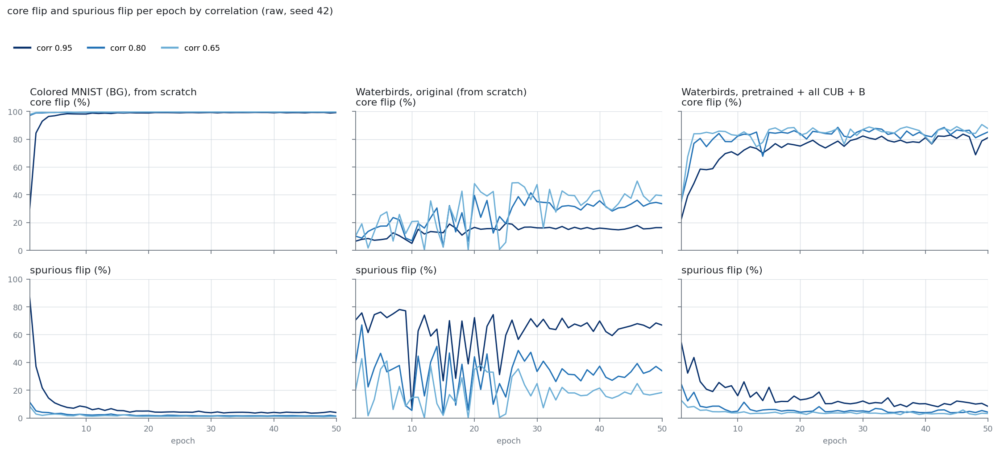

이번 설정의 초반 epoch:

| epoch | .95 core / spurious | .80 core / spurious | .65 core / spurious |
|---|---|---|---|
| 1 | 23 / 54% | 36 / 24% | 35 / 13% |
| 2 | 39 / 32% | 54 / 12% | 67 / 8% |
| 3 | 48 / 44% | 77 / 19% | 84 / 8% |
| 5 | 58 / 21% | 75 / 8% | 85 / 6% |
| 10 | 69 / 16% | 82 / 5% | 83 / 4% |
| 50 | 81 / 8% | 85 / 4% | 88 / 3% |

.95는 epoch 1에 배경을 먼저 쓰다가(spurious 54%) 몇 epoch에 걸쳐 새로 넘어간다. .80·.65는 epoch 1부터 새를 더 쓴다. Colored MNIST와 같은 모양이다.

### 03. 정확도와 WGA

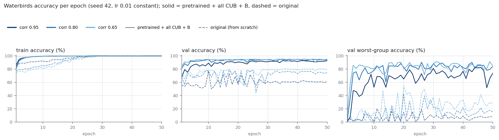

- **train 정확도:** 이번 설정은 epoch 8–9에 99%에 도달한다(원래 E23–28). 소수 그룹까지 99%가 되는 것도 E11–14로 원래(E23–26)보다 빠르다. 즉 **train을 덜 외워서 좋아진 것이 아니다.** core 사용은 train을 다 맞히기 전(E1–2)에 시작됐고, .95의 spurious flip은 그 뒤에도 계속 줄었다(E6–10 21% → E41–50 10%).
- **val WGA:** .80·.65는 epoch 3에 74–86%에 도달한다. .95는 epoch 3에 47%이고, E10–30에는 53–81% 사이에서 흔들린다.
- **.95 WGA는 epoch마다 크게 흔들린다**(E31–50에서 52–82%). lr이 0.01로 고정이라 후반에도 업데이트 폭이 크기 때문으로 보인다. cosine scheduler를 적용하면 이 흔들림이 크게 줄어든다(10–11절).

### 04. 모델이 쓰는 정보: 새만 vs 배경만


- **새만(왼쪽):** epoch 1에 77–88%이고, epoch 4부터 세 corr 모두 약 90% 이상이다(E31–50 평균 93–94%). 원래(점선)는 .95 57%, .80 69%, .65 80%였다. ImageNet 특징 덕분에 새 인식 문제가 사라졌다.
- **배경만(오른쪽):** corr이 강할수록 배경을 장소 클래스로 더 많이 답한다(.95 96%, .80 91%, .65 75%). 새가 있으면 새를 따르지만(core flip 80–86%), 새가 없을 때 남은 배경 단서는 corr에 따라 다르게 배운다.

### 05. 같은 새를 반대 배경에 놓았을 때

05–09는 [waterbirds_rerun50 6–7절](../waterbirds_rerun50/README.md)과 같은 그림이다. 다만 **test 이미지가 다르다.** 팀 test 5,794장 중 4,595장이 cubfull에서는 train이므로, 남은 cubfull test 1,199장만 쓴다. 원래 run도 이번 run도 학습에 쓰지 않은 이미지라 둘을 같은 이미지로 비교한다. 수치는 그룹당 137장(총 548장), 예시는 면적이 보통인 새(이미지의 7.7–16.2%, 가운데 50%)에서 예측을 보지 않고 무작위로 뽑았다. 이미지는 팀 합성과 픽셀까지 같고 새를 확대하지 않았다.

| 이번 설정 .95 | 원래 .95 (같은 새) |
|---|---|
| 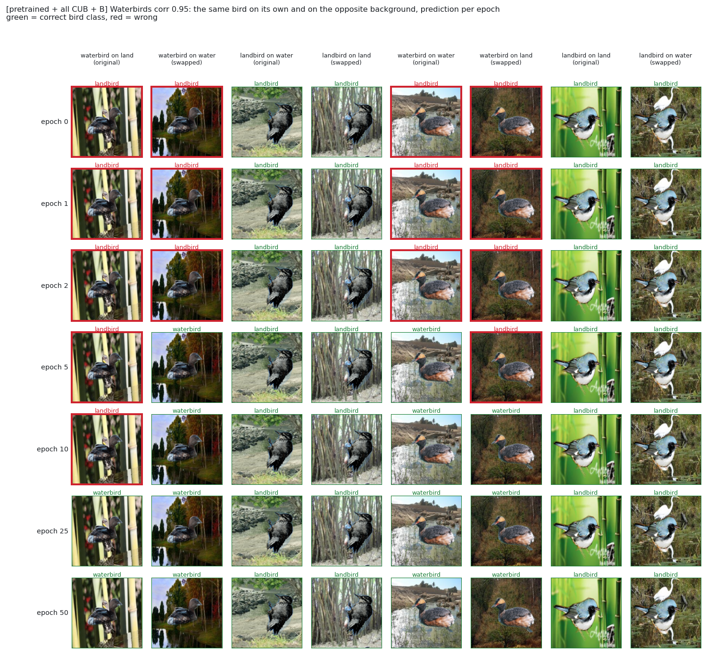 | 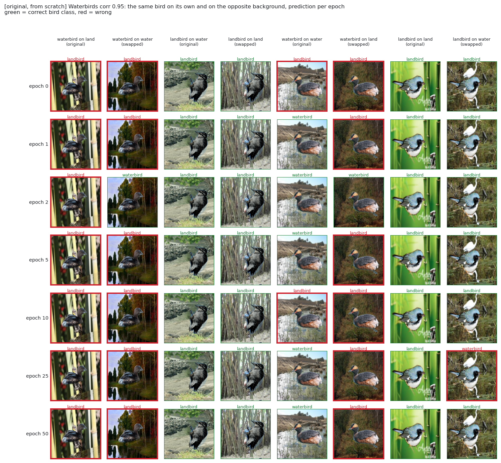 |

이번 설정은 epoch 1–2에는 네 마리의 예측이 모두 landbird라 waterbird를 틀리다가, epoch 25부터 8장을 모두 맞힌다. 원래 모델은 epoch 50에도 땅 배경의 waterbird 두 장을 포함해 3장을 틀린다. 다른 corr: [.80](figures/05_swap_grid_080.png) / [.65](figures/05_swap_grid_065.png), 원래 [.80](figures/05_swap_grid_080_original.png) / [.65](figures/05_swap_grid_065_original.png). 네 마리 예시이므로 크기는 아래 수치로 본다.

### 06–07. Grad-CAM

| 이번 설정 .95 | 원래 .95 (같은 새) |
|---|---|
| 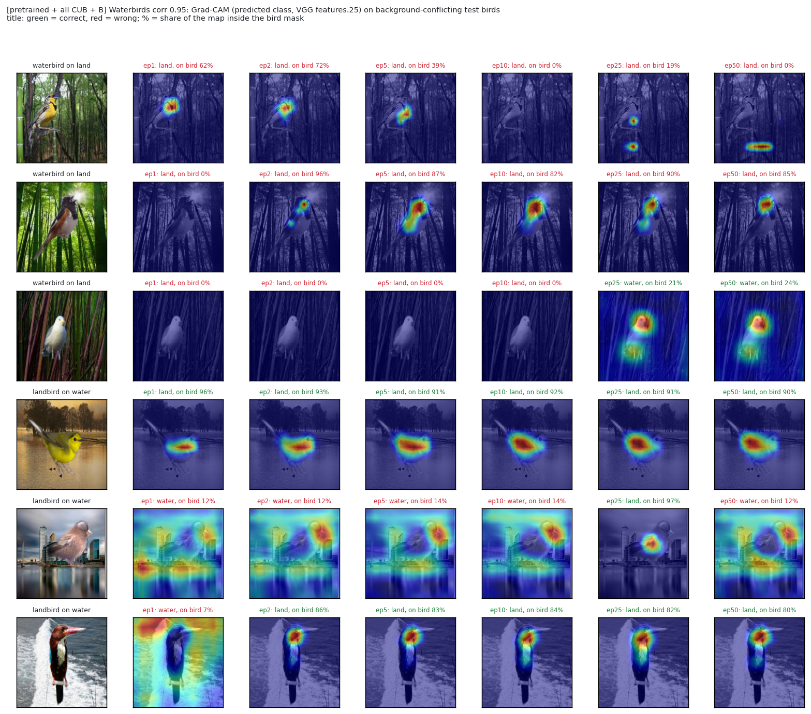 | 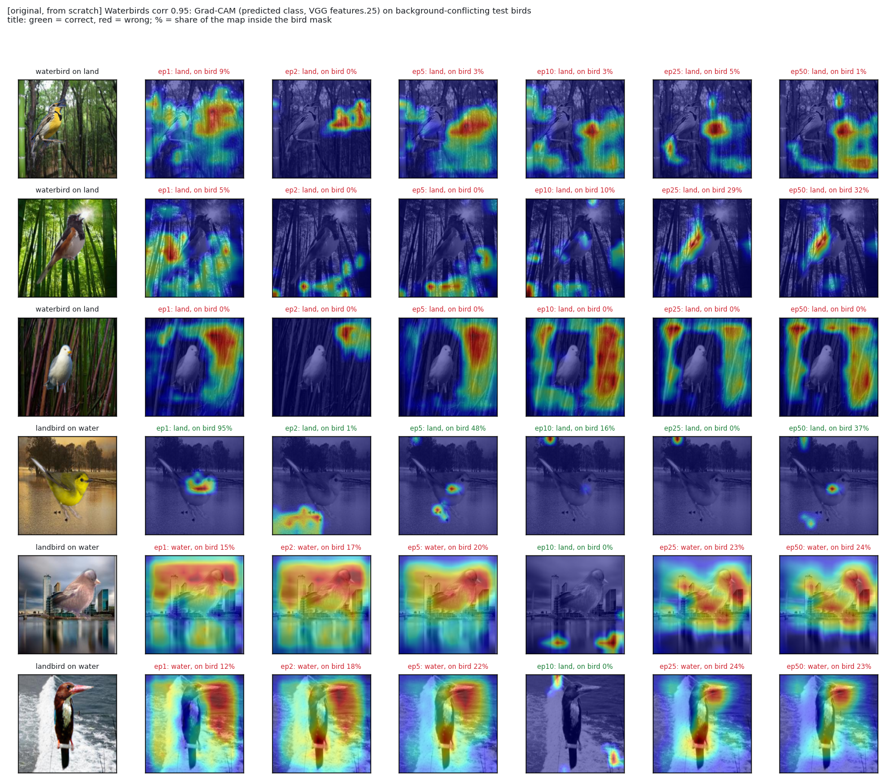 |

*conflicting test 이미지(땅 위 waterbird 3, 물 위 landbird 3), VGG features.25, 예측 클래스 기준. 제목의 %는 heatmap 중 새 마스크 안에 든 비율. 전부 파란 칸은 양의 기여가 없어 heatmap이 0인 경우이고 평균에서는 뺀다.*

위 두 행은 라벨이 waterbird인 meadowlark와 towhee(위 '라벨' 참고)라, 새를 보고도 landbird로 답해 오답으로 표시된다. 다른 corr: [.80](figures/06_gradcam_grid_080.png) / [.65](figures/06_gradcam_grid_065.png), 원래 [.80](figures/06_gradcam_grid_080_original.png) / [.65](figures/06_gradcam_grid_065_original.png).

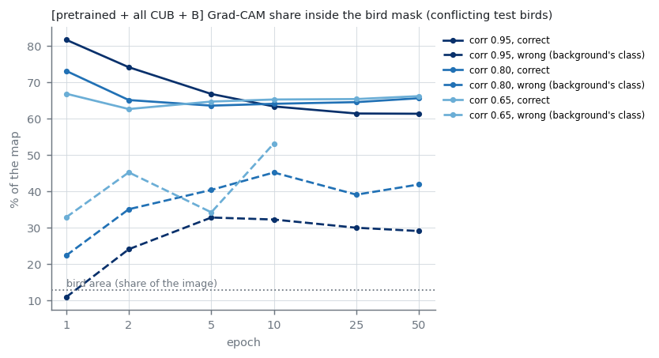

conflicting 274장 중 heatmap이 새 위에 있는 비율(%), 괄호는 해당 장수:

| corr | 예측 | 이번 E1 | E5 | E50 | 원래 E1 | E5 | E50 |
|---|---|---|---|---|---|---|---|
| .95 | 정답 | 82 (77) | 67 (173) | 61 (229) | 14 (45) | 18 (39) | 28 (69) |
| | 배경 클래스로 오답 | 11 (197) | 33 (101) | 29 (45) | 7 (229) | 9 (235) | 10 (205) |
| .80 | 정답 | 73 (128) | 64 (223) | 66 (252) | 17 (97) | 18 (85) | 35 (137) |
| | 배경 클래스로 오답 | 22 (146) | 40 (51) | 42 (22) | 6 (177) | 9 (189) | 16 (137) |
| .65 | 정답 | 67 (160) | 65 (252) | 66 (255) | 26 (126) | 21 (123) | 22 (165) |
| | 배경 클래스로 오답 | 33 (114) | 34 (22) | 47 (19) | 9 (148) | 11 (151) | 15 (109) |

새가 이미지에서 차지하는 면적은 약 13%다. 이번 설정은 맞힌 이미지에서 heatmap의 61–82%가 새 위에 있다(원래 14–35%). epoch에 따라 이 비율이 커지기보다, **새를 보고 맞히는 이미지 수가 늘어난다**(.95 77 → 229장). [gradcam_bird_share.csv](gradcam_bird_share.csv), [원래](gradcam_bird_share_original.csv)

### 08–09. Stress test (epoch 50)

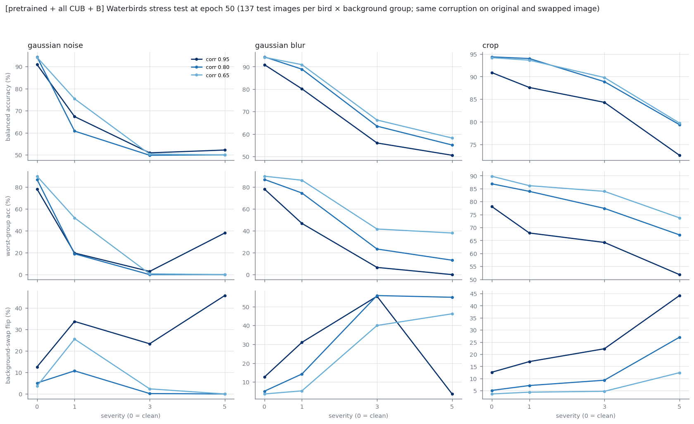

| corr | 손상 | 이번: 균형 정확도 / WGA / flip | 원래: 균형 정확도 / WGA / flip |
|---|---|---|---|
| .95 | 없음 | 91 / 78 / 13 | 58 / 15 / 70 |
| | noise 3 | 51 / 3 / 23 | 50 / 0 / 1 |
| | blur 3 | 56 / 7 / 56 | 50 / 11 / 43 |
| | crop 3 | 84 / 64 / 22 | 58 / 19 / 62 |
| .80 | 없음 | 94 / 87 / 5 | 66 / 27 / 38 |
| | noise 3 | 50 / 0 / 0 | 50 / 2 / 5 |
| | blur 3 | 64 / 23 / 56 | 53 / 8 / 23 |
| | crop 3 | 89 / 77 / 9 | 62 / 21 / 33 |
| .65 | 없음 | 94 / 90 / 4 | 70 / 33 / 29 |
| | noise 3 | 50 / 1 / 2 | 52 / 2 / 6 |
| | blur 3 | 66 / 42 / 40 | 59 / 31 / 33 |
| | crop 3 | 90 / 84 / 5 | 67 / 33 / 22 |

- **깨끗한 이미지와 crop**에서는 이번 설정이 훨씬 낫다.
- **noise 3 이상**에서는 이번 모델도 무너진다(균형 정확도 50–52%). 강건해진 것이 아니다.
- **blur 3**에서는 배경 교체 flip이 40–56%로 원래(23–43%)보다 **높다.** 새의 세부가 흐려지면 다시 배경을 따른다.

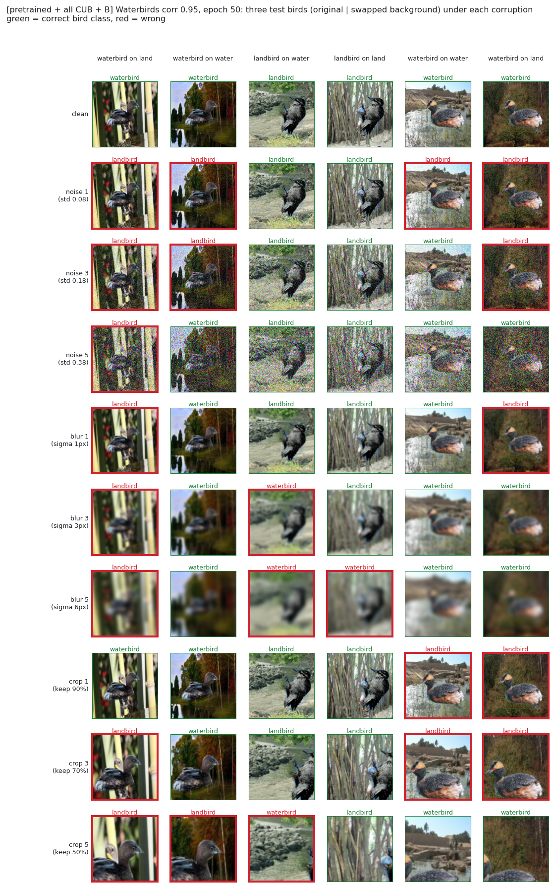

다른 corr: [.80](figures/09_stress_examples_080.png) / [.65](figures/09_stress_examples_065.png). 원래 run: [그래프](figures/08_stress_epoch50_original.png), 예시 [.95](figures/09_stress_examples_095_original.png) / [.80](figures/09_stress_examples_080_original.png) / [.65](figures/09_stress_examples_065_original.png). [stress_epoch50.csv](stress_epoch50.csv), [원래](stress_epoch50_original.csv)

### 10–11. cosine scheduler (lr 0.01 → 0)

위 run과 나머지는 모두 같고 **scheduler만 cosine**으로 바꿔 다시 학습했다(seed 42, 50 epoch, CosineAnnealingLR T_max = 50: epoch 25에 lr 0.005, epoch 50에 0). 후반 흔들림이 lr 고정 때문인지 보려는 것이다.

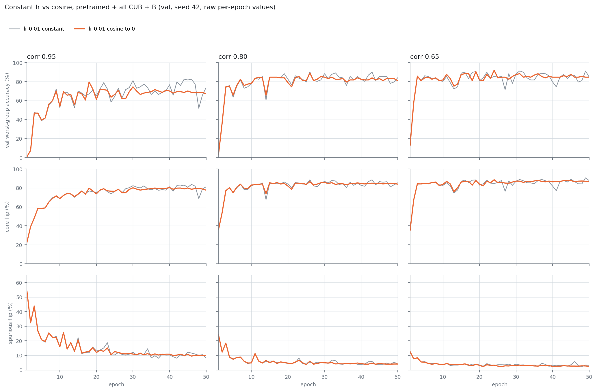

| corr | scheduler | core 사용 시작 | 팀 강건 기준 | core flip | spurious flip | val acc | val WGA 평균 | WGA 범위 | WGA 흔들림 | core flip 흔들림 |
|---|---|---|---|---|---|---|---|---|---|---|
| .95 | 고정 | E2 | E3 | 79.6% | 10.2% | 91.9% | **72.7%** | 52–82% | 6.4pp | 3.1pp |
| | cosine | E2 | E3 | 79.1% | 10.4% | 92.0% | 69.0% | 66–72% | **1.2pp** | **0.7pp** |
| .80 | 고정 | E1 | E2 | 84.7% | 4.6% | 94.1% | **83.8%** | 76–90% | 4.1pp | 2.8pp |
| | cosine | E1 | E2 | 84.5% | 4.3% | 94.4% | 82.5% | 80–85% | **1.4pp** | **0.6pp** |
| .65 | 고정 | E1 | E2 | 86.2% | 3.3% | 94.3% | 84.9% | 74–91% | 4.1pp | 2.6pp |
| | cosine | E1 | E2 | 87.0% | 2.8% | 95.3% | **85.5%** | 84–88% | **1.3pp** | **0.6pp** |

*E31–50. 흔들림 = 이웃한 epoch 사이 변화량(절댓값)의 평균.*

- **후반이 훨씬 완만해졌다.** WGA 흔들림이 1/3–1/5로, core flip 흔들림이 1/4 정도로 줄었다.
- **평균 수준은 거의 같다.** core·spurious flip 차이는 1pp 안이고 core 사용 시작과 강건 기준 도달 epoch도 같다. 그래서 H1/H2 판정은 바뀌지 않는다.
- **.95 WGA는 좋아지지 않았다**(평균 73 → 69%). .80도 1pp 낮고 .65는 1pp 높다. seed 하나라 이 차이가 scheduler 때문인지는 알 수 없다.
- **초반 흔들림은 남는다.** lr이 아직 높은 epoch 10–30의 WGA는 cosine에서도 흔들린다(.95 epoch 10과 14의 급락은 두 run에 똑같이 나온다. 데이터 순서와 초기값이 같기 때문으로 보인다).

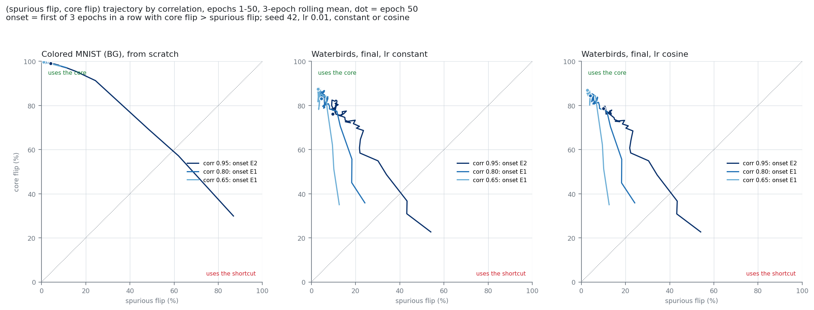

cosine run의 배경 교체 예시([.95](figures/05_swap_grid_095_cosine.png) / [.80](figures/05_swap_grid_080_cosine.png) / [.65](figures/05_swap_grid_065_cosine.png)), Grad-CAM([.95](figures/06_gradcam_grid_095_cosine.png) / [.80](figures/06_gradcam_grid_080_cosine.png) / [.65](figures/06_gradcam_grid_065_cosine.png), [새 위 비율](figures/07_gradcam_bird_share_cosine.png)), stress test([그래프](figures/08_stress_epoch50_cosine.png), 예시 [.95](figures/09_stress_examples_095_cosine.png) / [.80](figures/09_stress_examples_080_cosine.png) / [.65](figures/09_stress_examples_065_cosine.png))는 고정 lr run과 거의 같다. conflicting 274장 중 epoch 50 정답은 229 / 247 / 254장(고정 229 / 252 / 255), 정답일 때 새 위 비율은 61 / 65 / 66%(고정 61 / 66 / 66%)다. noise 3에서는 cosine도 무너진다(균형 정확도 50–53%). [gradcam](gradcam_bird_share_cosine.csv), [stress](stress_epoch50_cosine.csv)

## 팀 가설로 보면

| 가설 | 결과 | 판정 |
|---|---|---|
| **H1** epoch가 늘수록 shortcut 의존 감소 | 세 corr 모두 spurious flip이 줄고 core flip이 는다. .95: spurious 54% (E1) → 21% (E5) → 10% (E31–50). 원래 설정에서 보였던 후반 재상승은 없다 | **지지** (Colored MNIST처럼 초반에 크게 줄고 이후 낮게 유지) |
| **H2** corr이 강할수록 core 학습이 늦음 | core 사용 시작 .95 E2 > .80·.65 E1. 팀 강건 기준 .95 E3 > .80·.65 E2. 도착점도 .95 < .80 < .65 (core flip 80 < 85 < 86%, WGA 73 < 84 < 85%) | **순서는 지지.** 시점 차이는 1 epoch뿐이라 seed 하나로는 단정할 수 없다(Colored MNIST도 1 epoch 차이) |

## 주의할 점

- **원래 Waterbirds 결과가 아니다.** 시작 가중치, train 데이터 양, 학습 중 배경 조합 세 가지가 다르다. 결론은 **"이 세 가지를 함께 바꾸면 Waterbirds의 flip 궤적이 Colored MNIST와 비슷해진다"**까지다. 왜 그런지(새 인식, 데이터 양, 배경 조합 중 무엇이 얼마나)는 이 3개 run만으로 가를 수 없다.
- **새 인식이 ImageNet에서 온다.** 새 특징을 처음부터 갖고 시작하므로, H2의 "core를 배우는 데 걸리는 시간"보다는 "이미 가진 core 정보를 쓰기 시작하는 시점"에 가깝다. Colored MNIST에서도 숫자 정보는 epoch 1에 이미 있었다(RESULTS_OVERVIEW A5).
- **seed 42 하나다.** H2의 1 epoch 차이를 말하려면 seed를 더 돌려야 한다.
- **test 세트가 원래와 다르다.** cubfull은 CUB test 새 대부분을 train으로 옮겼으므로 test 1,199장이 원래 test와 다르다. 01–04의 수치는 원래와 같은 val, 05–09는 cubfull test로 계산했다.
- **Colored MNIST와 아직 차이가 있다.** 후반 core flip이 80–86%로 Colored MNIST(99–100%)보다 낮고, .95 WGA가 크게 흔들린다.
- **여러 설정을 시도한 뒤 고른 결과다.** 아래는 .95, seed 42의 같은 val에서 본 값이고, 이 val 지표를 보면서 설정을 골랐으므로 위 수치는 낙관적일 수 있다. 시도한 run과 CSV는 정리하면서 지워서 수치만 남긴다(재현하려면 다시 학습해야 한다).

  | .95 설정 (full-size 이미지) | core 사용 시작 | core / spurious flip (E31–50) | WGA |
  |---|---|---|---|
  | pretrained, lr 0.001 고정 | 없음 | 39 / 43% | – |
  | pretrained, lr 0.01 고정 | E7 | 52 / 35% | 40% |
  | + CUB 전체 | E4 | 60 / 27% | 49% |
  | + CUB 전체 + B (**이 문서**) | E2 | 80 / 10% | 73% |

  그 밖에 처음부터 학습한 조건으로 클래스 균형 loss, 증강, 증강 + cosine, CUB 전체, CUB 전체 + B + cosine(20 epoch까지), 새 확대(crop)를 시도했다. 새 확대 + CUB 전체는 core 사용 시작이 .80 E3, .65 E2, .95 없음이었고, 여기에 B를 더하면 .95 E28이었다. 새 확대는 입력 이미지를 바꾸는 방식이라 쓰지 않았다.
- **라벨에 땅새가 섞여 있다.** Western Meadowlark, Western Wood Pewee, Eastern Towhee는 땅에 사는 새인데 waterbird로 라벨되어 있다(val waterbird 274마리 중 18, test 274마리 중 22). train에도 같은 라벨로 140마리가 있다. 팀 manifest의 라벨을 그대로 쓴 것이며, WGA에 영향을 줄 수 있다.


## 재현

저장소 루트에서 실행한다. 데이터는 `data/waterbirds_rerun50/` 아래에 있어야 한다([waterbirds_rerun50 README](../waterbirds_rerun50/README.md)).

```bash
python3 reports/waterbirds_rerun50/scripts/cubfull_manifest.py
DATA=cubfull PRETRAINED=1 LR=0.01 MULTISCENE=1 CACHE=1 bash reports/waterbirds_rerun50/scripts/run_all.sh 42
python3 reports/core_flip/scripts/core_flip.py --dataset waterbirds --suffix _cubfull_pretrained_lr0.01_multiscene --seeds 42
python3 reports/waterbirds_cubfull_pretrained/scripts/isolate.py
python3 reports/waterbirds_cubfull_pretrained/scripts/isolate.py --suffix ""
# cosine run
DATA=cubfull PRETRAINED=1 LR=0.01 SCHED=cosine MULTISCENE=1 CACHE=1 bash reports/waterbirds_rerun50/scripts/run_all.sh 42
python3 reports/core_flip/scripts/core_flip.py --dataset waterbirds --suffix _cubfull_pretrained_lr0.01_cosine_multiscene --seeds 42
python3 reports/waterbirds_cubfull_pretrained/scripts/isolate.py --suffix _cubfull_pretrained_lr0.01_cosine_multiscene
# 그림과 표
python3 reports/waterbirds_cubfull_pretrained/scripts/report.py
python3 reports/waterbirds_cubfull_pretrained/scripts/examples.py
```

| 단계 | 시간 (RTX 5070 Ti 1장) | 결과 |
|---|---|---|
| `run_all.sh` | corr당 약 30분 (epoch당 약 33초) | `runs/waterbirds_rerun50/A_corr*_seed42_e50_contentv3_cubfull_pretrained_lr0.01_multiscene/` |
| `core_flip.py` | corr당 몇 분 | [`../core_flip/core_flip_waterbirds_cubfull_pretrained_lr0.01_multiscene.csv`](../core_flip/core_flip_waterbirds_cubfull_pretrained_lr0.01_multiscene.csv) |
| `isolate.py` | corr당 몇 분 | [`isolate.csv`](isolate.csv) (원래 run 행은 `--suffix ""`) |
| `examples.py` | 설정(이번·원래·cosine)당 몇 분 | `figures/05–09`, `gradcam_bird_share*.csv`, `stress_epoch50*.csv` |
| `report.py` | 몇 초 | [`summary.csv`](summary.csv), `figures/01–04`, `10–11` |

- `CACHE=1`(`--cache-eval`)은 평가 이미지를 한 번만 합성해 재사용하는 속도 옵션이다. 샘플과 지표는 같다.
- core flip 계산은 학습 중 저장된 history와 일치한다(정확도·spurious flip 차이 최대 1장 = 0.08pp: [`check_waterbirds_cubfull_pretrained_lr0.01_multiscene.csv`](../core_flip/check_waterbirds_cubfull_pretrained_lr0.01_multiscene.csv)).
