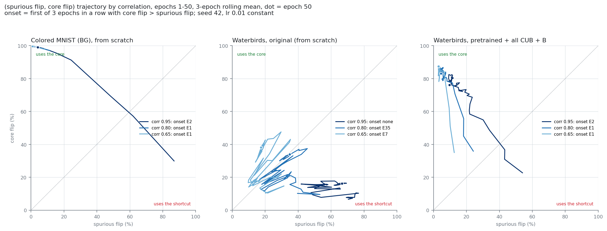
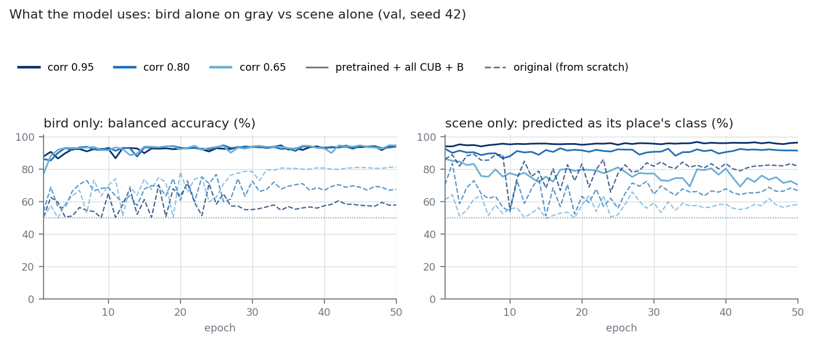

# Waterbirds: 새를 알아볼 수 있고 train을 금방 외우지 못하면 Colored MNIST처럼 움직인다

원래 Waterbirds 실험(팀 설정, VGG11_BN 처음부터 학습)은 Colored MNIST와 달랐다. 50 epoch 동안 배경 의존이 줄지 않았고(H1 불지지), corr별 core 사용 시점도 비교할 수 없었다(H2 시점 확인 불가). 원인으로 두 가지를 확인했다.

1. **새를 잘 못 알아본다.** 회색 바탕에 새만 붙여 보여주면 균형 정확도가 .95 57%, .80 69%, .65 80%다(아래 그림 04 점선).
2. **train을 금방 외운다.** 4,795장이라 epoch 23–28이면 train 정확도가 99%가 되고, 소수 그룹(물 위 landbird, 땅 위 waterbird)까지 외우면 core로 넘어갈 gradient가 사라진다.

그래서 아래 세 가지를 바꿔 corr .95/.80/.65를 학습했다(seed 42).

| | 원래 (팀 설정) | 이번 설정 |
|---|---|---|
| 시작 가중치 | 처음부터 (random init) | **ImageNet pretrained** VGG11_BN (torchvision `VGG11_BN_Weights.DEFAULT`) + 새 2-class head, 전체 layer 학습 |
| train 데이터 | 4,795마리 | **CUB 전체 9,390마리** ([`cubfull_manifest.py`](../waterbirds_rerun50/scripts/cubfull_manifest.py)). val 1,199장은 그대로, test는 다른 1,199마리 |
| 배경 | 새마다 고정 | **B: 매 epoch 새 배경.** 같은 장소 종류(땅/물)의 train 배경 풀(땅 5,924 / 물 6,068장)에서 (seed, epoch, img_id)로 뽑는다. 장소는 그대로이므로 corr도 그대로다 |
| lr / scheduler | 0.01 / none (고정) | **0.01 / none (고정)** |
| 나머지 | SGD momentum 0.9, wd 1e-4, batch 128, AMP, 224px, 50 epoch, 증강 없음 | 같음 |

평가는 원래와 같은 val 1,199장, 원래 크기 이미지로 한다. Colored MNIST는 팀 재실행(BG, 처음부터 학습, lr 0.01 고정)이다.

## 요약

| corr | core 사용 시작 | 팀 강건 기준 도달 | train 99% | core flip | spurious flip | val acc | val WGA | 새만 | 배경만 |
|---|---|---|---|---|---|---|---|---|---|
| **.95** | **E2** (원래 없음) | **E3** (원래 미도달) | E9 (원래 E23) | 80% (16%) | 10% (66%) | 92% (61%) | 73% (7%) | 94% (57%) | 96% (82%) |
| **.80** | **E1** (원래 E35) | **E2** (원래 미도달) | E8 (원래 E25) | 85% (32%) | 4.6% (33%) | 94% (75%) | 84% (15%) | 93% (69%) | 91% (66%) |
| **.65** | **E1** (원래 E7) | **E2** (원래 E26) | E8 (원래 E28) | 86% (37%) | 3.3% (17%) | 94% (80%) | 85% (26%) | 94% (80%) | 75% (57%) |
| Colored MNIST BG | E2 / E1 / E1 | | | 99–100% | 1–4% | | | | |

*괄호 안은 원래 Waterbirds(seed 42). flip·정확도·새만·배경만은 E31–50 평균. 전체 수치: [summary.csv](summary.csv)*

- **core 사용 시작:** core flip > spurious flip이 3 epoch 연속인 첫 epoch.
- **팀 강건 기준:** 균형 conflicting 정확도 ≥ 50%이고 WGA ≥ 20%인 상태가 5 epoch 연속인 첫 epoch.
- **core flip:** 같은 장면에서 새를 반대 클래스 새로 바꿨을 때 예측이 바뀌는 비율. 높을수록 새를 본다.
- **spurious flip:** 같은 새에서 배경만 반대 장소로 바꿨을 때 예측이 바뀌는 비율. 높을수록 배경을 본다.
- **새만:** 회색 바탕에 새만 붙였을 때의 균형 정확도(우연 50%).
- **배경만:** 새 없는 배경을 그 장소의 클래스로 예측하는 비율(땅→landbird, 물→waterbird).

**core 사용 시작 epoch가 corr별로 Colored MNIST와 같다**(.95 E2, .80 E1, .65 E1).

## 그림

### 01. flip 평면: Colored MNIST, 원래 Waterbirds, 이번 설정



- x축은 배경 의존(spurious flip), y축은 새 사용(core flip)이다. 대각선 왼쪽 위로 갈수록 core를 쓴다.
- **원래 Waterbirds(가운데):** 대각선 근처나 아래에서 흔들린다. .95는 끝까지 배경 쪽이다.
- **이번 설정(오른쪽):** Colored MNIST(왼쪽)처럼 몇 epoch 안에 왼쪽 위로 올라간다. corr이 강할수록 출발점이 배경 쪽이고 도착점이 조금 낮다.

### 02. epoch별 core flip / spurious flip


이번 설정의 초반 epoch:

| epoch | .95 core / spurious | .80 core / spurious | .65 core / spurious |
|---|---|---|---|
| 1 | 23 / 54% | 36 / 24% | 35 / 13% |
| 2 | 39 / 32% | 54 / 12% | 67 / 8% |
| 3 | 48 / 44% | 77 / 19% | 84 / 8% |
| 5 | 58 / 21% | 75 / 8% | 85 / 6% |
| 10 | 69 / 16% | 82 / 5% | 83 / 4% |
| 50 | 81 / 8% | 85 / 4% | 88 / 3% |

.95는 epoch 1에 배경을 먼저 쓰다가(spurious 54%) 몇 epoch에 걸쳐 새로 넘어간다. .80·.65는 epoch 1부터 새를 더 쓴다. Colored MNIST와 같은 모양이다.

### 03. 정확도와 WGA


- **train 정확도:** 이번 설정은 epoch 8–9에 99%에 도달한다. 원래보다 빨리 외우지만, 그 전에 이미 core로 넘어갔다.
- **val WGA:** .80·.65는 epoch 3에 74–86%에 도달한다. .95는 epoch 3에 47%, epoch 30 무렵 81%까지 천천히 오른다.
- **.95 WGA는 epoch마다 크게 흔들린다**(E31–50에서 52–82%). lr이 0.01로 고정이라 후반에도 업데이트 폭이 크기 때문으로 보인다. 다음 단계로 cosine scheduler를 적용해 이 흔들림이 줄어드는지 본다.

### 04. 모델이 쓰는 정보: 새만 vs 배경만



- **새만(왼쪽):** epoch 1에 77–88%이고, epoch 4부터 세 corr 모두 약 90% 이상이다(E31–50 평균 93–94%). 원래(점선)는 .95 57%, .80 69%, .65 80%였다. ImageNet 특징 덕분에 새 인식 문제가 사라졌다.
- **배경만(오른쪽):** corr이 강할수록 배경을 장소 클래스로 더 많이 답한다(.95 96%, .80 91%, .65 75%). 새가 있으면 새를 따르지만(core flip 80–86%), 새가 없을 때 남은 배경 단서는 corr에 따라 다르게 배운다.

## 팀 가설로 보면

| 가설 | 결과 | 판정 |
|---|---|---|
| **H1** epoch가 늘수록 shortcut 의존 감소 | 세 corr 모두 spurious flip이 줄고 core flip이 는다. .95: spurious 54% (E1) → 21% (E5) → 10% (E31–50). 원래 설정에서 보였던 후반 재상승은 없다 | **지지** (Colored MNIST처럼 초반에 크게 줄고 이후 낮게 유지) |
| **H2** corr이 강할수록 core 학습이 늦음 | core 사용 시작 .95 E2 > .80·.65 E1. 팀 강건 기준 .95 E3 > .80·.65 E2. 도착점도 .95 < .80 < .65 (core flip 80 < 85 < 86%, WGA 73 < 84 < 85%) | **순서는 지지.** 시점 차이는 1 epoch뿐이라 seed 하나로는 단정할 수 없다(Colored MNIST도 1 epoch 차이) |

## 주의할 점

- **원래 Waterbirds 결과가 아니다.** 시작 가중치, train 데이터 양, 학습 중 배경 조합 세 가지가 다르다. 그래서 결론은 "Waterbirds도 Colored MNIST처럼 된다"가 아니라 **"새를 알아볼 수 있고 train을 금방 외우지 못하는 조건에서는 Waterbirds도 Colored MNIST처럼 움직인다"**이다.
- **새 인식이 ImageNet에서 온다.** 새 특징을 처음부터 갖고 시작하므로, H2의 "core를 배우는 데 걸리는 시간"보다는 "이미 가진 core 정보를 쓰기 시작하는 시점"에 가깝다. Colored MNIST에서도 숫자 정보는 epoch 1에 이미 있었다(RESULTS_OVERVIEW A5).
- **seed 42 하나다.** H2의 1 epoch 차이를 말하려면 seed를 더 돌려야 한다.
- **test 세트가 원래와 다르다.** cubfull은 CUB test 새 대부분을 train으로 옮겼으므로 test 1,199장이 원래 test와 다르다. 이 문서의 수치는 모두 원래와 같은 val로 계산했다.
- **Colored MNIST와 아직 차이가 있다.** 후반 core flip이 80–86%로 Colored MNIST(99–100%)보다 낮고, .95 WGA가 크게 흔들린다.
- **이 설정에 이르기까지 다른 시도도 했다.** 클래스 균형 loss, 증강, cosine, 새 확대(crop), 처음부터 학습 + CUB 전체 + B는 새 인식이나 core 사용을 이만큼 바꾸지 못했거나 입력 이미지를 바꿨다. pretrained lr 0.001은 50 epoch 동안 core 사용 시작이 없었다. 이 시도들은 정리에서 뺐다.

## 재현

저장소 루트에서 실행한다. 데이터는 `data/waterbirds_rerun50/` 아래에 있어야 한다([waterbirds_rerun50 README](../waterbirds_rerun50/README.md)).

```bash
python3 reports/waterbirds_rerun50/scripts/cubfull_manifest.py
DATA=cubfull PRETRAINED=1 LR=0.01 MULTISCENE=1 CACHE=1 bash reports/waterbirds_rerun50/scripts/run_all.sh 42
python3 reports/core_flip/scripts/core_flip.py --dataset waterbirds --suffix _cubfull_pretrained_lr0.01_multiscene --seeds 42
python3 reports/waterbirds_cubfull_pretrained/scripts/isolate.py
python3 reports/waterbirds_cubfull_pretrained/scripts/report.py
```

| 단계 | 시간 (RTX 5070 Ti 1장) | 결과 |
|---|---|---|
| `run_all.sh` | corr당 약 30분 (epoch당 약 33초) | `runs/waterbirds_rerun50/A_corr*_seed42_e50_contentv3_cubfull_pretrained_lr0.01_multiscene/` |
| `core_flip.py` | corr당 몇 분 | [`../core_flip/core_flip_waterbirds_cubfull_pretrained_lr0.01_multiscene.csv`](../core_flip/core_flip_waterbirds_cubfull_pretrained_lr0.01_multiscene.csv) |
| `isolate.py` | corr당 몇 분 | [`isolate.csv`](isolate.csv) (원래 run 행은 `--suffix ""`) |
| `report.py` | 몇 초 | [`summary.csv`](summary.csv), `figures/01–04` |

- `CACHE=1`(`--cache-eval`)은 평가 이미지를 한 번만 합성해 재사용하는 속도 옵션이다. 샘플과 지표는 같다.
- core flip 계산은 학습 중 저장된 history와 일치한다(정확도·spurious flip 차이 최대 1장 = 0.08pp: [`check_waterbirds_cubfull_pretrained_lr0.01_multiscene.csv`](../core_flip/check_waterbirds_cubfull_pretrained_lr0.01_multiscene.csv)).
