# Waterbirds 3개 실험 재실행 · 체크포인트 시각화 · Proposal 대비 정리

팀이 공유한 Waterbirds Condition A × VGG11_BN 50-epoch 실험 3개(train corr .95/.80/.65)를 **팀 코드와 같은 설정으로 다시 학습**했다. 저장된 51개 체크포인트(epoch 0–50)로 그림을 새로 만들었다. 끝에서 proposal의 가설·지표·stress test 계획과 맞는 부분과 맞지 않는 부분을 정리한다.

> 팀 결과 원본 정리는 [`../waterbirds_vgg50/WATERBIRDS_FINAL_RESULTS_KO.md`](../waterbirds_vgg50/WATERBIRDS_FINAL_RESULTS_KO.md)와 [`../RESULTS_OVERVIEW_KO.md`](../RESULTS_OVERVIEW_KO.md) Part B에 있다. 이 폴더는 재실행 결과와 새 그림만 다룬다.

## 요약

| | 결과 |
|---|---|
| 데이터 | 팀 manifest와 **바이트 단위로 같다**(원본 해시 43,578개, 세 조건 CSV sha256 일치). |
| 재현 | epoch 0은 완전히 같다. epoch 1–2부터 GPU 비결정성으로 갈라지고, 이 데이터는 epoch마다 크게 출렁여서 **중반(1–30) epoch별 값은 다르다**. 후반(31–50) 평균과 epoch 50 값은 1–4pp 안에서 같다. |
| H1 | .65만 초기 → 후기에 배경 의존이 줄어든다. .95는 중반에 줄었다가 후반에 다시 늘고, .80은 거의 정체한다. **팀 결론(제한적·조건부 일치)이 재실행에서도 같다.** |
| H2 | 강건 기준(균형 conflicting ≥ 50% & WGA ≥ 20%)은 .65만 도달하고 .80/.95는 50 epoch 안에 미도달. 도달 epoch는 팀 16, 재실행 26으로 **실행마다 다르다**. |
| Seed 반복 | seed 43/44를 추가해 4개 run(팀 + seed 42/43/44)을 비교했다. 구간 평균·최종값·H1/H2 판정·probe·stress 결론은 **모두 유지**된다. .65의 강건 도달 epoch는 14–36으로 **seed마다 다르고**, 한-클래스 붕괴도 특정 epoch에서 재현되지 않는다(8절). |
| 새 관찰 | 마지막 conv 층에서 배경은 epoch 0부터 약 85% 해독되지만 새 종류는 .95에서 끝까지 우연 수준(≈50%)이다. .80/.65에서는 후반에 55–70%(probe 방식에 따라 다름)로, 배경보다 10pp 이상 낮다. Colored MNIST와 달리 **core 정보가 약하다**(5절). |
| Stress test | noise·강한 blur에서는 모든 이미지를 landbird로 예측하는 붕괴가 일어나 flip이 0 근처로 떨어진다. **낮은 flip이 강건함이 아니다.** crop에서는 .95가 여전히 배경을 따른다. |

## 1. 실험 설정

팀 코드의 설정 함수(`scripts/waterbirds_vgg50/full_training.py`의 `configuration`)를 그대로 불러 학습했다. 실행 스크립트는 [`scripts/run_all.sh`](scripts/run_all.sh), 래퍼는 [`scripts/local_pipeline.py`](scripts/local_pipeline.py)다.

| 항목 | 값 |
|---|---|
| 데이터 | CUB-200-2011 새 + Places365 배경 합성(land: bamboo_forest·forest/broadleaf, water: ocean·lake/natural), 224×224, augment 없음 |
| 분할 | train 4,795 / val 1,199 / test 5,794, landbird 77% · val/test corr 0.5 |
| 모델 | VGG11_BN, pretrained 없음 |
| 학습 | **SGD lr 0.01 고정(`scheduler none`)**, momentum 0.9, wd 1e-4, batch 128, AMP, seed 42, 50 epoch. 8절에서 seed 43/44 추가 |
| 평가 | `single_pass_cf_v1`: 같은 새·마스크를 반대 배경에 합성한 이미지로 flip, C→I 측정. feature는 그룹당 32장 저장 |
| 환경 | RTX 5070 Ti 1장, epoch당 약 70초(run당 약 1시간). 팀 run은 서버 GPU |

`history.csv`의 lr은 아홉 run(seed 42/43/44 × 3 조건) 모두 모든 epoch에서 0.01이다.

### 팀 파이프라인과 다르게 한 부분

팀 코드는 서버(moana-u2, SLURM, `/local_datasets/`) 전용 안전장치가 있어 이 PC에서 그대로 돌릴 수 없다. `local_pipeline.py`는 **학습·평가 코드는 그대로 두고** 다음만 바꾼다.

| 팀 코드 | 재실행 |
|---|---|
| 데이터 루트를 `/local_datasets/`로 강제 (`storage.local_root`) | 레포의 `data/waterbirds_rerun50/`로 바꿈 (`data/`는 gitignore) |
| 캐시가 NFS에 있으면 거부 (`StoragePolicy`) | 레포 안 캐시 허용 |
| 호스트 이름·SLURM 확인, pilot 선행 요구 | 생략 |

데이터는 팀 downloader(`download.py`)와 manifest 생성기(`protocol.prepare`)를 그대로 써서 새로 만들었다. 그 결과를 공유된 팀 manifest와 비교했다(`local_pipeline.py compare`).

| 확인 항목 | 결과 |
|---|---|
| 원본 이미지·마스크·장면 해시 | 43,578개 모두 일치 |
| `A_corr095/080/065.csv` | sha256 일치, 11,788행 × 셀 차이 0 |
| `split_audit.json` | sha256 일치 |

### 데이터셋 구성: 원래 `data.py`와 다른 점

팀 manifest는 [`data.py`](../../data.py)의 `waterbirds_metadata`로 시작하지만, **배경 배정을 다시 한다**([`content_split.py`](../../scripts/waterbirds_vgg50/content_split.py)의 `group_scenes`).

| 항목 | 원래 `data.py` | 팀 manifest(content-v3) |
|---|---|---|
| 새 이미지·라벨·split·place(그룹) | — | **같다**(세 조건 모두 차이 0) |
| 배경 장면 풀 | 1만 장을 모든 split이 공유 | 내용 해시로 묶어 train/val/test에 60/20/20 분할 |
| train과 test에 같은 배경 사진 | 375장(반대 배경 후보까지 1,452장) | 0장 |
| 파일명만 다른 동일 장면 | 따로 셈 | 13묶음을 하나로 처리 |
| test 고유 배경 수 | 약 5,400장 | 종류당 약 2,000장(한 장이 평균 약 3번 쓰임) |

따라서 원래 `data.py`로 만든 Waterbirds와는 **배경이 달라 숫자를 직접 비교하면 안 된다**. 팀 문서에는 "새·배경의 cross-split 중복을 방지"했다고만 적혀 있고, 구체적인 동기는 기록돼 있지 않다.

<details>
<summary>실행 명령</summary>

```bash
python3 reports/waterbirds_rerun50/scripts/local_pipeline.py download   # CUB + Places365 4개 카테고리 (약 1.5GB)
python3 reports/waterbirds_rerun50/scripts/local_pipeline.py prepare    # manifest 생성
python3 reports/waterbirds_rerun50/scripts/local_pipeline.py compare    # 팀 manifest와 비교
bash reports/waterbirds_rerun50/scripts/run_all.sh                      # .95 → .80 → .65 순서로 학습 (끊기면 이어서)
bash reports/waterbirds_rerun50/scripts/run_all.sh 43 44                # seed 43, 44 (8절)
```

</details>

## 2. 재현 확인

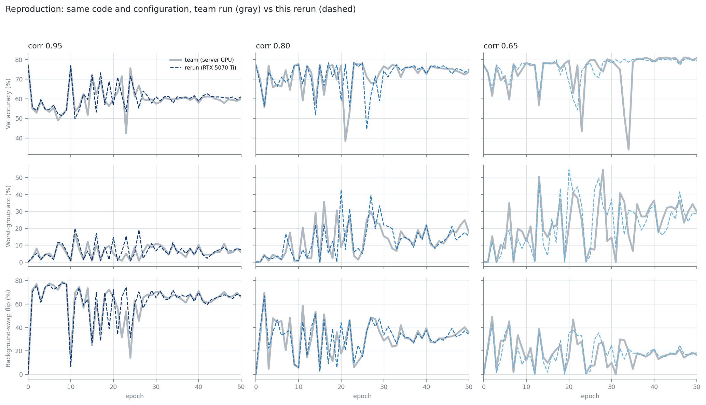

*회색 실선: 팀 run(서버 GPU), 점선: 재실행. 위부터 Val 정확도, WGA, 배경 교체 flip.*

| 조건 | 지표 | epoch 1–30 평균 차이 | epoch 31–50 평균 차이 |
|---|---|---:|---:|
| .95 | Val 정확도 / WGA / flip | 3.8 / 3.3 / 8.1pp | 1.0 / 1.1 / 1.7pp |
| .80 | Val 정확도 / WGA / flip | 6.0 / 6.9 / 8.6pp | 1.2 / 2.8 / 2.8pp |
| .65 | Val 정확도 / WGA / flip | 4.3 / 9.1 / 7.2pp | 4.6 / 7.5 / 3.4pp |

Epoch 0(학습 전)은 모든 지표가 완전히 같다. 정확도 차이가 1pp를 넘는 첫 epoch는 1–2다. Colored MNIST 재실행(평균 차이 0.07–0.29pp)과 달리 중반 차이가 큰 이유는, 이 데이터가 **한 run 안에서도 epoch마다 정확도가 10–40pp씩 출렁이기** 때문이다. 작은 수치 차이가 어느 epoch에 출렁이는지를 바꾼다. 전체 표는 [reproduction_diff.csv](reproduction_diff.csv)에 있다.

### 구간 평균

| Corr | 구간 | Val 정확도 (팀 / 재실행) | WGA | 배경 교체 flip | 균형 conflicting |
|---|---|---|---|---|---|
| .95 | 초기 1–10 | 56.1 / 57.0 | 5.0 / 4.9 | 68.0 / 66.7 | 16.3 / 16.8 |
| | 중기 11–30 | 61.0 / 61.4 | 6.3 / 7.8 | 56.9 / 58.0 | 23.9 / 24.0 |
| | 후기 31–50 | 59.8 / 60.6 | 6.5 / 6.7 | 66.0 / 66.1 | 19.2 / 19.9 |
| .80 | 초기 | 69.5 / 69.8 | 3.9 / 4.0 | 32.7 / 33.2 | 36.0 / 36.1 |
| | 중기 | 69.4 / 68.7 | 15.6 / 15.7 | 30.2 / 31.1 | 43.6 / 43.1 |
| | 후기 | 74.9 / 75.1 | 14.8 / 14.6 | 32.2 / 32.7 | 43.1 / 43.3 |
| .65 | 초기 | 71.4 / 73.5 | 11.9 / 8.6 | 24.9 / 20.6 | 44.2 / 45.1 |
| | 중기 | 74.3 / 73.5 | 22.3 / 26.0 | 17.5 / 19.7 | 53.9 / 53.7 |
| | 후기 | 76.1 / 79.6 | 27.5 / 25.9 | 16.9 / 17.5 | 57.6 / 56.6 |

단위 %. 구간 평균은 대부분 1–2pp 안에서 같고(.65는 최대 4pp), 팀 보고서의 구간별 해석(.95 후기 재상승, .80 flip 정체, .65 개선)이 그대로 나온다. 출처: [phase_means.csv](phase_means.csv).

### Epoch 50

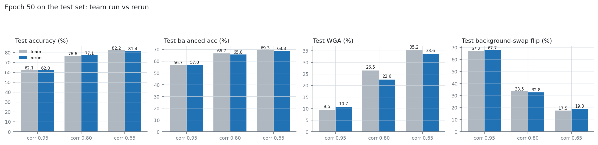

| Train corr | Test 정확도 (팀 → 재실행) | 균형 정확도 | WGA | 배경 교체 flip | C→I |
|---|---|---|---|---|---|
| .95 | 62.1 → 62.0 | 56.7 → 57.0 | 9.5 → 10.7 | 67.2 → 67.7 | 54.6 → 55.3 |
| .80 | 76.6 → 77.1 | 66.7 → 65.8 | 26.5 → 22.6 | 33.5 → 32.8 | 22.3 → 22.1 |
| .65 | 82.2 → 81.4 | 69.3 → 68.8 | 35.2 → 33.6 | 17.5 → 19.3 | 10.5 → 11.5 |

모든 지표에서 .65가 가장 좋고 .95가 가장 나쁜 순서가 팀·재실행 모두 같다. Val 기준 최종 WGA 그룹은 팀·재실행 모두 Waterbird/Land(g10)다. 출처: [epoch50_compare.csv](epoch50_compare.csv).

### 실행마다 달라진 것

| | 팀 run | 재실행 |
|---|---|---|
| 최고 Val WGA (.95 / .80 / .65) | 16.8 (e11) / 35.8 (e16) / 54.7 (e28) | 19.9 (e11) / 42.9 (e20) / 54.7 (e20) |
| 바로 다음 epoch WGA | 7.3 / 10.2 / 12.4 | 11.0 / 7.3 / 41.3 |
| 모든 이미지를 landbird로 예측한 epoch (.65) | **31** | **19** |
| WGA ≥ 20% 최장 연속 (.80 / .65) | 4 / 9 | 3 / 7 |

최고점이 다음 epoch에 무너지는 패턴과 한 번의 한-클래스 붕괴는 둘 다 재현됐지만, **어느 epoch에 일어나는지는 다르다**. Colored MNIST 재실행에서 epoch 28 급락이 재현되지 않은 것과 같은 성격이다. 출처: [wga_peaks.csv](wga_peaks.csv). seed 43/44에서는 waterbird recall이 정확히 0인 epoch가 없다(8절).

## 3. 학습 곡선 (H1)

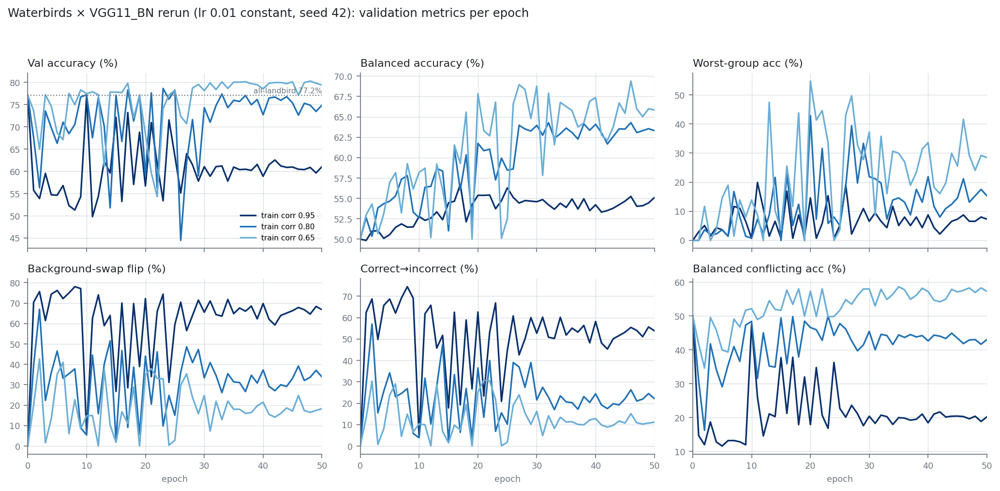

*Validation, 진할수록 train correlation이 강하다. 점선은 모두 landbird로 답할 때의 정확도(77.2%).*

- **.95:** epoch 1에 바로 배경을 따른다(flip 70%). 중기에 flip이 내려갔다가 후기에 66% 수준으로 돌아온다. 균형 conflicting 정확도는 끝까지 20% 근처다.
- **.80:** 정확도와 C→I는 좋아지지만 flip은 30–35%에서 정체한다.
- **.65:** flip이 초기 21% → 후기 18%로 줄고 균형 conflicting이 45 → 57%로 오른다. 그러나 epoch 19에 전부 landbird로 예측하는 붕괴가 있다.

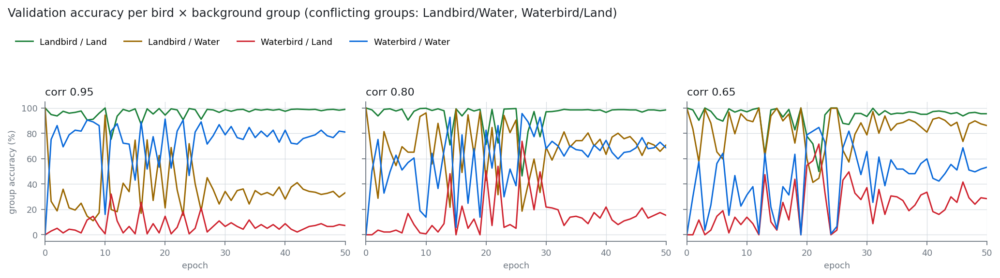

*Val 그룹별 정확도. conflicting 그룹은 Landbird/Water(갈색)와 Waterbird/Land(빨강).*

| Corr (Val, epoch 50) | Landbird/Land | Landbird/Water | Waterbird/Land | Waterbird/Water | Waterbird recall |
|---|---:|---:|---:|---:|---:|
| .95 | 98.9 | 33.1 | 7.3 | 81.0 | 44.2 |
| .80 | 98.5 | 70.8 | 15.3 | 68.6 | 42.0 |
| .65 | 95.5 | 86.2 | 28.5 | 53.3 | 40.9 |

Correlation이 낮아질수록 Waterbird/Land는 좋아지지만 Waterbird/Water는 나빠져서 **waterbird recall은 세 조건 모두 41–44%로 비슷하다**. 팀 보고서의 "모든 그룹이 함께 개선되지는 않는다"와 같다. 낮은 correlation 모델은 배경 대신 "대부분 landbird"라는 다수 클래스 쪽으로 기운다.

## 4. 강건해지는 시점 (H2)

팀 보고서의 사후 기준(균형 conflicting ≥ 50% **그리고** WGA ≥ 20%가 N epoch 연속)을 그대로 적용했다.

| 기준 | 팀 .95 / .80 / .65 | 재실행 .95 / .80 / .65 |
|---|---|---|
| WGA ≥ 20%, 3 epoch 연속 | 미도달 / 미도달 / **16** | 미도달 / 미도달 / **26** |
| WGA ≥ 20%, 5 epoch 연속 | 미도달 / 미도달 / **36** | 미도달 / 미도달 / **26** |
| WGA ≥ 20%, 10 epoch 연속 | 미도달 (모두) | 미도달 (모두) |
| WGA ≥ 30%, 3 epoch 연속 | 미도달 / 미도달 / 43 | 미도달 / 미도달 / 26 |
| WGA ≥ 30%, 5 epoch 연속 | 미도달 (모두) | 미도달 (모두) |

출처: [robust_proxy.csv](robust_proxy.csv). **.65만 도달하고 .80/.95는 미도달**이라는 결론은 같다. 그러나 .65의 도달 epoch는 16 ↔ 26, 36 ↔ 26처럼 실행마다 10–20 epoch씩 다르다. 이 데이터에서 "core를 쓰기 시작하는 epoch"를 한 run으로 정하는 것은 불안정하다. Colored MNIST는 같은 기준의 도달 epoch가 팀과 재실행에서 같았다. seed 43/44를 더하면 3 epoch 기준 14–26, 5 epoch 기준 26–36이다(8절).

## 5. 정보가 있는 것 ≠ 쓰는 것 (probe)

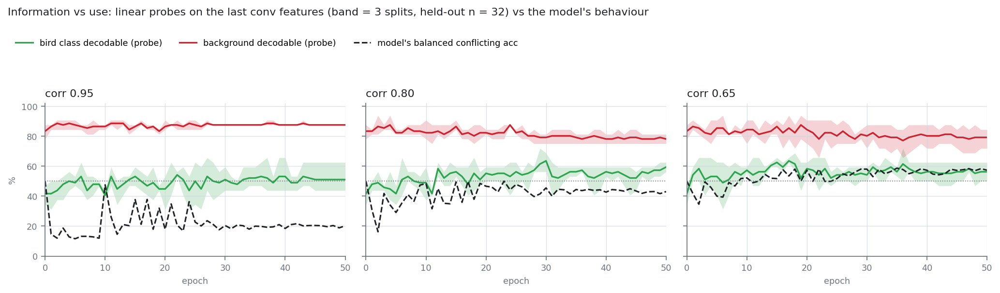

*마지막 conv 층(features.28) feature에 선형 ridge probe. 초록 = 새 종류, 빨강 = 배경 해독 정확도, 검은 점선 = 모델의 균형 conflicting 정확도. 띠는 split 3개의 범위.*

| Epoch | 새 종류 (.95 / .80 / .65) | 배경 (.95 / .80 / .65) |
|---|---|---|
| 0 | 42 / 42 / 42 | 83 / 83 / 83 |
| 10 | 41 / 49 / 57 | 86 / 82 / 84 |
| 50 | 51 / 59 / 56 | 88 / 78 / 79 |

단위 %, 우연 수준은 둘 다 50%다.

- **배경**은 학습 전부터 약 85% 해독된다(무작위 conv feature로도 장면 색·질감이 갈린다).
- **새 종류**는 .95에서 50 epoch 내내 우연 수준이다. .80/.65에서도 후반에 55–60%에 그친다(이 probe 기준. 아래 팀 probe 방식으로는 61–69%).
- .65에서는 probe 곡선이 모델의 균형 conflicting 정확도와 거의 겹친다. 모델이 가진 새 정보를 그만큼 쓰고 있다는 뜻으로 읽힌다.

Colored MNIST에서는 숫자 정보가 epoch 1에 90% 이상 해독됐고 "정보는 있는데 쓰지 않는" 상태였다. Waterbirds에서는 **새 정보가 약하다**. .95는 거의 생기지 않고, .80/.65는 생기지만 배경보다 10pp 이상 낮다. 처음부터 학습하는 VGG11_BN이 4,795장으로 새 종류를 구분하는 특징을 충분히 만들지 못한 것으로 보인다.

#### 팀 probe 방식과의 비교

팀의 후속 분석(`scripts/waterbirds_followup/probes.py`, PR #23 통합 보고서의 Waterbirds VGG probe)은 같은 128장을 **배경·새 사진이 겹치지 않게 56 / 56장으로 나누고** 경사하강 선형 probe(`DecodedCorrelation`)를 쓴다. 같은 코드를 재실행 seed 42/43/44의 마지막 conv feature에 그대로 적용했다([`scripts/probe_team_protocol.py`](scripts/probe_team_protocol.py)).

| 후기 31–50 평균 | 새 종류 .95 / .80 / .65 | 배경 .95 / .80 / .65 |
|---|---|---|
| 팀 방식, 팀 run (PR #23) | 59.4 / 61.2 / 72.1 | 94.3 / 83.9 / 80.9 |
| 팀 방식, 재실행 seed 42 / 43 / 44 | 50.0–52.3 / 60.9–66.9 / 67.3–69.4 | 89.9–91.3 / 85.1–87.4 / 76.2–79.0 |
| 이 문서 방식(ridge, 24/8 × 3 split), seed 42 / 43 / 44 | 45.1–51.1 / 55.0–57.5 / 56.8–65.0 | 86.3–88.1 / 79.0–90.2 / 79.7–83.0 |

- **.95의 새 종류는 두 방식, 세 seed 모두 우연 수준이다.** 팀 run만 59%다. 평가 56장에서 한 장이 1.8pp라, 9pp는 약 5장 차이다.
- **.80/.65의 새 종류는 팀 방식이 5–10pp 높다**(61–69%). 이 문서의 "55–60%"는 probe 방식에 따른 값이다. ".65·.80은 새 정보가 어느 정도 생기지만 배경보다 약하다"가 두 방식에 공통된 결론이다.
- 출처: [probe_team_protocol.csv](seeds/probe_team_protocol.csv)

> 주의: 저장된 feature가 그룹당 32장(총 128장)뿐이라, probe는 그룹당 24장으로 학습하고 8장(총 32장)으로 평가한다. 한 장이 3.1pp이고 split 간 범위가 ±10pp에 이른다. 정확한 수치보다 "배경 ≫ 새 종류"라는 크기 차이만 근거로 쓴다. ridge의 alpha는 학습 split 안 4-fold CV로 골랐다. 출처: [probe_curves.csv](probe_curves.csv).

## 6. 체크포인트로 본 예측

체크포인트 기반 그림은 test에서 그룹당 300장(총 1,200장)을 뽑아 만들었다. 그룹이 균형이라 여기서는 정확도 = 균형 정확도다.

### 같은 새를 반대 배경에 놓았을 때

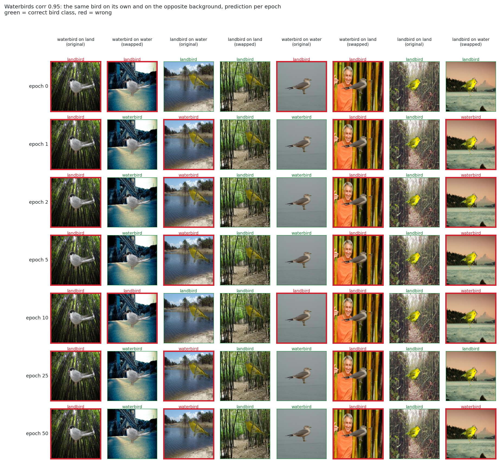

*.95. 열은 (원본 | 배경만 바꾼 이미지) 쌍 4개, 행은 epoch. 초록 테두리 = 정답, 빨강 = 오답.*

.95 모델은 epoch 1부터 50까지 대부분 **배경이 물이면 waterbird, 땅이면 landbird**로 답한다. 같은 갈매기가 물 위에서는 waterbird, 대나무 숲 앞에서는 landbird다. 노란 landbird도 물 배경에 놓으면 대부분의 epoch에서 waterbird가 된다. epoch 10만 전체가 landbird 쪽으로 기울어 예외다.

[`.65 격자`](figures/05_swap_grid_065.png)에서는 노란 landbird가 epoch 1부터 배경과 상관없이 landbird로 맞는다. 그러나 땅 위 waterbird는 epoch 10과 50에만 맞고 25에는 틀리며, 물 위 갈매기는 끝까지 landbird로 틀린다. 배경 의존은 줄었지만 새 자체를 보는 것도 아니고 landbird 쪽으로 기운다.

### Grad-CAM

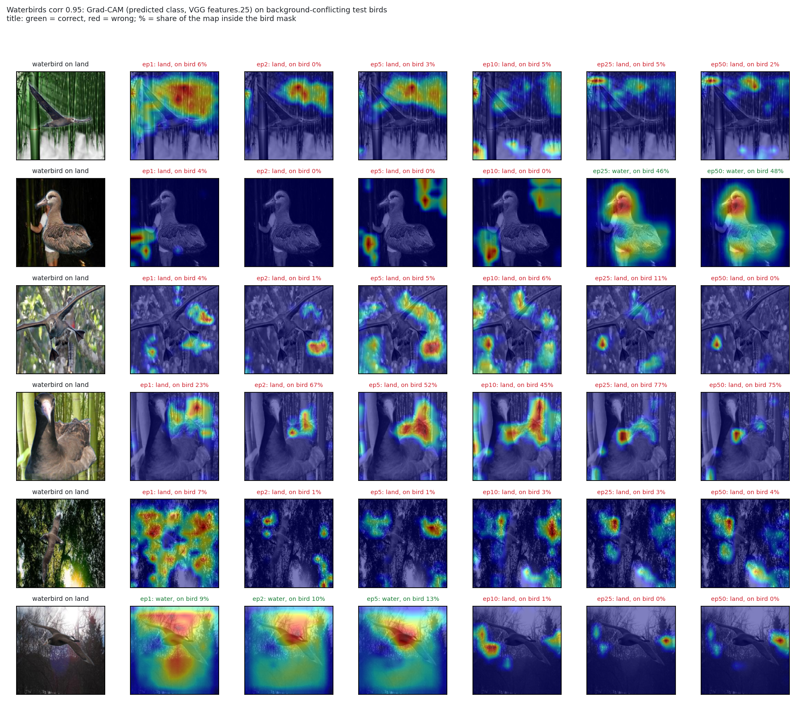

*.95, conflicting test 이미지(땅 위 waterbird). VGG features.25, 예측 클래스 기준. 제목의 %는 heatmap 중 새 마스크 안에 들어가는 비율.*

배경 클래스로 틀린 예측은 대부분 대나무·나뭇잎 쪽을 보고 새 위에는 0–6%만 있다. 네 번째 행처럼 새를 보고도(45–77%) 틀리는 경우도 있다. 두 번째 행처럼 epoch 25 이후 새 머리를 보면서 waterbird로 맞히는 사례도 있다. 다른 조건은 [`.80`](figures/06_gradcam_grid_080.png), [`.65`](figures/06_gradcam_grid_065.png)에 있다.

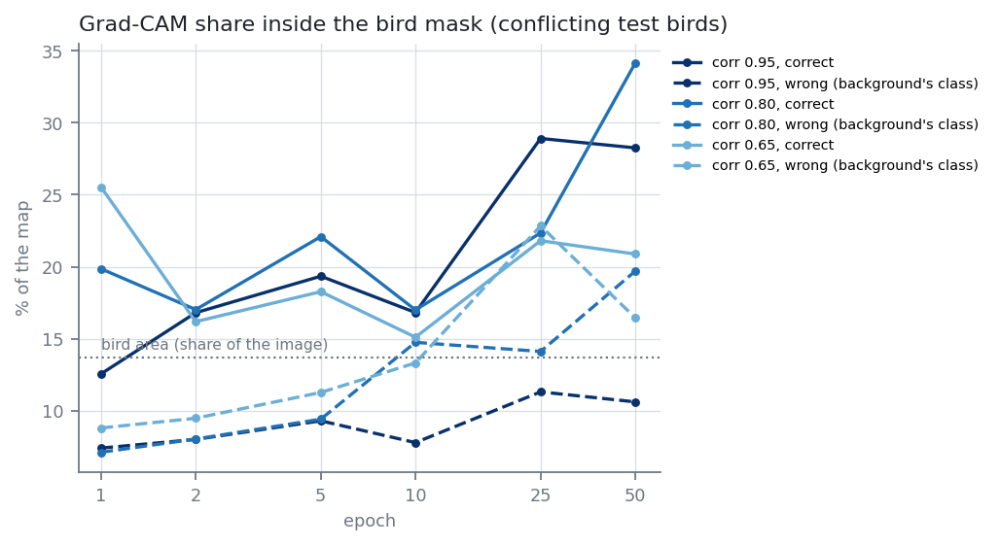

| Corr | 예측 | epoch 1 | 5 | 10 | 25 | 50 |
|---|---|---:|---:|---:|---:|---:|
| .95 | 정답 | 12.6 | 19.3 | 16.8 | 28.9 | 28.3 |
| | 배경 클래스로 오답 | 7.4 | 9.3 | 7.8 | 11.3 | 10.6 |
| .80 | 정답 | 19.9 | 22.1 | 17.0 | 22.3 | 34.1 |
| | 배경 클래스로 오답 | 7.1 | 9.4 | 14.7 | 14.1 | 19.7 |
| .65 | 정답 | 25.5 | 18.3 | 15.1 | 21.8 | 20.9 |
| | 배경 클래스로 오답 | 8.8 | 11.3 | 13.3 | 22.8 | 16.5 |

단위 %, 새 마스크가 이미지에서 차지하는 비율은 평균 13.7%다. **맞힌 예측은 새 면적보다 많이(13–34%) 새를 보고, 배경 클래스로 틀린 예측은 초반(epoch 1–5)에 새 면적보다 적게(7–11%) 본다**. .95의 오답은 50 epoch 내내 이 수준이다. .80/.65는 후반으로 갈수록 오답도 새를 더 보는데(14–23%), 새를 보고도 틀리는 경우가 늘어난다는 뜻이다. 출처: [gradcam_bird_share.csv](gradcam_bird_share.csv).

## 7. Stress test (proposal 6.1)

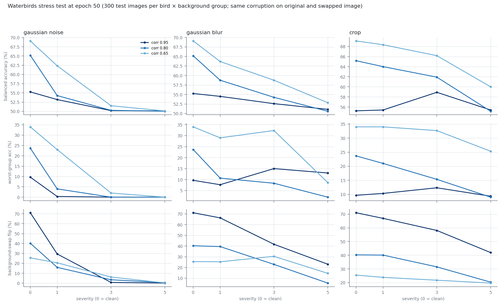

*Epoch 50 모델, 그룹당 300장. 원본과 배경 교체 이미지에 같은 손상을 준다. severity 1/3/5.*

| Corr | 손상 | 균형 정확도 | WGA | flip | waterbird 예측 비율 |
|---|---|---:|---:|---:|---:|
| .95 | 없음 | 55.2 | 9.7 | 71.0 | 40.9 |
| | noise 3 | 50.2 | 0.0 | 0.8 | 0.3 |
| | blur 3 | 52.6 | 15.0 | 41.7 | 26.9 |
| | crop 3 (70%) | 58.9 | 12.3 | 58.1 | 35.9 |
| .80 | 없음 | 65.2 | 23.7 | 40.2 | 30.0 |
| | noise 3 | 50.2 | 0.0 | 3.4 | 1.6 |
| | blur 3 | 54.2 | 8.3 | 22.9 | 13.8 |
| | crop 3 | 61.9 | 15.3 | 31.5 | 22.4 |
| .65 | 없음 | 69.1 | 34.0 | 25.5 | 25.9 |
| | noise 3 | 51.5 | 2.0 | 6.2 | 3.0 |
| | blur 3 | 58.8 | 32.3 | 30.4 | 24.6 |
| | crop 3 | 66.2 | 32.7 | 21.8 | 23.7 |

단위 %. 전체 표(severity 1/3/5)는 [stress_epoch50.csv](stress_epoch50.csv)에 있다.

- **Gaussian noise:** severity 1에서 waterbird 예측이 8–18%로 줄고, severity 3부터는 세 모델 모두 거의 전부 landbird로 답한다(waterbird 예측 0.3–3%). 그래서 flip이 0 근처로 떨어진다. Colored MNIST FG + noise와 같은 **한-클래스 붕괴**이며 강건함이 아니다.
- **Gaussian blur:** 정확도가 떨어지면서 landbird 쪽으로 기운다. flip이 줄어드는 것도 대부분 이 기울어짐 때문이다. .65는 blur 3까지 WGA를 유지한다.
- **Crop:** 가장 영향이 작다. .95는 70%만 남겨도 flip 58%로 여전히 배경을 따른다. .65는 crop 3까지 정확도 손실이 3pp에 그친다.
- 세 손상 모두 **correlation이 낮은 모델이 정확도·WGA를 더 잘 유지한다**.

### 손상 이미지 예시

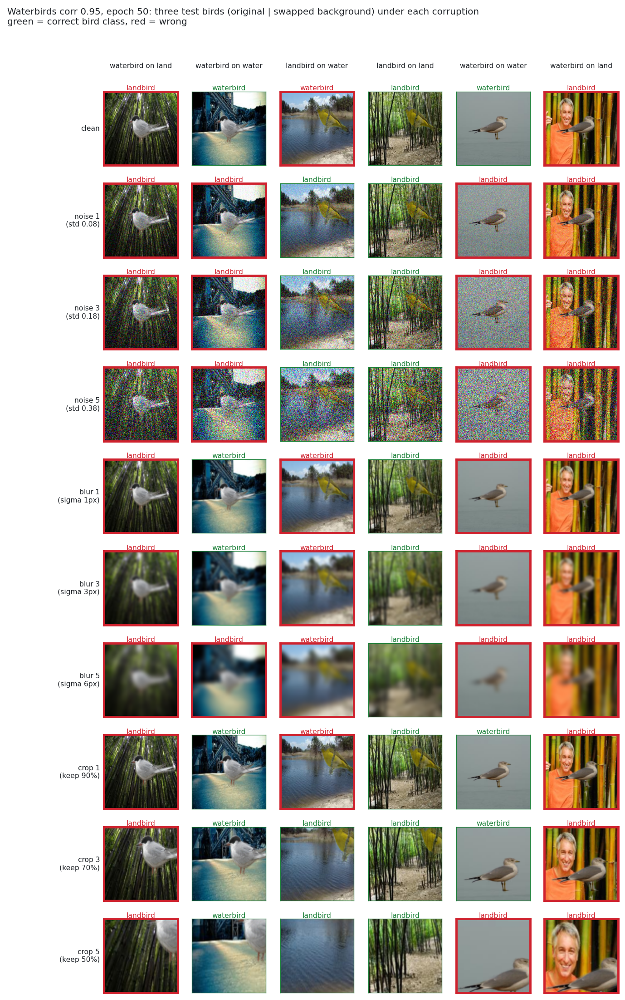

*.95, epoch 50. 세 마리의 (원본 | 배경 교체) 쌍에 손상을 단계별로 적용했다. 초록 = 정답, 빨강 = 오답.*

noise를 더하면 물 위 갈매기도 landbird가 되고, crop 5(50%)로 새가 잘려 나가도 예측은 배경을 따른다. [`.65 예시`](figures/09_stress_examples_065.png)도 있다.

## 8. Seed 반복 (42 / 43 / 44)

2–4절의 "팀 run vs 재실행"은 둘 다 seed 42라 GPU 비결정성만 비교한다. 같은 설정에서 **학습 seed만 바꾼 run 2개(43, 44)를 더 학습**하고, 같은 분석을 다시 했다. lr 0.01 고정·scheduler none 등 나머지 설정은 그대로이고, 체크포인트 51개를 모두 저장했다.

| 항목 | 내용 |
|---|---|
| seed가 바꾸는 것 | 모델 초기화(`seed_everything`)와 학습 데이터 순서(generator `seed + 777`). 팀 코드는 두 값을 42와 819(= 42 + 777)로 고정해 두었고, seed 42에서는 팀 값과 똑같다. |
| 바꾸지 않은 것 | 데이터·manifest·평가 표본. probe용 val feature 128장도 seed와 상관없이 같은 이미지다. |
| 중단·재개 | .80/.65 seed 43은 epoch 3에서 한 번 멈췄다가 저장된 체크포인트에서 이어 학습했다. 데이터 순서 generator 상태도 함께 복원된다. |
| 출처 | [seeds/](seeds/) 아래 `seeds_*.csv`, 그림 11–13, [`scripts/seeds.py`](scripts/seeds.py) |

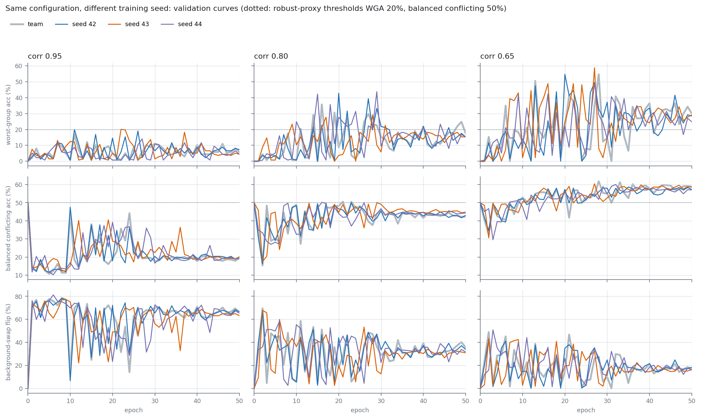

*Validation. 회색 굵은 선 = 팀 run(seed 42, 서버 GPU), 파랑 = 재실행 seed 42, 주황 = 43, 보라 = 44. 점선은 강건 기준(WGA 20%, 균형 conflicting 50%).*

### 구간 평균과 epoch 50: seed를 바꿔도 같다

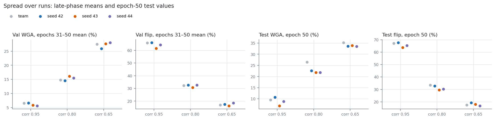

| Corr | 후기 31–50 Val WGA (팀 / 42 / 43 / 44) | 후기 Val flip | Test WGA, epoch 50 | Test flip, epoch 50 |
|---|---|---|---|---|
| .95 | 6.5 / 6.7 / 5.8 / 5.6 | 66.0 / 66.1 / 61.5 / 64.4 | 9.5 / 10.7 / 6.9 / 8.9 | 67.2 / 67.7 / 63.7 / 65.4 |
| .80 | 14.8 / 14.6 / 16.1 / 15.5 | 32.2 / 32.7 / 30.7 / 32.7 | 26.5 / 22.6 / 21.8 / 21.8 | 33.5 / 32.8 / 29.7 / 30.3 |
| .65 | 27.5 / 25.9 / 27.6 / 28.0 | 16.9 / 17.5 / 16.2 / 18.6 | 35.2 / 33.6 / 34.0 / 33.5 | 17.5 / 19.3 / 18.1 / 16.7 |

단위 %. 네 run의 차이는 후기 WGA 약 2pp, 후기 flip 5pp, epoch 50 test 정확도 2pp, epoch 50 test WGA 5pp 안이다. .65 > .80 > .95 순서는 모든 run, 모든 지표에서 같다.

구간별 해석도 네 run 모두 같다.

- **.65:** flip이 초기 → 후기에 줄고(21–27% → 16–19%), 균형 conflicting이 44–46% → 57–58%로 오른다.
- **.95:** flip이 중기에 51–58%로 내려갔다가 후기에 62–66%로 돌아온다. 균형 conflicting은 후기 19–21%다.
- **.80:** 후기 flip 31–33%, 균형 conflicting 43–45%. seed 43/44는 초기 flip이 37–39%로 조금 높아서 초기 → 후기 감소가 5–9pp 보이지만, seed 42와 팀은 거의 정체다.

출처: [seeds_phase_means.csv](seeds/seeds_phase_means.csv), [seeds_epoch50_test.csv](seeds/seeds_epoch50_test.csv).

### 시점: seed마다 다르다

| .65, 강건 기준 첫 도달 epoch | 팀 | seed 42 | 43 | 44 |
|---|---:|---:|---:|---:|
| WGA ≥ 20%, 3 epoch 연속 | 16 | 26 | 14 | 26 |
| WGA ≥ 20%, 5 epoch 연속 | 36 | 26 | 33 | 36 |
| WGA ≥ 20%, 10 epoch 연속 | 미도달 | 미도달 | 33 | 36 |
| WGA ≥ 30%, 3 epoch 연속 | 43 | 26 | 14 | 미도달 |

- **.80/.95는 네 run 모두 어떤 기준에도 도달하지 않는다.** "강건 기준은 .65만 도달한다"는 결론은 seed에 상관없이 유지된다.
- .65의 도달 epoch는 3 epoch 기준 14–26, 5 epoch 기준 26–36이다. 10 epoch 기준은 두 run만 도달한다. 후기 WGA 평균(26–28%)이 기준선 20% 바로 위에서 출렁이기 때문에, 연속 조건이 몇 epoch에서 끊기느냐에 따라 결과가 바뀐다.
- 최고 WGA가 다음 epoch에 절반 이하로 떨어지는 경우가 12개(4 run × 3 조건) 중 8개다. WGA ≥ 20% 최장 연속은 .65에서 7–18 epoch다.

출처: [seeds_robust_proxy.csv](seeds/seeds_robust_proxy.csv), [seeds_wga_peaks.csv](seeds/seeds_wga_peaks.csv).

### 한-클래스 붕괴: 특정 epoch의 사건이 아니다

| Val waterbird recall | 팀 | seed 42 | 43 | 44 |
|---|---|---|---|---|
| .65에서 정확히 0인 epoch | 31 | 19 | 없음 (최저 1.5%, e1) | 없음 (최저 4.0%, e17) |
| .65에서 5% 미만인 epoch | 3 7 12 19 24 31 | 3 12 15 19 24 | 1 3 5 29 | 17 |
| .80에서 5% 미만인 epoch | 없음 (최저 5.5%) | 15 | 19 | 8 |
| .95에서 5% 미만인 epoch | 없음 | 없음 | 없음 | 없음 |

"전부 landbird로 예측하는 붕괴"가 정확히 일어난 것은 팀과 seed 42의 한 epoch씩뿐이다. 그러나 **거의 전부 landbird로 기우는 epoch(recall < 5%)는 .65와 .80의 모든 seed에 있다**. 붕괴를 특정 epoch의 사건으로 볼 것이 아니라, 이 설정에서 반복되는 출렁임의 극단으로 봐야 한다. 출처: [seeds_collapse.csv](seeds/seeds_collapse.csv).

### Probe, Grad-CAM, stress test

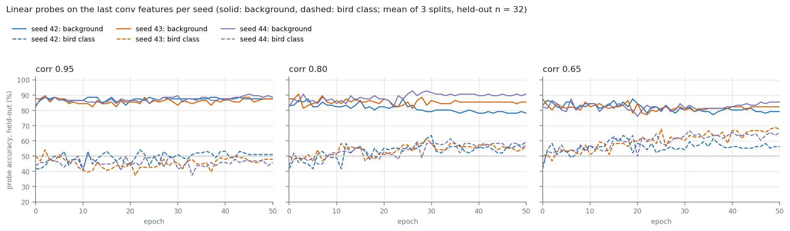

*마지막 conv 층 probe. 실선 = 배경, 점선 = 새 종류, split 3개 평균.*

| 후기 31–50 probe (seed 42 / 43 / 44) | .95 | .80 | .65 |
|---|---|---|---|
| 배경 | 88 / 86 / 88 | 79 / 85 / 90 | 80 / 82 / 83 |
| 새 종류 | 51 / 47 / 45 | 55 / 56 / 58 | 57 / 65 / 64 |

- **probe:** 배경은 모든 seed에서 79–90%로 해독되고, 새 종류는 .95에서 세 seed 모두 우연 수준이다. .65에서는 seed 43/44가 64–65%로 seed 42(57%)보다 높다. 그래도 배경보다 15pp 이상 낮다. 팀 probe 방식으로도 같은 결론이다(5절 표).

| Grad-CAM 새 위 비율 (seed 42 / 43 / 44) | epoch 1 | 5 | 10 | 25 | 50 |
|---|---|---|---|---|---|
| .95 정답 | 12.6 / 22.2 / 16.9 | 19.3 / 18.3 / 14.2 | 16.8 / 20.0 / 21.6 | 28.9 / 27.2 / 21.9 | 28.3 / 22.6 / 24.3 |
| .95 배경 클래스로 오답 | 7.4 / 10.3 / 7.2 | 9.3 / 10.4 / 9.0 | 7.8 / 13.0 / 9.7 | 11.3 / 12.8 / 11.4 | 10.6 / 11.7 / 10.6 |
| .65 정답 | 25.5 / 14.1 / 2.8 | 18.3 / 10.8 / 26.3 | 15.1 / 18.6 / 17.8 | 21.8 / 19.2 / 16.3 | 20.9 / 19.3 / 21.1 |
| .65 배경 클래스로 오답 | 8.8 / 7.3 / 2.4 | 11.3 / 8.4 / 10.5 | 13.3 / 20.7 / 22.5 | 22.8 / 15.1 / 21.4 | 16.5 / 14.1 / 15.1 |

- **Grad-CAM:** 새 면적은 13.7%다.
  - **.95의 오답이 새를 새 면적보다 적게(7–13%) 보는 것은 세 seed, 모든 epoch에서 같다.** 정답은 13–29%로 항상 오답보다 높다.
  - .65는 seed 42에서도 그랬듯 epoch 10 이후 오답도 새를 13–23% 본다. seed 43/44에서는 epoch 10에 오답의 비율이 정답보다 높다.
  - .80/.65에서 seed 44의 epoch 1은 정답·오답 모두 2–5%다. 학습 직후 상태는 seed에 따라 다르다.
  - .80은 [seeds_gradcam_bird_share.csv](seeds/seeds_gradcam_bird_share.csv)에 있다(seed 44 epoch 1을 빼면 정답 > 오답).

| Stress test, epoch 50 (seed 42 / 43 / 44) | .95 | .80 | .65 |
|---|---|---|---|
| noise 3, waterbird 예측 비율 | 0.3 / 0.4 / 1.3 | 1.6 / 0.6 / 2.5 | 3.0 / 1.6 / 1.9 |
| crop 3, flip | 58.1 / 56.3 / 56.1 | 31.5 / 28.6 / 28.7 | 21.8 / 19.1 / 18.5 |
| crop 3, 균형 정확도 | 58.9 / 58.3 / 57.9 | 61.9 / 61.7 / 62.0 | 66.2 / 64.6 / 65.7 |
| blur 3, 균형 정확도 | 52.6 / 52.7 / 53.3 | 54.2 / 54.2 / 52.7 | 58.8 / 56.8 / 58.5 |

- **stress test:** 7절의 결론이 세 seed 모두 같다.
  - noise 3에서는 모든 모델이 거의 전부 landbird로 답한다(waterbird 예측 3% 이하).
  - crop 3에서도 .95는 flip 56–58%로 배경을 따른다.
  - correlation이 낮을수록 정확도를 더 잘 유지한다.

출처: [seeds_probe_phase.csv](seeds/seeds_probe_phase.csv), [seeds_stress_epoch50.csv](seeds/seeds_stress_epoch50.csv).

### 정리

| 주장 | seed 3개 + 팀 run에서 |
|---|---|
| 구간 평균·최종값, .65 > .80 > .95 순서 | **유지** (차이 2–5pp) |
| H1: .65만 배경 의존이 감소, .95는 후기 재상승 | **유지** |
| H2: 강건 기준은 .65만 도달 | **유지** |
| .65가 강건 기준에 도달하는 epoch | **seed마다 다름** (3 epoch 기준 14–26, 5 epoch 기준 26–36) |
| 특정 epoch의 한-클래스 붕괴 | **재현 안 됨**. 거의 붕괴하는 epoch는 모든 seed에 있으나 시점이 다르다 |
| 배경 ≫ 새 종류 (probe), .95 오답은 새를 덜 봄 (Grad-CAM), noise 붕괴 (stress) | **유지** |

## 9. Proposal 대비 정리

### 맞는 부분

| Proposal | 근거 |
|---|---|
| **H2** 방향: correlation이 강할수록 강건해지기 어렵다 | 강건 기준을 .65만 도달하고 .80/.95는 미도달(4절). 최종 WGA·flip·균형 conflicting 순서가 .65 > .80 > .95로 팀·재실행 모두 같다(2절). |
| 6.2 데이터 분포 조작(low/med/high correlation) | .65/.80/.95로 수행. 같은 데이터·설정의 재실행으로 최종 결과와 구간 평균이 재현됐다(2절). |
| 6.1 Gaussian noise / blur / crop | 수행(7절). correlation이 낮은 모델이 손상에도 성능을 더 잘 유지한다. |
| Flip rate가 shortcut 의존 지표로 유효 | 배경 교체 격자(6절)에서 .95가 배경만 보고 답을 바꾸는 것이 flip 67%와 일치한다. |
| Grad-CAM으로 shortcut 확인 | 배경 클래스로 틀린 예측은 새를 새 면적보다 덜 본다(.95는 50 epoch 내내, .80/.65는 초반에 7–11% vs 13.7%). 맞힌 예측은 더 본다(6절). |

### 맞지 않거나 보완이 필요한 부분

| Proposal | 실제 관찰 | 보고서에서의 표현 제안 |
|---|---|---|
| **H1** "epoch가 늘수록 shortcut 의존이 감소" | .65만 감소한다. .95는 중기에 줄었다가 후기에 다시 늘고, .80은 정체한다. 매 epoch 10–40pp씩 출렁인다. | "낮은 correlation에서만 부분적으로 감소한다. 더 학습한다고 자동으로 줄지 않는다" |
| **H2** "core 학습 시점이 늦어진다" (시점 측정) | 도달 epoch가 팀·seed 42/43/44에서 16/26/14/26(3 epoch 기준), 36/26/33/36(5 epoch 기준)으로 다르다. .80/.95는 네 run 모두 미도달이라 지연 크기를 잴 수 없다. | "시점은 seed마다 10–20 epoch씩 달라 단일 run으로 정할 수 없다. 여러 seed의 범위로 보고한다" |
| Decoded core correlation으로 core 학습 추적 | 새 종류가 마지막 conv 층에서 약하게만 해독된다(.95는 끝까지 우연 수준, .80/.65는 55–69%). 평가 표본이 32–56장뿐이고 probe 방식에 따라 5–10pp 달라진다. | probe는 "core 정보가 약하다"는 보조 근거로만 쓴다. 정밀한 시점 추적에는 feature를 더 많이 저장해야 한다 |
| Qiu et al.: core와 spurious 표현이 공존 | Colored MNIST에서는 맞다. Waterbirds .95에서는 배경만 해독되고 새 종류는 해독되지 않는다. .80/.65는 약하게 공존한다. | "pretrained 없이 작은 데이터로 학습하면 core 표현 자체가 약하다"를 별도 관찰로 적는다 |
| 낮은 flip = 강건함 | noise·blur에서는 한-클래스 붕괴로 flip이 0에 가까워진다(세 seed 모두). .65 epoch 19(재실행)와 31(팀)도 같은 붕괴이고, waterbird recall이 5% 미만으로 떨어지는 epoch는 .65/.80의 모든 seed에 있다. | flip은 정확도·waterbird 예측 비율과 함께 보고한다 |
| 낮은 correlation = 모든 그룹 개선 | Waterbird/Water 정확도는 .95 81% → .65 53%로 떨어진다. waterbird recall은 세 조건 모두 41–44%다. | "conflicting 그룹은 개선되지만 다수 클래스(landbird) 쪽으로 기운다" |
| VGGNet·ResNet 두 모델 | VGG11_BN만 사용했다. | ResNet 결과는 별도 실험이 필요하다 |

### 한계

- seed는 42/43/44 세 개다(8절). 구간 평균·최종값은 세 seed에서 안정적이지만 시점은 seed마다 달라서, 시점의 분포를 좁히려면 seed가 더 필요하다. .80/.65 seed 43은 epoch 3에서 한 번 멈췄다가 체크포인트에서 이어 학습했다.
- 데이터는 팀이 재구성한 content-v3 manifest다. 공식 Waterbirds 분할이 아니고, 원래 `data.py` 방식과도 배경이 다르다(1절). test 배경은 종류당 약 2,000장이라 한 장이 평균 3번쯤 재사용된다.
- 체크포인트 기반 그림은 test 그룹당 300장 표본이다. probe는 저장된 feature가 그룹당 32장뿐이라 오차가 크다.
- 서버 전용 안전장치(데이터 경로, NFS 캐시 검사, 호스트·SLURM 확인)를 우회했다. 학습·평가 코드와 설정은 바꾸지 않았다.
- `data/waterbirds_rerun50/`(원본 이미지 1.5GB)와 `runs/waterbirds_rerun50/`(체크포인트 32GB, seed 3개)는 gitignore라 레포에 올라가지 않는다.

## 10. 다시 만들기

`runs/waterbirds_rerun50/`에 체크포인트가, `data/waterbirds_rerun50/`에 데이터와 manifest가 있어야 한다.

```bash
cd reports/waterbirds_rerun50/scripts
python3 figs_history.py          # 01–04: history.csv만 사용 (CPU, 수 초)
python3 probe_features.py        # 10: 저장된 feature로 probe (CPU, 수 분)
python3 figs_checkpoints.py --n 300 --parts swapgrid,cam,stress,stressgrid  # 05–09 (GPU)
for s in 43 44; do WB_SEED=$s python3 probe_features.py; WB_SEED=$s python3 figs_checkpoints.py --n 300 --parts cam,stress; done  # seeds/*_seed4x.csv
python3 seeds.py                 # 11–13, seeds/seeds_*.csv (seed 42 CSV와 seeds/ CSV를 합친다)
python3 probe_team_protocol.py   # 팀 probe 방식(56/56 분할)을 seed 42/43/44에 적용 (CPU, 약 10분)
```

| 파일 | 내용 |
|---|---|
| [reproduction_diff.csv](reproduction_diff.csv) | 팀 run 대비 epoch별 차이 |
| [phase_means.csv](phase_means.csv) | 초기·중기·후기 평균 (팀, 재실행) |
| [robust_proxy.csv](robust_proxy.csv) | 강건 기준 도달 epoch |
| [wga_peaks.csv](wga_peaks.csv) | 최고 WGA와 다음 epoch |
| [epoch50_compare.csv](epoch50_compare.csv) | epoch 50 val/test 지표 (팀, 재실행) |
| [probe_curves.csv](probe_curves.csv) | 층·epoch·split별 probe 정확도 |
| [gradcam_bird_share.csv](gradcam_bird_share.csv) | Grad-CAM 새 위 비율 |
| [stress_epoch50.csv](stress_epoch50.csv) | stress test 지표 |
| [seeds/](seeds/) | seed 43/44 체크포인트 분석(`*_seed43.csv`, `*_seed44.csv`)과 4개 run 비교표(`seeds_*.csv`) |
