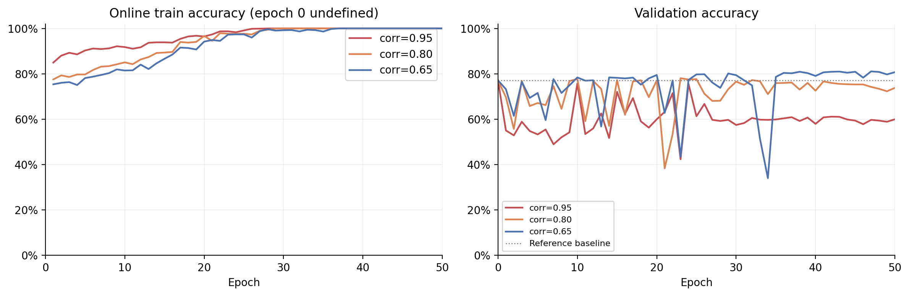
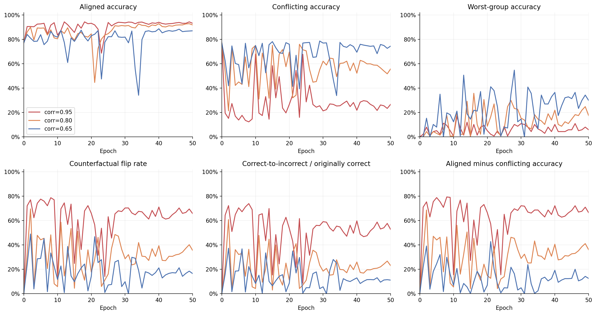
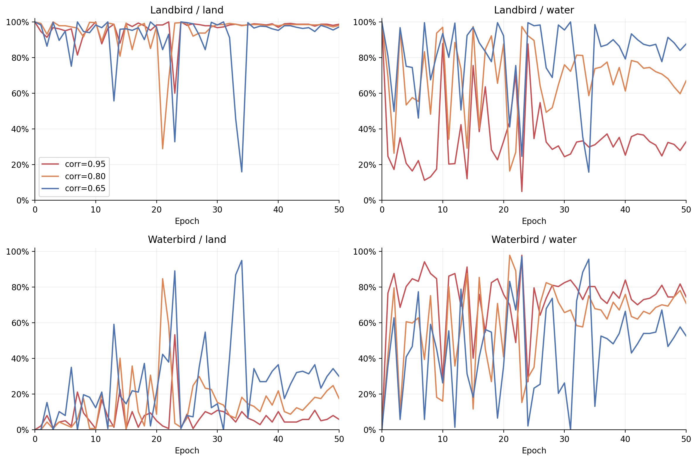
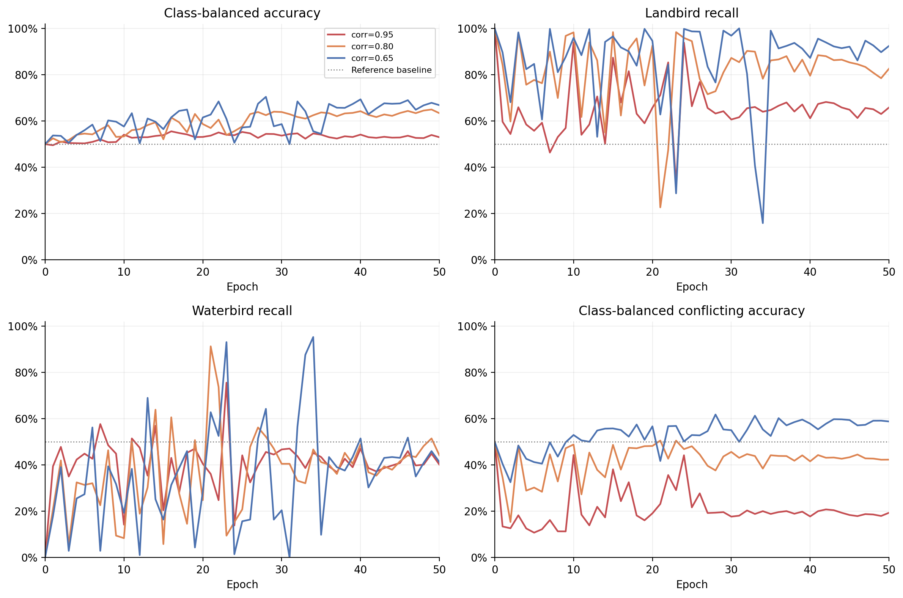
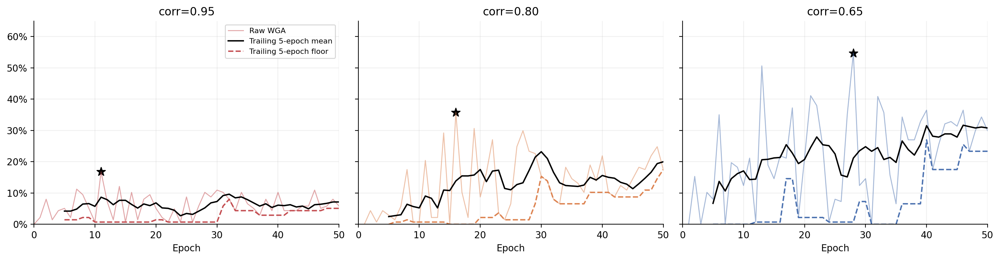

# Waterbirds Condition A 최종 결과

## 1. 목적과 가설

새 종류를 예측하는 동안 배경과 정답의 상관관계가 학습 동역학에 미치는 영향을 비교했다.

- **H1:** Epoch이 증가하면 Shortcut 의존성이 감소하는가?
- **H2:** Train correlation이 높을수록 Core 학습 시점이 지연되는가?

이 문서는 완료된 세 학습의 기존 로그와 분석 자료만 정리한다. 주 분석은 Validation의 Epoch 0~50 전체 궤적이며, Test는 저장된 최종 결과의 보조 비교로 제시한다. 새 실험·추론·Feature Probe·Grad-CAM은 수행하지 않았다.

공유본의 [경로·무결성 기록 안내](SHARING.ko.md)를 함께 참고한다. 아래의 `runs/` 원본 로그는 [경량 복사본](shared/source_metrics/)으로 제공한다.

## 2. 공통 실험 설정과 데이터

| 항목 | 설정 |
|---|---|
| 조건 | Waterbirds Condition A — Background |
| Target / Core | 새 종류: Landbird=0, Waterbird=1 |
| Shortcut | 배경: Land=0, Water=1 |
| Train correlation | 0.95 / 0.80 / 0.65; correlation은 P(y=place) |
| Validation / Test 목표 correlation | 0.50 / 0.50 |
| 모델 | VGG11_BN, pretrained=False, 출력 2차원 |
| 학습 | 50 Epoch; Epoch 0은 학습 전 평가 |
| Optimizer | SGD, lr=0.01, momentum=0.9, weight_decay=1e-4 |
| 기타 | batch_size=128, image_size=224×224, seed=42, AMP=True |
| Scheduler / augmentation | none / False |

설정 출처: 각 `runs/waterbirds_vgg50/A_corr{095,080,065}_seed42_e50_contentv3/config.json`. 세 조건 모두 Checkpoint·Feature 각 51개, history.csv 52줄(헤더 포함), TRAIN_SUCCESS를 확인했다([완료 검증](analysis/run_verification.csv)).

동일한 content-v3 Manifest를 사용했다. 조건 사이에서 새 원본·split·대응 배경 쌍을 고정하고 Train의 배경 선택(`place`)을 바꾼 paired comparison이다. Validation/Test는 조건 사이에서 동일하다. 원본 콘텐츠 해시를 split 단위로 묶어 새·배경의 cross-split 중복을 방지했으며, 기존 준비 검증에서 누수는 0건이었다. 같은 split 안의 배경 재사용 및 조건 사이의 원본 재사용은 split 간 누수와 구분한다.

| Split | 표본 수 | Landbird / Waterbird | 실제 correlation |
|---|---:|---:|---|
| Train | 4,795 | 3,690 / 1,105 | 0.949948 / 0.800000 / 0.649844 |
| Validation | 1,199 | 925 / 274 | 0.500417 |
| Test | 5,794 | 4,510 / 1,284 | 0.500000 |

출처: [protocol.json](shared/dataset/protocol.json), [split audit](shared/dataset/split_audit.json). Validation의 작은 차이는 정수 표본 배정에 따른 것이다. **Correlation 0.5는 클래스가 50:50이라는 뜻이 아니다.**

## 3. 지표를 읽는 기준

- **Accuracy:** 해당 분포의 정답률. Train은 업데이트 중 online accuracy, Validation은 checkpoint의 eval-mode accuracy이므로 직접 같은 평가 방식은 아니다. Epoch 0의 Train 값은 없다.
- **Balanced Accuracy:** 두 클래스 Recall의 평균. 클래스 불균형을 보완한다.
- **Aligned / Conflicting Accuracy:** 각각 y=place / y≠place 표본의 정답률.
- **WGA:** 새 종류×배경의 네 그룹 중 최저 정답률. 취약 그룹 성능을 나타내며 평균 Accuracy와 구분한다.
- **CF Flip Rate:** 같은 새·마스크를 유지하고 반대 종류 배경으로 바꿨을 때 예측이 바뀌는 비율. 배경 개입에 대한 민감도다.
- **Correct→Incorrect(C→I):** 원본에서 맞힌 표본 중 배경 교체 후 틀린 비율. 조건마다 원본 정답 수, 즉 분모가 다르다.

낮은 Flip만으로 Core 학습을 판정하지 않는다. 모든 이미지를 한 클래스로 예측해도 Flip은 0이다. 반대로 Accuracy 상승만으로 배경 의존성 감소를 판정하지 않는다.

## 4. 결과

### 4.1 Epoch 50 비교

Validation, 단위 %. 세 조건 모두 Train Accuracy는 100%였다.

| Train corr | Val Acc | Balanced Acc | WGA | CF Flip | C→I |
|---|---:|---:|---:|---:|---:|
| 0.95 | 59.97 | 52.99 | 5.84 | 65.72 | 52.71 |
| 0.80 | 73.81 | 63.38 | 17.52 | 35.53 | 23.05 |
| 0.65 | 80.73 | 66.84 | 29.93 | 16.51 | 11.16 |

출처: [통합 History](analysis/merged_history.csv), 각 조건 Epoch 50; [최종 비교표](analysis/final_comparison.ko.md).

낮은 Train correlation에서 최종 Accuracy·WGA가 높고, Flip·C→I는 낮았다. 이는 **최종 배경 민감도와 취약 그룹 성능의 조건 간 차이**다. 이 표만으로 학습 중 Shortcut 의존성이 계속 감소했다거나 Core 학습이 언제 시작됐다고 판단할 수는 없다.

최종 Aligned/Conflicting Accuracy는 0.95에서 93.17/26.71%, 0.80에서 91.83/55.76%, 0.65에서 87.00/74.46%다. 격차는 각각 66.46/36.07/12.54 percentage points로, 높은 correlation에서 배경 불일치에 더 취약했다(동일 CSV, Epoch 50).

기존 Epoch 50 Test 기록도 같은 성능 순서를 보였다. 새로운 평가는 수행하지 않았다.

| Train corr | Test Acc | Balanced Acc | WGA | CF Flip | C→I |
|---|---:|---:|---:|---:|---:|
| 0.95 | 62.08 | 56.70 | 9.50 | 67.19 | 54.60 |
| 0.80 | 76.56 | 66.73 | 26.48 | 33.53 | 22.32 |
| 0.65 | 82.21 | 69.29 | 35.20 | 17.52 | 10.52 |

출처: [기존 Test 로그 요약](analysis/final_test_from_existing_logs.csv), 원본은 각 run의 `epoch_050.json`. Test로 Epoch이나 아래 지속성 기준을 선택하지 않았다.

### 4.2 전체 Epoch의 변화

출처: [accuracy.png](analysis/figures/accuracy.png), [merged_history.csv](analysis/merged_history.csv). Train 적합이 완료되어도 Validation 성능과 그룹 강건성은 조건마다 다르다.

출처: [shortcut_metrics.png](analysis/figures/shortcut_metrics.png). 단일 최고점 대신 전체 궤적을 비교한다. 초기 1~10, 중기 11~30, 후기 31~50의 Epoch별 산술평균은 다음과 같다(단위 %).

| Corr | 구간 | Val Acc | WGA | CF Flip | C→I |
|---|---|---:|---:|---:|---:|
| 0.95 | 초기 / 중기 / 후기 | 56.13 / 60.97 / 59.77 | 4.99 / 6.33 / 6.53 | 68.02 / 56.89 / 65.98 | 61.27 / 47.20 / 53.10 |
| 0.80 | 초기 / 중기 / 후기 | 69.52 / 69.42 / 74.89 | 3.87 / 15.64 / 14.82 | 32.69 / 30.20 / 32.23 | 24.80 / 22.81 / 20.84 |
| 0.65 | 초기 / 중기 / 후기 | 71.43 / 74.31 / 76.08 | 11.90 / 22.32 / 27.50 | 24.86 / 17.53 / 16.89 | 17.55 / 12.64 / 12.13 |

출처: [phase_summary.csv](analysis/phase_summary.csv). Epoch 0은 학습 전 기준점으로 평균에서 제외했다. 구간 평균은 변동을 요약하며, 각 Epoch의 단조 개선을 뜻하지 않는다.

- **0.95:** 중기에 줄었던 Flip·C→I가 후기에 다시 증가한다. 후기 WGA도 낮다. 계속 학습하면 배경 의존성이 해소된다는 패턴과 맞지 않는다.
- **0.80:** Accuracy와 C→I는 개선되지만 Flip은 대체로 정체하고 WGA도 중기보다 후기에 높지 않다. 정답률 개선과 배경 민감도 감소가 함께 진행되지는 않는다.
- **0.65:** 구간 평균에서 Accuracy·WGA 상승과 Flip·C→I 하락이 함께 나타난다. 다만 중간 붕괴와 후기 정체가 있어 지속적인 단조 감소로 볼 수 없다.

특히 Epoch 0의 세 조건과 **0.65의 Epoch 31**은 원본·CF 모두 Landbird만 예측했다. 이때 Val Acc는 77.15%지만 Balanced Acc=50%, WGA=0%, Flip=0%다. 낮은 Flip을 Shortcut 극복으로 해석하면 이 시점을 잘못 분류한다([degenerate_epoch_flags.csv](analysis/degenerate_epoch_flags.csv)).

### 4.3 그룹 성능과 클래스 불균형

출처: [group_accuracy.png](analysis/figures/group_accuracy.png). g00=Landbird/Land, g01=Landbird/Water, g10=Waterbird/Land, g11=Waterbird/Water다.

| Corr | g00 | g01 | g10 | g11 | Landbird Recall | Waterbird Recall |
|---|---:|---:|---:|---:|---:|---:|
| 0.95 | 98.70 | 32.90 | 5.84 | 74.45 | 65.84 | 40.15 |
| 0.80 | 98.06 | 67.10 | 17.52 | 70.80 | 82.59 | 44.16 |
| 0.65 | 97.19 | 87.66 | 29.93 | 52.55 | 92.43 | 41.24 |

출처: [final_comparison.ko.md](analysis/final_comparison.ko.md), Validation Epoch 50, 단위 %. 최종 WGA는 모두 g10이며 정답 수는 8/137, 24/137, 41/137이다.

Validation은 Landbird가 77.15%다. Conflicting 집단도 g01=462, g10=137로 불균형하므로 raw Conflicting Accuracy는 다수 클래스의 영향을 받는다. 두 conflicting 그룹의 Accuracy를 동등하게 평균하면 최종값은 19.37/42.31/58.79%로, raw 값 26.71/55.76/74.46%보다 낮다.

0.80→0.65에서 전체 Accuracy는 상승하지만 Waterbird Recall은 44.16→41.24%로 낮아진다. g10 개선과 g11 악화가 공존하므로 모든 클래스·그룹의 일괄 개선은 아니다. 클래스 비율은 조건 간 같아 성능 차이 자체를 클래스 비율 차이로 설명할 수는 없다. 다만 Train g10 경험은 55/221/387개로 달라, 높은 correlation의 희소 불일치 그룹도 함께 고려해야 한다.

출처: [class_imbalance.png](analysis/figures/class_imbalance.png). 기존 집계 CSV에는 클래스별 CF 전이 수가 없어 class-balanced Flip/C→I는 복원할 수 없다. 현재 CF 값에 클래스 불균형이 제거됐다고 해석하지 않는다.

### 4.4 일시적 상승과 지속 성능

출처: [wga_stability.png](analysis/figures/wga_stability.png), [wga_peaks.csv](analysis/wga_peaks.csv), [wga_rolling_windows.csv](analysis/wga_rolling_windows.csv).

| Corr | 최고 WGA | 바로 다음 Epoch | 가장 높은 5-Epoch 최저 WGA 구간 |
|---|---|---|---|
| 0.95 | 16.79% (E11) | 7.30% (E12) | E28~32: 최저 8.03%, 평균 9.64% |
| 0.80 | 35.77% (E16) | 10.22% (E17) | E46~50: 최저 17.52%, 평균 20.00% |
| 0.65 | 54.74% (E28) | 12.41% (E29) | E36~40: 최저 27.01%, 평균 31.53% |

세 최고점 모두 다음 Epoch까지 유지되지 않았다. 반면 0.65는 WGA≥20%를 E36~40과 E42~50에서 각각 5회·9회 연속 유지했다. 0.80의 최장 구간은 4회(E26~29), 0.95는 해당 수준에 도달하지 않았다. 다만 **WGA≥30%를 5회 연속 유지한 조건은 없다**([wga_threshold_runs.csv](analysis/wga_threshold_runs.csv)). 이 기준들은 사후 기술 기준이며 사전 정의된 성공 판정이나 checkpoint 선택 규칙이 아니다.

## 5. 가설별 판단

### H1 — Epoch 증가에 따라 Shortcut 의존성이 감소하는가?

**일부 조건·구간에서만 일치하며, 일반적인 감소 가설은 지지되지 않는다.**

일치하는 관찰은 0.65의 초기→후기 평균 Flip·C→I 감소와 WGA·균형 Conflicting Accuracy 개선이다. 0.80에서도 C→I 감소는 나타난다. 반면 0.95는 중기 이후 Flip·C→I가 다시 증가하고, 0.80의 Flip은 뚜렷하게 줄지 않는다. 0.65에도 Epoch 31 붕괴가 있다.

기존 E11~50의 Flip–Epoch Spearman 기술 통계는 0.95=+0.120, 0.80=+0.158, 0.65=−0.005다([descriptive_trends.csv](analysis/descriptive_trends.csv)). 0.65의 초기 대비 개선도 중·후기 내내 계속되는 감소는 아니다. 이 상관은 독립 반복 실험에 대한 통계 검정이 아니다.

따라서 **더 오래 학습하면 자동으로 Shortcut 의존성이 감소한다는 결론은 내릴 수 없다.** 0.65에서 관찰된 부분적 개선과 조건별 차이가 이번 결과다.

### H2 — Correlation이 높을수록 Core 학습 시점이 지연되는가?

**가설 방향과 양립하는 간접 근거는 있으나, Core 학습 시점 지연은 확인하지 못했다.**

낮은 correlation의 최종 WGA·균형 Conflicting Accuracy 우위와 낮은 Flip은 가설 방향에 맞는다. 기존 분석에서 사후 행동 기준인 `균형 Conflicting Accuracy≥50% 및 WGA≥20%`의 연속 충족을 보면, 0.65는 3-Epoch 기준 E16~18, 5-Epoch 기준 E36~40에 도달했다. 0.80/0.95는 E50까지 미도달이었다([core_proxy_thresholds.csv](analysis/core_proxy_thresholds.csv)).

그러나 10-Epoch 지속 기준은 0.65도 충족하지 못하며, WGA 기준을 30%로 높이면 5-Epoch 지속은 모두 미관찰이다. 두 높은 correlation 조건이 모두 미도달이므로 0.80과 0.95의 지연 순서·크기를 추정할 수 없다. 성능 기준 미도달은 내부 표현에 Core 정보가 없다는 뜻도 아니다.

따라서 **E36을 Core 학습 시작 시점으로 명명할 수 없으며**, 최종 성능 차이를 학습 시점 지연의 증명으로 바꿔 해석하지 않는다.

## 6. 최종 결론

이번 seed42·VGG11_BN·50-Epoch 실험에서 확인한 사실은 다음과 같다.

1. 낮은 Train correlation에서 최종 Validation/Test 성능과 WGA가 높고 배경 개입 민감도가 낮았다. 그러나 모든 클래스·그룹의 성능이 함께 개선되지는 않았다.
2. 학습 동역학은 조건마다 달랐다. 0.65는 초기 대비 개선이 가장 일관됐지만 변동과 붕괴가 존재했고, 높은 correlation에서는 배경 민감도가 학습 말기에도 남았다.
3. 순간 최고 WGA와 지속 강건성은 다르다. 낮은 Flip도 다수 클래스 예측 붕괴와 구분해야 한다.

**연구 질문에 대한 답은 H1의 제한적·조건부 일치, H2의 간접적 방향 일치와 시점 판단 유보다.** 현재 행동 지표만으로 내부 Core 표현의 획득 시점·인과적 사용 방식·성능 변동의 원인은 확정할 수 없다. 단일 seed 결과이므로 모델·seed 전반의 일반 법칙이나 통계적 유의성도 주장하지 않는다.

이 문서는 [기존 분석 보고서](analysis/README.ko.md), [최종 비교표](analysis/final_comparison.ko.md), [153행 통합 History](analysis/merged_history.csv)와 기존 그래프를 근거로 작성했다. 원본 학습 결과·Checkpoint·Feature·분할을 변경하지 않았으며, 추가 실험이나 GPU/SLURM 작업을 수행하지 않았다.
