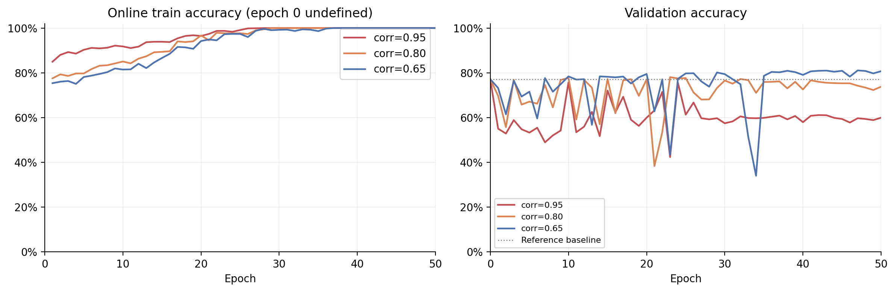
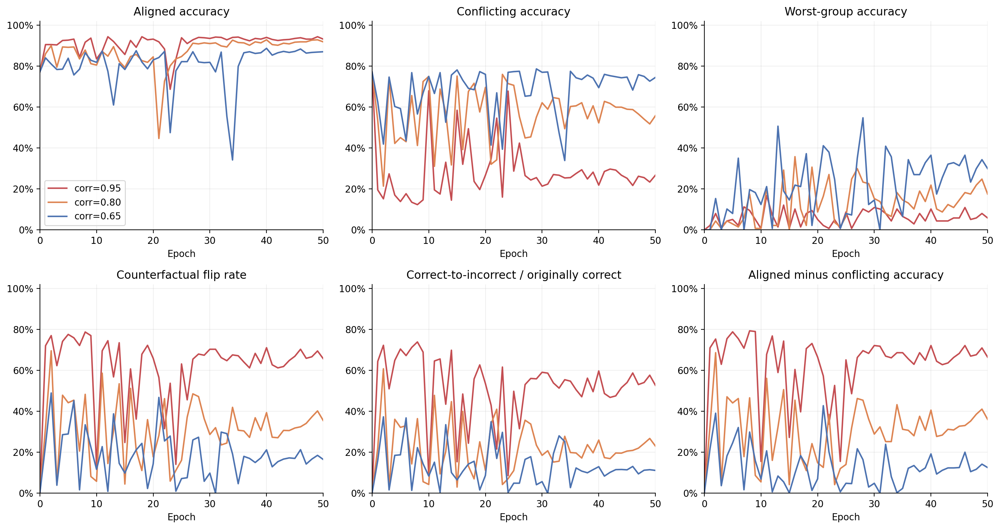
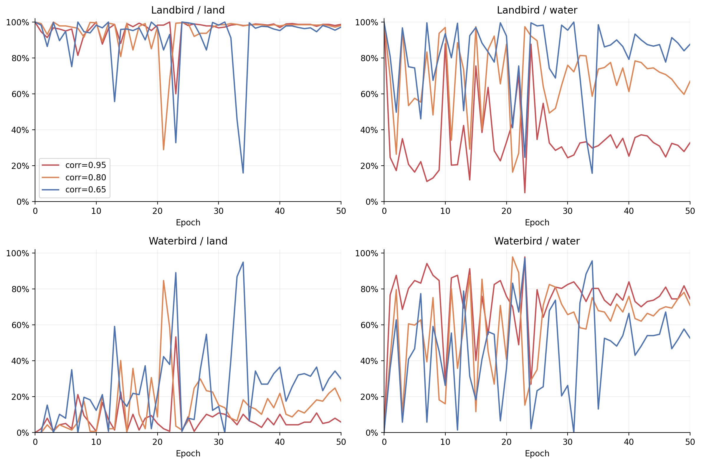
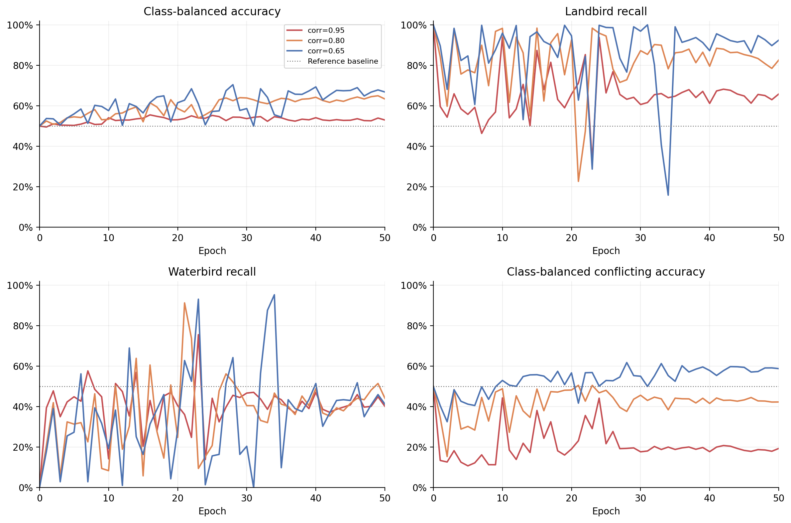
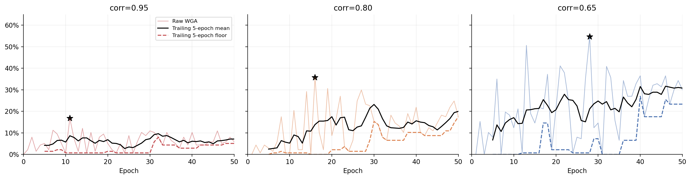

# Waterbirds Condition A 실험 결과 독립 검토

검토일: 2026-11-16

## 검토 범위와 핵심 판단

**Epoch 50의 요청 수치는 모두 기존 데이터와 일치한다. H1은 0.65의 특정 구간에서 제한적으로 부합하지만 일반적인 감소 가설로 확인되지 않았으며, H2의 Core 학습 시점 지연은 직접 입증되지 않았다.**

기존 분석 문서를 요약하는 데 그치지 않고, 다음 자료를 직접 읽어 대조했다.

- [기존 최종 결과 보고서](WATERBIRDS_FINAL_RESULTS_KO.md)
- [상세 분석 README](analysis/README.ko.md)
- [최종 비교표](analysis/final_comparison.ko.md)
- [통합 History](analysis/merged_history.csv): 3조건 × 51 Epoch = 153행
- [공유 원본 지표](shared/source_metrics/): 세 조건의 history.csv, config.json, Epoch별 JSON 총 153개
- [데이터 Manifest 및 감사 자료](shared/dataset/)
- [기존 그래프](analysis/figures/): accuracy, shortcut_metrics, group_accuracy, class_imbalance, wga_stability의 PNG 5개
- 모델·데이터·학습·평가 코드

수치 검토는 기존 CSV·JSON에 대한 읽기 및 CPU 집계 계산으로 수행했다. 기존 파일 수정, 새 학습·모델 평가, Checkpoint·Feature 생성, GPU·SLURM, Git Commit·Push·Pull은 수행하지 않았다. 이 보고서는 검토 후 사용자의 별도 요청에 따라 새 Markdown 파일로 작성했다.

## 1. 실험 설정 요약

| 항목 | 확인 결과 |
|---|---|
| Dataset | Waterbirds Condition A — Background |
| 정답 / Core | 새 종류: Landbird=0, Waterbird=1 |
| Shortcut | 배경 종류: Land=0, Water=1 |
| Correlation 정의 | P(y=place) |
| 모델 | VGG11_BN, pretrained=False |
| 모델 분류기 | AdaptiveAvgPool2d((1,1)) 및 Linear(512,2)로 변경 |
| Train correlation 목표 | 0.95 / 0.80 / 0.65 |
| Validation / Test correlation 목표 | 0.5 / 0.5 |
| Epoch | 0~50; Epoch 0은 학습 전 평가 |
| Optimizer | SGD, lr=0.01, momentum=0.9, weight_decay=0.0001 |
| Scheduler | 설정상 none; 구현의 ConstantLR도 factor=1로 학습률 변화 없음 |
| 공통 설정 | seed=42, batch_size=128, image_size=224×224, AMP=True |
| Augmentation | False |
| 기타 공통 설정 | num_workers=4, cf_chunk_size=128, evaluation_protocol=single_pass_cf_v1 |

세 config.json을 비교했을 때 차이는 **train_corr뿐**이었다. 모델 코드는 [shortcut_experiment.py](../../shortcut_experiment.py)의 build_model을 확인했다. 따라서 정확한 모델 표기는 “VGG11_BN backbone에 1×1 pooling 및 Linear(512,2) 분류기를 적용한 모델”이다.

### 데이터 분할과 조건 간 비교 가능성

| Split | 표본 수 | Landbird / Waterbird | 실제 correlation |
|---|---:|---:|---|
| Train | 4,795 | 3,690 / 1,105 | 0.949948 / 0.800000 / 0.649844 |
| Validation | 1,199 | 925 / 274 | 0.500417 |
| Test | 5,794 | 4,510 / 1,284 | 0.500000 |

목표와 실제 correlation의 작은 차이는 정수 표본 배정 때문이다. 세 Manifest CSV는 각각 11,788행이다. 행별 비교에서 img_id, img_filename, y, split, land_file, water_file, original_split의 조건 간 차이는 0건이었다. Validation/Test에서는 place도 동일했다. 즉, 동일한 새·분할·대응 배경 쌍을 유지하면서 Train의 배경 선택만 바꾼 비교다.

Train의 네 그룹 표본 수는 다음과 같다.

| Train corr | g00 | g01 | g10 | g11 |
|---|---:|---:|---:|---:|
| 0.95 | 3,505 | 185 | 55 | 1,050 |
| 0.80 | 2,952 | 738 | 221 | 884 |
| 0.65 | 2,398 | 1,292 | 387 | 718 |

Correlation 변경에는 불일치 그룹의 학습 표본 증가도 수반된다. 특히 g10 경험은 55→221→387개로 달라진다.

이 데이터는 프로젝트에서 CUB 새·마스크와 Places 배경을 합성한 재구성이다. **공식 Waterbirds composite와 동일한 분할로 간주하면 안 된다.** 콘텐츠 해시 단위 분할을 사용하며, split_audit.json의 최종 cross-split 중복 기록은 0건이다. 다만 공유본에는 원본 이미지가 없어 이미지 바이트를 직접 다시 읽어 누수를 검증한 것은 아니다. 감사 자료의 legacy 중복 기록과 최종 content-v3의 중복 0건은 구분해야 한다.

## 2. 세 Correlation 조건의 최종 성능 비교

### Validation Epoch 50

단위는 %다. 아래 15개 핵심 수치는 요청값 및 기존 문서와 모두 소수 둘째 자리에서 일치한다.

| Train corr | Train Acc | Val Acc | Balanced Acc | WGA | CF Flip | Correct→Incorrect |
|---|---:|---:|---:|---:|---:|---:|
| 0.95 | 100.00 | 59.97 | 52.99 | 5.84 | 65.72 | 52.71 |
| 0.80 | 100.00 | 73.81 | 63.38 | 17.52 | 35.53 | 23.05 |
| 0.65 | 100.00 | 80.73 | 66.84 | 29.93 | 16.51 | 11.16 |

History의 Train Accuracy는 업데이트 중 online accuracy다. Epoch 0에는 학습이 없어 결측이다. 저장된 Epoch 50 JSON의 frozen Train eval-mode Accuracy도 세 조건 모두 100%다.

### 데이터 일관성과 계산식 검증

전체 153행에서 원본 history와 통합 CSV, Validation JSON의 대응 지표를 수치 허용오차 1e-10으로 비교했으며 불일치는 없었다. 빈 값·NaN·JSON null은 결측으로 구분했다. 그룹별 수치로 다음 관계도 확인했다.

- Accuracy = Σ(그룹 표본 수 × 그룹 Accuracy) / 전체 표본 수
- 클래스 Recall = 해당 클래스의 두 그룹 정답 수 합 / 해당 클래스 표본 수
- Balanced Accuracy = (Landbird Recall + Waterbird Recall) / 2
- WGA = min(g00 Accuracy, g01 Accuracy, g10 Accuracy, g11 Accuracy)
- Balanced Conflicting Accuracy = (g01 Accuracy + g10 Accuracy) / 2
- C→I = 원본 정답에서 CF 오답으로 바뀐 수 / 원본 정답 수
- 이진 분류에서 CF Accuracy = Original Accuracy + Flip − 2 × Original Accuracy × C→I

CF 지표의 최종 정수 집계도 다음과 같이 일치한다.

| Corr | 원본 정답 수 | 예측 변경 수 / 1,199 | 정답→오답 수 / 원본 정답 수 |
|---|---:|---:|---:|
| 0.95 | 719 | 788 / 1,199 | 379 / 719 |
| 0.80 | 885 | 426 / 1,199 | 204 / 885 |
| 0.65 | 968 | 198 / 1,199 | 108 / 968 |

### Aligned / Conflicting Accuracy

| Corr | Aligned Acc | Conflicting Acc | 차이, percentage points |
|---|---:|---:|---:|
| 0.95 | 93.17 | 26.71 | 66.46 |
| 0.80 | 91.83 | 55.76 | 36.07 |
| 0.65 | 87.00 | 74.46 | 12.54 |

높은 Train correlation일수록 최종 배경 불일치에 더 취약했다. 다만 raw Conflicting Accuracy에도 클래스 불균형이 반영되므로 그룹 분해와 함께 읽어야 한다.

### 저장된 Epoch 50 Test 결과

| Corr | Test Acc | Balanced Acc | WGA | CF Flip | C→I |
|---|---:|---:|---:|---:|---:|
| 0.95 | 62.08 | 56.70 | 9.50 | 67.19 | 54.60 |
| 0.80 | 76.56 | 66.73 | 26.48 | 33.53 | 22.32 |
| 0.65 | 82.21 | 69.29 | 35.20 | 17.52 | 10.52 |

세 epoch_050.json을 직접 읽고 Test Balanced Accuracy도 그룹 수치에서 계산했다. Validation과 동일한 성능 순서다. 기존 Test 기록 확인이며 새 평가가 아니다.

## 3. Epoch별 학습 동역학에서 발견한 주요 현상

### Epoch 0과 초기 변화

Epoch 0은 세 조건 모두 원본·CF에서 Landbird만 예측한다. Accuracy=77.15%, Balanced Accuracy=50%, WGA=0%, Flip=0%다. 높은 Accuracy와 낮은 Flip이 강건성을 뜻하지 않는 명확한 반례다.

단위 %인 Epoch 1 지표는 다음과 같다.

| Corr | Val Acc | Balanced Acc | WGA | CF Flip | C→I |
|---|---:|---:|---:|---:|---:|
| 0.95 | 55.05 | 49.55 | 2.19 | 72.06 | 64.39 |
| 0.80 | 69.72 | 52.51 | 0.00 | 32.36 | 22.13 |
| 0.65 | 73.23 | 53.75 | 0.00 | 23.69 | 16.06 |

0.95는 첫 학습 직후부터 배경 변경에 매우 민감하다. 0.80·0.65도 초기 WGA가 0이므로, 낮은 Flip만으로 Core 학습 완료를 판단할 수 없다. 초기 곡선은 크게 변동하며 이후 개선도 직선적이지 않다.

### 초기·중기·후기 평균

Epoch 0을 제외하고 E1~10, E11~30, E31~50의 산술평균을 독립적으로 계산했다. 단위 %다. 구간 평균은 각 Epoch의 단조 개선을 뜻하지 않는다.

| Corr | 구간 | Train Acc | Val Acc | Balanced Acc | WGA | CF Flip | C→I |
|---|---|---:|---:|---:|---:|---:|---:|
| 0.95 | 초기 | 89.83 | 56.13 | 51.07 | 4.99 | 68.02 | 61.27 |
| 0.95 | 중기 | 96.74 | 60.97 | 53.93 | 6.33 | 56.89 | 47.20 |
| 0.95 | 후기 | 100.00 | 59.77 | 53.33 | 6.53 | 65.98 | 53.10 |
| 0.80 | 초기 | 81.23 | 69.52 | 53.89 | 3.87 | 32.69 | 24.80 |
| 0.80 | 중기 | 94.28 | 69.42 | 59.11 | 15.64 | 30.20 | 22.81 |
| 0.80 | 후기 | 100.00 | 74.89 | 63.09 | 14.82 | 32.23 | 20.84 |
| 0.65 | 초기 | 78.29 | 71.43 | 55.53 | 11.90 | 24.86 | 17.55 |
| 0.65 | 중기 | 92.47 | 74.31 | 60.36 | 22.32 | 17.53 | 12.64 |
| 0.65 | 후기 | 99.75 | 76.08 | 64.72 | 27.50 | 16.89 | 12.13 |

- **0.95:** 중기에 감소한 Flip·C→I가 후기에 재상승한다. WGA는 전반적으로 낮고 후기 Balanced Accuracy도 중기보다 소폭 낮다. 배경 민감도가 학습 말기까지 남는다.
- **0.80:** Balanced Accuracy와 C→I는 개선되지만 Flip은 약 30~33%에서 정체한다. 후기 WGA 평균은 중기보다 낮다. 정답률 개선과 배경 민감도 감소가 함께 진행되는 패턴은 아니다.
- **0.65:** 초기 대비 후기 WGA·Balanced Accuracy 상승과 Flip·C→I 하락이 함께 나타난다. 다만 중기→후기 Flip 감소는 약 0.64pp에 그치며, E31에는 원본·CF 모두 Landbird만 예측하는 붕괴가 발생한다.

### 순간 최고점과 지속 성능

| Corr | 최고 WGA | 다음 Epoch WGA | 최저 WGA가 가장 높은 5-Epoch 구간 |
|---|---|---:|---|
| 0.95 | 16.79%, E11 | 7.30% | E28~32: 최소 8.03%, 평균 9.64% |
| 0.80 | 35.77%, E16 | 10.22% | E46~50: 최소 17.52%, 평균 20.00% |
| 0.65 | 54.74%, E28 | 12.41% | E36~40: 최소 27.01%, 평균 31.53% |

세 최고점 모두 다음 Epoch까지 유지되지 않았다. 특히 0.65의 E28 최고점을 안정적인 강건성 획득 시점으로 해석할 수 없다.

WGA≥20% 연속 유지 구간을 다시 계산하면 0.65는 E36~40에서 5회, E42~50에서 9회를 유지한다. 0.80의 최장 구간은 E26~29의 4회이고, 0.95는 해당 수준에 도달하지 않는다. WGA≥30%를 5회 연속 유지한 조건은 없다. 이 임계값들은 사후 기술 기준이다.

### 그래프 대조

기존 PNG 5개를 직접 확인했으며, 주요 변화와 본문 해석은 CSV와 일치한다. Train 적합 이후에도 Validation·그룹 성능 차이가 남고, CF 지표의 정체·재상승과 WGA 최고점 직후 하락이 확인된다.

## 4. H1에 대한 판단과 근거

> H1: Epoch가 증가할수록 모델의 Shortcut Feature 의존성이 감소할 것이다.

**판단: 0.65의 특정 구간에서 제한적으로 부합하지만, 세 조건을 포괄하는 일반적인 감소 가설은 확인되지 않았다.**

근거는 단순한 비단조성만이 아니다. 0.95는 중기 이후 Flip과 C→I가 다시 증가하고, 0.80은 Balanced Accuracy 개선에도 Flip이 지속적으로 낮아지지 않는다. 0.65에서는 초기 대비 여러 지표가 함께 개선되지만 중·후기에는 정체와 붕괴가 공존한다.

E1~50의 인접 변화 49번에서 CF Flip이 증가한 횟수는 0.95/0.80/0.65에서 각각 24/26/28번이었다. 어느 조건도 단조 감소가 아니다. 다만 횟수는 변화 크기를 반영하지 않으므로 이것만으로 장기 추세를 판정하지 않는다.

기존 descriptive_trends.csv의 E11~50 Flip–Epoch Spearman 기술 통계는 각각 +0.120/+0.158/−0.005다. 구간 평균 및 전체 곡선과 함께 보면 0.65의 초기 개선을 학습 내내 지속되는 감소로 확대할 근거가 없다. 해당 상관은 독립 seed 반복에 대한 통계 검정이 아니다.

따라서 “더 오래 학습하면 자동으로 Shortcut 의존성이 줄어든다”는 결론은 내릴 수 없다. 관찰된 것은 0.65의 초기 대비 부분적 개선과 조건별 동역학 차이다. 행동 지표에서의 부합을 내부 Feature 의존성에 대한 직접 검증과 구분해야 한다.

## 5. H2에 대한 판단과 근거

> H2: Shortcut과 Core의 Correlation이 강할수록 Core Feature를 학습하는 Epoch 시점이 증가할 것이다.

**판단: 가설 방향과 양립하는 간접 관찰은 있으나 Core 학습 시점 지연은 직접 입증되지 않았다.**

낮은 correlation에서 최종 WGA·Balanced Conflicting Accuracy가 높고 CF Flip·C→I가 낮다. 0.80은 후반에도 Balanced Accuracy가 개선되며, 0.65는 초기부터 상대적으로 높은 성능을 보인다. 그러나 0.95가 같은 개선 경로를 더 늦게 따라오는지는 E50까지 확인되지 않는다. 현재 자료만으로 지연과 낮은 성능 수준을 구분할 수 없다.

기존 사후 행동 기준인 `Balanced Conflicting Accuracy≥50% AND WGA≥20%`를 다시 확인했다.

| Corr | 최초 3-Epoch 연속 충족 | 최초 5-Epoch 연속 충족 | 10-Epoch 연속 충족 |
|---|---|---|---|
| 0.95 | 없음 | 없음 | 없음 |
| 0.80 | 없음 | 없음 | 없음 |
| 0.65 | E16~18 | E36~40 | 없음 |

0.65가 일부 지속 성능 기준에 먼저 도달한다는 근거다. 그러나 이를 Core 학습 시점으로 부를 수는 없다.

- 임계값과 지속 길이는 사후 기술 기준이다.
- E36~40의 5회 연속 충족은 E40까지의 기록으로 확인하는 구간이다. E36에서 내부 표현 획득을 관찰한 것이 아니다.
- 0.80·0.95는 모두 E50까지 미도달이므로 두 조건 사이의 지연 순서나 지연량을 추정할 수 없다.
- WGA≥30%로 강화하면 5-Epoch 지속은 세 조건 모두 미관찰이다.
- 행동 기준 미충족은 내부에 Core 정보가 없다는 뜻이 아니다.

최종 성능 차이를 학습 시점 지연의 증명으로 바꾸어 해석하면 안 된다.

## 6. 클래스 불균형 및 해석상 주의사항

### 최종 클래스·그룹 성능

단위 %다.

| Corr | g00 Landbird/Land | g01 Landbird/Water | g10 Waterbird/Land | g11 Waterbird/Water | Landbird Recall | Waterbird Recall |
|---|---:|---:|---:|---:|---:|---:|
| 0.95 | 98.70 | 32.90 | 5.84 | 74.45 | 65.84 | 40.15 |
| 0.80 | 98.06 | 67.10 | 17.52 | 70.80 | 82.59 | 44.16 |
| 0.65 | 97.19 | 87.66 | 29.93 | 52.55 | 92.43 | 41.24 |

Validation의 Landbird 비율은 925/1,199=77.15%다. Correlation=0.5는 클래스가 50:50이라는 뜻이 아니다. 다수 클래스만 예측해도 Accuracy가 77.15%에 도달한다.

Conflicting 집단도 g01=462, g10=137로 불균형하다. 두 그룹을 동등하게 평균한 최종 성능은 19.37/42.31/58.79%로, raw Conflicting Accuracy 26.71/55.76/74.46%보다 낮다.

0.80→0.65에서 전체 Accuracy는 6.92pp 상승하지만 Waterbird Recall은 44.16→41.24%로 하락한다. g10 개선과 g11 악화가 공존하므로 모든 클래스·그룹의 일괄 개선은 아니다. 클래스 비율은 조건 간 같으므로 성능 차이 자체를 클래스 비율 차이로 설명할 수도 없다.

### WGA와 Counterfactual 지표의 의미

- 최종 WGA는 모두 g10이며 정답 수는 8/137, 24/137, 41/137이다. WGA는 취약 그룹 성능이고 Shortcut 사용의 직접 측정은 아니다.
- g10에서 한 표본은 약 0.73pp다. 작은 변화를 과대 해석하면 안 되지만, 큰 변동의 원인을 단순한 sampling noise로 확정할 근거도 없다.
- CF 구현은 동일한 새·마스크를 유지하고 해당 표본에 지정된 반대 종류 배경으로 바꾼다. Flip은 이 배경 개입에 대한 예측 민감도이며 내부 Core 표현의 직접 측정은 아니다.
- 모든 이미지를 한 클래스로 예측하면 Flip=0이다. Epoch 0과 0.65의 E31이 실제 반례다.
- Flip에는 정답→오답과 오답→정답이 모두 포함된다. 0.95·0.80의 CF Accuracy는 원본보다 각각 2.50/1.50pp 높지만, 원본 정답의 52.71/23.05%를 잃는다. CF Accuracy 상승을 배경 비의존성으로 해석하면 안 된다.
- C→I의 분모는 조건별 원본 정답 수로 다르다. 전체 표본 기준 정답 손실은 각각 31.61/17.01/9.01%다.
- 클래스별 CF 전이 집계가 없어 class-balanced Flip/C→I는 현재 집계 기록에서 복원할 수 없다. 전체 표본 기준 손실도 클래스 불균형을 제거한 값은 아니다.
- Train online Accuracy와 Validation eval-mode Accuracy는 계산 방식이 다르다.
- 단일 seed42, 한 모델, 50-Epoch 관찰이다. Epoch들을 독립 반복 실험으로 취급하거나 모델·seed 전반의 법칙으로 일반화할 수 없다. 붕괴의 원인도 현재 기록으로 확정할 수 없다.

## 7. 기존 최종 분석 문서에서 수정하거나 보완할 부분

**검토한 핵심 표·구간 평균·최고점·지속 구간에서 수치 오류는 발견하지 못했다. 그래프의 주요 변화와 본문 해석도 일치한다.** 클래스 불균형, 낮은 Flip의 퇴화 사례, WGA의 한계, H2 판단 유보는 기존 문서에 적절히 반영되어 있다.

필수적인 결론 수정보다 다음 명확화가 유용하다. 기존 파일에는 변경을 적용하지 않았다.

| 문서 위치 | 보완 사항 | 근거 및 적절한 표현 |
|---|---|---|
| WATERBIRDS_FINAL_RESULTS_KO.md §2 모델 설정, 23행 부근 | VGG11_BN 구조 변경 명시 | shortcut_experiment.py 62~63행에서 pooling과 classifier를 교체한다. “VGG11_BN backbone, 1×1 pooling 및 Linear(512,2) 분류기”로 구체화 |
| WATERBIRDS_FINAL_RESULTS_KO.md §2 데이터 설명, 31행 부근 | 공식 Waterbirds와의 구분을 본문에도 명시 | SHARING.ko.md 32행에는 이미 명시되어 있다. 최종 보고서에도 프로젝트 합성 재구성임을 명시 |
| analysis/README.ko.md §1 완료 검증, 9행 부근 | 서버 당시 검증과 현재 공유본 검증을 문장 앞에서 구분 | Checkpoint·Feature 51개 확인은 기존 서버 기록이다. 현재 공유본에 실물이 존재하거나 이번에 무결성을 재검증했다는 뜻으로 읽히지 않게 보완 |
| WATERBIRDS_FINAL_RESULTS_KO.md §5 H1, 142행 이후 | 부분 지지의 범위를 특정 구간의 관찰로 한정 | 0.65 초기→후기 개선은 확인되지만 내부 Feature 의존성 직접 검증이나 통계적 가설 지지는 아님 |
| WATERBIRDS_FINAL_RESULTS_KO.md §5 H2, 156행 부근 | 지속 구간 시작과 확인 시점 구분 | “E36~40에서 5회 연속 충족, E40까지의 기록으로 확인”이라고 표현하면 E36을 Core 획득 시점으로 오독할 가능성이 줄어듦 |

최종 보고서가 이미 E36을 Core 학습 시작 시점으로 명명할 수 없다고 명시한 점은 타당하다. analysis/final_comparison.ko.md의 핵심 수치는 수정할 필요가 없다.

검토 과정에서 상세 README 중간 표의 누락 가능성을 잠시 의심했지만, 해당 줄을 재확인한 결과 §4와 전체 구간 표가 정상적으로 존재했다. 문서 누락으로 보고할 사항은 아니다.

### 확인할 수 없는 범위

요청한 분석용 Markdown·CSV·설정·Epoch JSON·그림은 존재한다. history는 shared/source_metrics의 경량 복사본에서 확인했다. 기존 문서의 runs/... 표기는 서버 원본 출처이며 현재 공유본 경로와 구분해야 한다.

원본 이미지·Checkpoint·Feature 실물은 공유 대상에서 제외되어 있어 모델 재실행에 의한 성능 재현, 실제 텐서 내용 및 실물 Checkpoint 무결성은 이번 검토에서 확인하지 않았다. JSON의 원본 실행 SHA는 경로 정규화된 공개 JSON 자체의 SHA와 구분해야 한다. 자세한 공유 정책은 [SHARING.ko.md](SHARING.ko.md)에 명시되어 있다.

## 8. 팀원들에게 공유할 핵심 결론

1. **낮은 Train correlation에서 최종 일반화 성능과 취약 그룹 성능이 높고 배경 변경 민감도가 낮았다.** Validation과 저장된 Test 결과에서 같은 순서를 확인했다.
2. **학습 시간을 늘리는 것만으로 Shortcut 의존성이 해소되지는 않았다.** 0.95는 중기 이후 민감도가 재상승했고, 0.80은 성능 개선에도 Flip이 정체했다.
3. **0.65는 상대적으로 나았지만 완전한 강건성을 얻지는 못했다.** 일시적 최고점, E31 붕괴, 낮은 Waterbird Recall이 남아 있다. 모든 그룹이 함께 개선된 것도 아니다.
4. **H1은 특정 조건·구간에서 제한적으로 부합하고, H2의 시점 판단은 유보해야 한다.** 최종 성능 차이와 Core 획득 시점의 지연은 서로 다른 주장이다.
5. **이번 결과의 가장 강한 근거는 동일한 원본·분할·학습 설정에서 Train correlation에 따라 최종 성능과 배경 민감도가 크게 달라졌다는 관찰이다.** 이 사실은 CSV·JSON에서 직접 확인되며, 내부 Feature 획득 시점이나 변동의 원인까지 확정하지 않는다.
