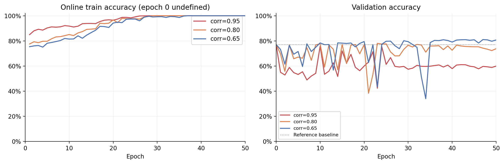
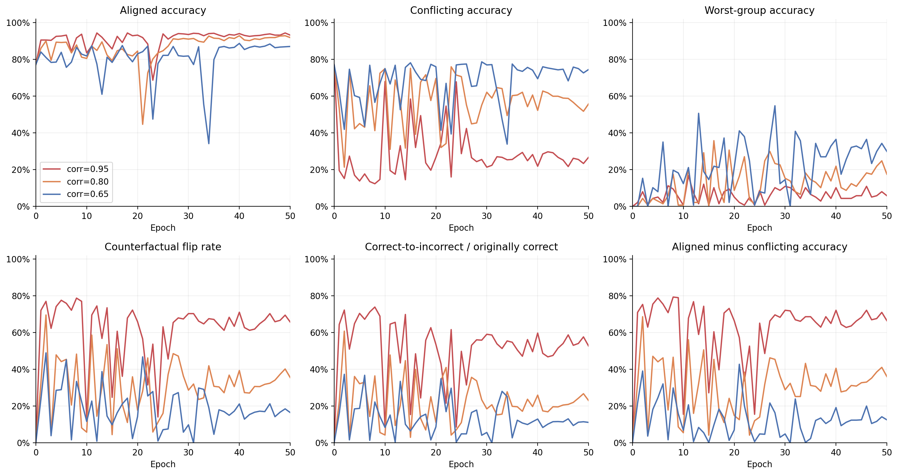
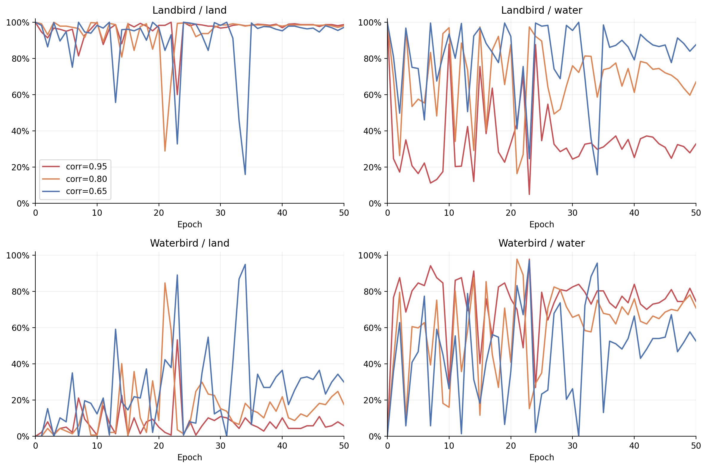
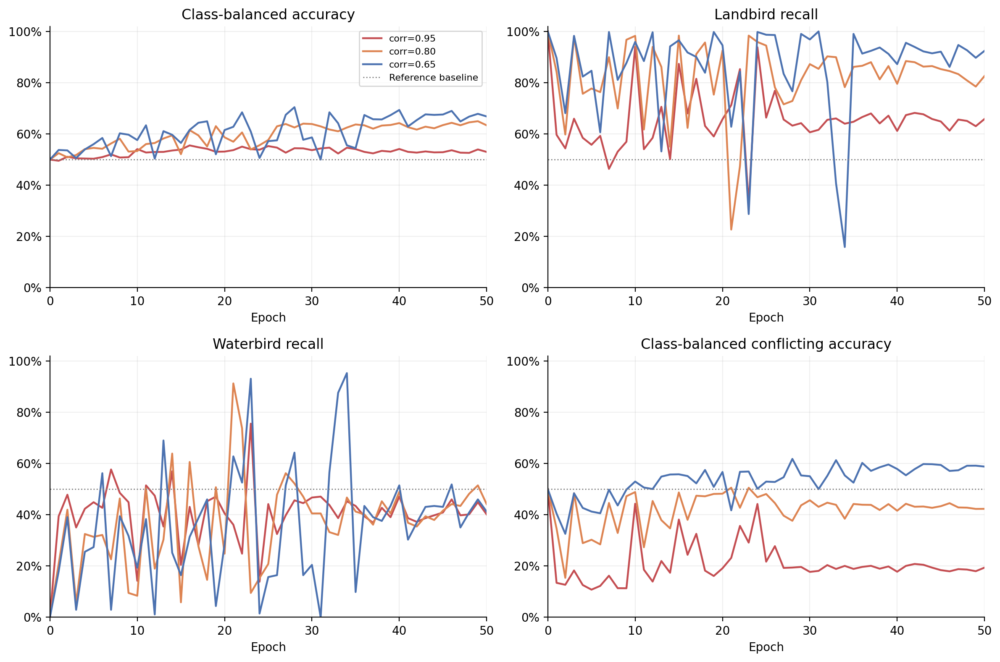
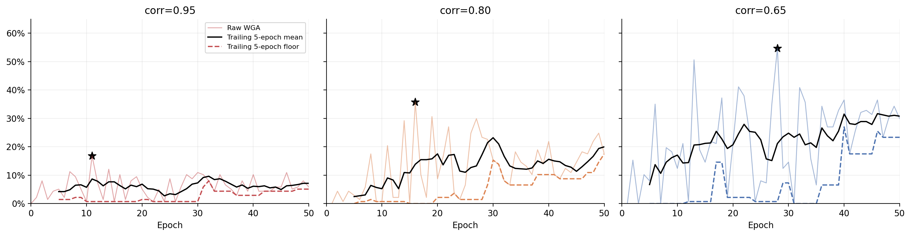

# Waterbirds Condition A 학습 Dynamics 분석

## 핵심 결과

낮은 train correlation에서 최종 배경 민감도가 작고 WGA가 높다. 그러나 세 run 모두 train accuracy100%인 반면 validation의 소수 클래스·conflicting group은 취약하다. **H1의 보편적/단조로운 Shortcut 의존성 감소는 지지되지 않으며, A065에서 부분적 개선 근거가 있다. H2는 낮은 correlation의 지속 성능 우위라는 간접 근거는 있으나 Core 학습 시점 지연 자체는 확인하지 못했다.**

## 1. 완료 및 입력 검증

세 run 모두 checkpoint51개·Feature51개(정확한 epoch000~050 이름), 비어 있지 않은 파일, history.csv52줄(헤더1+데이터51), epoch sequence0~50, TRAIN_SUCCESS가 존재한다. completion_integrity의 verified=true/51개 기록, checkpoint sidecar의 size/path/manifest SHA와 epoch JSON 연결도 확인했다. `run_verification.csv` 참조.

Checkpoint/Feature의 텐서는 열지 않았고 큰 binary SHA를 다시 읽지 않았다. 이 분석의 검증은 파일/이름/크기/기존 무결성 기록 연결이며 새로운 전체 checkpoint 무결성 계산과 구분한다. 원본 run633개 파일의 size/mtime, 입력 CSV/JSON SHA256 전후 비교에서 변경은0개다(`source_preservation.json`). 기존 가중치·Feature·학습 로그를 수정하거나 삭제하지 않았다.

주 분석은 각 history.csv뿐이다. 3조건×51epoch=153행을 `merged_history.csv`에 통합했다. 추가 입력은 기존 config/sidecar/completion/epoch JSON으로, CSV 일관성 확인 및 **epoch50 test 보조 표**에만 사용했다. 새로운 추론·probe·Grad-CAM·GPU·SLURM 제출은 수행하지 않았다. 분석 전용 수학/연속 구간 CPU 테스트2개와 Python 문법 검사도 통과했다(`tests_analysis.txt`).

## 2. 지표 정의와 해석 범위

- Train Acc는 SGD 업데이트 중 online accuracy이다. epoch0에는 업데이트가 없어 NaN이며 값으로 채우지 않았다. Val은 해당 checkpoint의 eval mode accuracy이다.
- aligned는 y=s, conflicting은 y≠s. WGA는 g00/g01/g10/g11 중 최소이다.
- CF flip은 동일 새·마스크에서 배경만 반대로 교체했을 때 예측이 바뀐 전체 비율이다.
- C→I는 **원본 정답→CF 오답 수 / 원본 정답 수**다. 조건마다 분모가 달라 unconditional harm=C→I×original accuracy도 별도로 제공했다.
- Weighted accuracy를 그룹 n/accuracy로 재구성하고 WGA=min(group), original-correct denominator 및 binary CF flip/accuracy 관계를 전153행에서 검증했다.
- val/test target correlation=.50, seed42 하나이며 같은 원본을 조건 사이에서 paired comparison한다. .50은 label 자체의50:50 균형을 뜻하지 않는다.

## 3. Epoch50 성능

다음 표의 단위는 %다.

| Train corr | Train Acc | Val Acc | Balanced Acc | WGA | CF flip | C→I |
| --- | --- | --- | --- | --- | --- | --- |
| 0.95 | 100.00 | 59.97 | 52.99 | 5.84 | 65.72 | 52.71 |
| 0.80 | 100.00 | 73.81 | 63.38 | 17.52 | 35.53 | 23.05 |
| 0.65 | 100.00 | 80.73 | 66.84 | 29.93 | 16.51 | 11.16 |

correlation .95→.65에서 Val Acc는59.97→80.73, WGA는5.84→29.93, CF flip은65.72→16.51이다. C→I도52.71→11.16으로 낮아진다. source·모델·seed를 공유하는 이 세 run에서는 낮은 train correlation의 결과가 더 좋지만 seed 반복에 대한 신뢰구간/유의성은 계산하지 않았다.

최종 aligned/conflicting accuracy는 각각 .95=93.17/26.71, .80=91.83/55.76, .65=87.00/74.46이다. gap은66.46/36.07/12.54 percentage points다. 높은 correlation에서 배경 일치 예측에 유리하고 반대 배경에 특히 약한 패턴이다. 다만 CF와 행동 지표는 feature 사용의 직접 측정이 아니다.

C→I unconditional harm은31.61/17.01/9.01%다. A095/A080은 CF accuracy가 원본보다각2.50/1.50pp 높아 CF accuracy drop이 음수이지만, flip과 정답 손실이 동시에 크다. **CF accuracy drop≤0을 Shortcut 비의존의 근거로 삼으면 안 된다.**

### 기존 epoch50 test 기록

| corr | Test Acc | Balanced Acc | WGA | CF flip | C→I |
| --- | --- | --- | --- | --- | --- |
| 0.95 | 62.08 | 56.70 | 9.50 | 67.19 | 54.60 |
| 0.80 | 76.56 | 66.73 | 26.48 | 33.53 | 22.32 |
| 0.65 | 82.21 | 69.29 | 35.20 | 17.52 | 10.52 |

이는 저장된 JSON을 읽은 결과로 새 평가가 아니다. 낮은 correlation의 성능 순서가 test에서도 유지된다. 이후 epoch 선택/threshold tuning에는 test 값을 사용하지 않았다. 매epoch test가 이미 학습 과정에서 기록된 실험이므로 향후 test 결과로 분석 규칙을 반복 조정하면 held-out 해석이 약해진다.

## 4. 초기·중기·후기 변화

epoch0은 학습 전 기준점으로 별도 취급한다. 초기1–10, 중기11–30, 후기31–50의 epoch별 산술평균이다. phase 길이는 다르며 표의 표준편차는 반복 실험 불확실성이 아니다.

| corr | Epoch | Val Acc | Balanced Acc | WGA | CF flip | C→I | Balanced conflict |
| --- | --- | --- | --- | --- | --- | --- | --- |
| 095 | 1–10 | 56.13 | 51.07 | 4.99 | 68.02 | 61.27 | 16.32 |
| 095 | 11–30 | 60.97 | 53.93 | 6.33 | 56.89 | 47.20 | 23.89 |
| 095 | 31–50 | 59.77 | 53.33 | 6.53 | 65.98 | 53.10 | 19.21 |
| 080 | 1–10 | 69.52 | 53.89 | 3.87 | 32.69 | 24.80 | 35.96 |
| 080 | 11–30 | 69.42 | 59.11 | 15.64 | 30.20 | 22.81 | 43.64 |
| 080 | 31–50 | 74.89 | 63.09 | 14.82 | 32.23 | 20.84 | 43.05 |
| 065 | 1–10 | 71.43 | 55.53 | 11.90 | 24.86 | 17.55 | 44.21 |
| 065 | 11–30 | 74.31 | 60.36 | 22.32 | 17.53 | 12.64 | 53.87 |
| 065 | 31–50 | 76.08 | 64.72 | 27.50 | 16.89 | 12.13 | 57.56 |

- A095: 중기에 CF flip56.89%까지 낮아졌다가 후기에65.98%로 다시 커진다. balanced conflict도23.89→19.21%로 나빠진다. 학습 말기에 일관된 Shortcut 감소가 관찰되지 않는다.
- A080: balanced accuracy는53.89→59.11→63.09%로 개선되지만 CF flip은32.69→30.20→32.23%로 거의 평탄하다. C→I는24.80→22.81→20.84%로 완만히 줄어든다. 더 잘 맞히는 것과 배경 민감도 감소를 동일시하면 안 된다.
- A065: CF flip24.86→17.53→16.89%, C→I17.55→12.64→12.13%, balanced conflict44.21→53.87→57.56%다. 세 조건 중 여러 지표가 함께 개선되는 근거가 가장 강하지만 아래 collapse와 불안정성도 존재한다.

### 낮은 flip의 퇴화 사례

세 조건의 epoch0은 val의925개 Landbird를 모두 맞히고274개 Waterbird를 모두 틀린다. accuracy=77.1476%, balanced accuracy50%, WGA0, CF flip0이다. 평가 원본과 CF에서 모두 Landbird를 예측하는 결과라서 Core 학습의 증거가 아니다.

**A065 epoch31에서도 정확히 같은 결과가 발생했다.** 따라서 초기에/특정 epoch에 flip이나 C→I가 낮다는 이유만으로 background shortcut을 극복했다고 판단하지 않는다. `degenerate_epoch_flags.csv`에 이 시점들을 기록했다.

## 5. WGA 순간 최고점과 지속 성능

| corr | 최고 WGA (epoch) | 바로 다음 epoch WGA | epoch50 | 후기41–50 평균±epoch SD |
|---|---|---:|---:|---:|
| .95 |16.79% (11)|7.30%|5.84%|6.06±1.93%|
| .80 |35.77% (16)|10.22%|17.52%|15.69±4.97%|
| .65 |54.74% (28)|12.41%|29.93%|29.34±5.39%|

A065 epoch13의50.65%도 다음 epoch18.98%로 하락한다. 최고점만 골라 강건성 획득 시점으로 부르면 오해한다. 이는 새로운 checkpoint 선택 규칙이 아니라 사후 기술 통계다.

지속 성능은 raw WGA의 연속 구간과 rolling mean/**rolling minimum**을 함께 보았다. 사후 설명 규칙으로3/5/10epoch와 threshold20/30/40/50%를 모두 제공해 특정 window만 선택하지 않았다.

| corr | 가장 높은5epoch floor 구간 | 구간 최소 WGA | 평균 |
|---|---|---:|---:|
| .95 |28–32|8.03%|9.64%|
| .80 |46–50|17.52%|20.00%|
| .65 |36–40|27.01%|31.53%|

A065는 WGA≥20%가36–40(5회),42–50(9회) 유지된다. A080의 최장 구간은26–29(4회)이며 A095는20%에 도달하지 못한다. 반면 WGA≥30%를5epoch 유지한 조건은 없고, A065의 ≥50%는13/28의 단일 peak뿐이다. A065가 상대적으로 개선되었어도 모든 그룹이 chance 이상인 상태가 지속됐다고 할 수 없다.

`wga_peaks.csv`, `wga_rolling_windows.csv`, `wga_threshold_runs.csv`, `transient_wga_spikes.csv` 참조. 자동 spike 규칙은 previous3 median 및 next3 mean보다각10pp 높은 단일점을 표시하며 통계적 change-point 검정이 아니다.

## 6. H1/H2 현재 근거

### H1: 학습 진행에 따른 Shortcut 의존성 감소

**조건부·부분 지지이며 보편적 감소로 결론 내릴 수 없다.** A065의 phase 평균은 감소하고 balanced conflict/WGA도 좋아진다. A080은 C→I 개선이 있으나 flip은 정체되어 있고 A095는 중기 이후 재악화한다. epoch0과A065 epoch31의 낮은 flip은 다수 클래스 collapse여서 강건한 Core 학습과 구분해야 한다.

11–50epoch의 flip–epoch Spearman은 .95=+.120, .80=+.158, .65=−.005로 어느 조건에서도 지속적인 음의 순위 추세가 뚜렷하지 않다. 반면 A065 balanced conflict–epoch 순위 상관은+.627이다. 이러한 값은 시간점이 독립적이지 않은 기술 통계이며 p-value/seed 통계가 아니다. Core 정보를 학습했다가 background 정보로 대체했는지 등 representation 기전은 아직 평가할 수 없다.

### H2: 높은 Correlation이 Core 학습 시점을 지연

최종 WGA·balanced conflict·flip의 조건 간 순서는 이 가설의 방향과 양립한다. 하지만 **최종 성능 차이만으로 학습 시점 지연을 입증하지는 못한다.**

시간 proxy로 `balanced conflicting accuracy≥50% AND WGA≥20%`를3/5/10epoch 유지하는 구간을 사후 기술했다. A065는3epoch 기준16–18,5epoch 기준36–40에서 관찰되며, A080/A095는50epoch까지 관찰되지 않는다. 그러나10epoch 기준은A065도 충족하지 못하고, WGA≥30%로 강화하면5epoch 기준은모두 미관찰이다.

따라서 A065가 일부 지속 성능 기준에 먼저 도달한다는 **간접 근거**는 있다. A080과A095는 이 기준에서 둘 다 관찰 기간 내 미도달이므로 두 조건 사이의 지연량을 정량 추정할 수 없다. 미도달은 hidden Core 정보가 전혀 없다는 뜻도 아니다. 임계값은 사전 등록 기준이 아니며이를 `Core 학습 epoch=36`으로 명명하지 않는다. 단일 seed·한 모델·세 조건이어서 재현성 검증이 필요하다.

## 7. 클래스 불균형을 분리한 해석

Val은 Landbird925/1199=77.15%, Waterbird274/1199=22.85%이며 동일 클래스 안에서는 배경이 약50:50이다. conflicting 집단에서도 g01=462, g10=137로 majority class가 약77.13%를 차지한다. 따라서 raw conflicting accuracy가 높아도 minority conflicting group을 잘 맞혔다고 할 수 없다.

| corr | Landbird recall | Waterbird recall | g00 | g01 | g10 | g11 | Balanced conflict |
| --- | --- | --- | --- | --- | --- | --- | --- |
| 0.95 | 65.84 | 40.15 | 98.70 | 32.90 | 5.84 | 74.45 | 19.37 |
| 0.80 | 82.59 | 44.16 | 98.06 | 67.10 | 17.52 | 70.80 | 42.31 |
| 0.65 | 92.43 | 41.24 | 97.19 | 87.66 | 29.93 | 52.55 | 58.79 |

최종 WGA는 모두 **g10(Waterbird/land)** 이며 정답 수는 8/137,24/137,41/137이다. Val minority 그룹1표본은 약0.73pp여서 WGA의 작은 변화를 과대 해석하지 않는다. 점프 전체를 sampling noise로 단정할 근거도 없다. 같은137개를 매epoch 반복 사용하므로 epoch 간 SD를독립 표본 신뢰구간으로 만들지 않았다.

A080→A065에서 전체 accuracy는73.81→80.73%로 증가하지만 Waterbird recall은44.16→41.24%로 오히려 낮다. g10은 좋아지고 g11은 나빠진다. 따라서 A065의 전반적 우위가 모든 클래스에서 단조롭게 나타난다고 해석하지 않는다. 두 클래스 균형 accuracy 개선은63.38→66.84%로 raw accuracy 개선보다 작다.

클래스 균형 conflicting accuracy는19.37/42.31/58.79%로 raw26.71/55.76/74.46%보다 낮다. class prior는세 조건에서같아 조건 차이를그 자체만으로설명하지 않지만, Shortcut 이용과 결합해 전체 accuracy를 크게 왜곡한다. train의 g10 표본은55/221/387로차이가있어 높은 correlation의 희소 conflicting-group 경험도 함께 해석해야 한다.

기록에는 클래스별 CF flip/C→I count가 없어 **class-balanced CF 지표는 현재 CSV에서 복원할 수 없다**. 조건부 C→I의 분모도변하므로 unconditional harm을보조로제시했으며, 이조차 클래스 불균형이 제거된 값은아니다.

## 8. 추가 검증 우선순위

1. **기존 Feature의 CPU probe:** 각 epoch/layer에서 core=y와 shortcut=place를 별도 binary probe로 평가한다. 저장 NPZ의 labels/indices/그룹 균형을 먼저 확인하고 source-content 단위로 disjoint fit/score 분할을 고정해야 한다. 같은128개로 fit과 평가를 동시에 하지 않는다. 동일 분할·seed·regularization을 조건과 epoch 간 유지하고 chance50%를 함께 보고한다. 작은 val Feature subset의 variance를 명시하며, Core decodability와 실제 classifier의 이용을 동일시하지 않는다.
2. **클래스별 paired 예측:** factual/CF 예측·정답·y/s·원본ID를 기록해 class-balanced flip/C→I와 minority 그룹의 손실·회복을 분해한다. 기존 CSV로는 복원할 수 없어 이번에는 새 inference를 하지 않았다.
3. **Grad-CAM:** 동일 bird IDs를 네 그룹에서 고정하고 정답 target class와 동일 layer(features.18)로 조건·epoch를 비교한다. 고정 grid 외에13/28의 peak,14/29의 하락,31의 collapse는 secondary event로 구분한다. mask 안팎 CAM mass·면적 보정·zero heatmap·resize·mask edge 처리를 명시한다. CAM만으로 인과적 feature 사용을 단정하지 않는다.
4. **Seed 반복과 paired uncertainty:** seed42 단일 곡선을 모집단 결론으로 확장하지 않는다. raw paired predictions가 있어야 bird/content 단위 paired bootstrap을 할 수 있다. 여러 epoch/threshold 탐색을 반영해야 하며, 현재 집계 CSV로 epoch-iid p-value를 만들지 않는다.
5. **학습/평가 상태 진단:** peak/붕괴가 class prediction bias·calibration·BN running stats·optimizer dynamics 등과 어떻게 연결되는지 추가 기록으로 검토한다. 현재 CSV만으로 특정 메커니즘이 원인이라고 단정하지 않는다. Val loss와 Train loss의 격차도 함께 본다.

추가 probe/CAM은 검토 항목이며 이번 요청에서 실행하지 않았다. 새로운 조건·클래스 가중치·데이터 재생성도 적용하지 않았다.

## 9. 그래프와 산출물











그래프는 raw epoch 곡선을 보존하며 WGA 그림에만 trailing5 평균/최소를 추가했다. PNG200dpi와 SVG를 모두 저장했다. gap은 percentage points로 해석한다.

- `merged_history.csv`:153개epoch행과class-balanced 파생지표.
- `final_comparison.csv`, `final_comparison.ko.md`:epoch50비교.
- `final_test_from_existing_logs.csv`:기존epoch50test보조값.
- `phase_summary.csv`, `descriptive_trends.csv`:phase평균/중앙값/범위/SD와기술적추세.
- `wga_*.csv`, `core_proxy_thresholds.csv`, `transient_wga_spikes.csv`, `degenerate_epoch_flags.csv`:지속/peak/proxy 세부결과.
- `run_verification.csv`, `provenance.json`, `source_preservation.json`:완료검사/입력SHA/보존근거.

전체 원본의 완료 검사는 `scripts/waterbirds_vgg50/analyze_history.py`가 수행한다. GitHub에는 큰 Checkpoint/Feature가 없으므로 [공유 안내](../SHARING.ko.md)의 CSV 전용 경로를 사용한다. 원본 완료 검사는 기존 기록이며 공개본 검사와 구분한다.

```bash
PYTHONDONTWRITEBYTECODE=1 CUDA_VISIBLE_DEVICES='' MPLCONFIGDIR=/tmp/waterbirds-analysis-mpl \
python3 scripts/waterbirds_vgg50/reproduce_shared.py --output /tmp/waterbirds-analysis-rerun
```

기존 output은 덮어쓰지 않는다. 공유 JSON의 경로 정규화와 null 변환, 원본/공개본 해시는 [공유 안내](../SHARING.ko.md)를 따른다.
