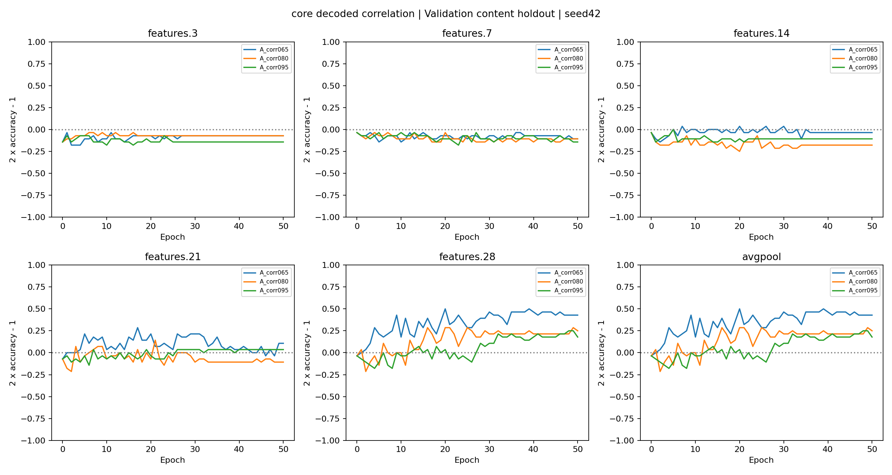
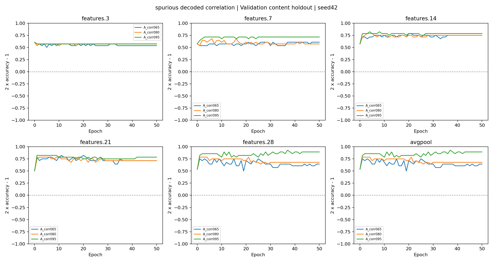
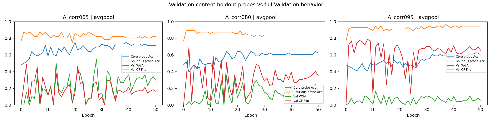
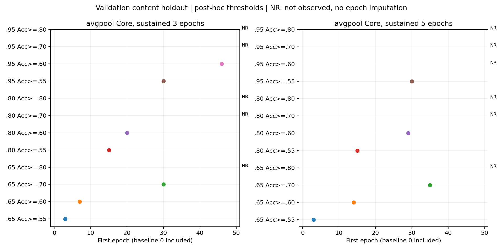

# Waterbirds 후속 분석: Decoded Correlation과 H1/H2

## 1. 범위와 현재 완료 상태

기존 Condition A, VGG11_BN(pretrained=False), train corr .95/.80/.65, seed42, Epoch0~50, val/test 목표 corr .50을 유지했다. 기존 VGG 학습·Accuracy/CF 계산은 재실행하지 않았다. 원본 Checkpoint/Feature는 수정하지 않았다.

**완료:** 저장 Feature153개에 대한 CPU Probe 1836개(3조건×51Epoch×6Layer×2Target), 행동 지표 통합, 민감도 분석·그래프. **미완료:** 실제 Grad-CAM, 독립 Test Feature 추출 및 val-fit/test-score Probe. 현재 노드 `moana-r5`에는 원본 이미지가 없어 GPU/SLURM 제출 없이 실행 준비만 했다. 따라서 이 문서는 Grad-CAM까지 통합한 최종 재검증이 아닌 현재 확보 결과의 보고다.

기존 최종 보고서는 읽기만 했다. 요청된 `WATERBIRDS_INDEPENDENT_REVIEW_KO.md`는 현재 작업 공간에서 발견하지 못해 그 문서의 논평을 감사했다고 주장하지 않는다.

## 2. 기존 산출물 감사와 재사용

- 세 조건의 Checkpoint/Feature는 각각51개다. Feature는 Validation의 고정128개, 4그룹별32개이며 labels=새 종류, spurious=배경, indices=CUB img_id다.
- 6Layer는 features.3/.7/.14/.21/.28, avgpool; GAP FP32 차원64/128/256/512/512/512다. 모든 Epoch·조건에서 ID/label/배경/layer 일치, 유한값, 입력 Manifest/CSV SHA를 검사했다.
- Feature SHA 전후 동일. Checkpoint는 존재·sidecar 크기 검증이며 큰 바이너리 SHA를 이번 CPU 단계에서 전부 다시 계산하지 않았다. 추후 GPU worker는 사용하는 Checkpoint SHA를 검사한다.
- Epoch JSON153개 모두 frozen eval-mode Train/Val/Test를 담는다(`behavior_all_splits.csv`, 459행). 원본 history의 Train은 online 값이며 통합 CSV의 `train_acc`와 frozen Train을 혼용하지 않는다. 전체 Test 기록은 존재하지만 표현 전환 임계값 선택에 사용하지 않았다.
- 입력 SHA·검증 범위는 `input_integrity.json`, `validation_results.json`에 기록했다.

## 3. Probe 프로토콜과 해석

기존 `evaluate.DecodedCorrelation`의 **Linear(D,2), AdamW,100epochs,batch256,lr=.001,wd=.0001,seed42**를 재사용했다. VGG와 분리된 작은 선형 분류기만 CPU에서 학습했다. Feature 표준화는 기존 구현처럼 하지 않았다. avgpool을 모든 조건의 주 분석 Layer로 고정하고 나머지5개를 보조 분석으로 모두 제시했다. 성능이 높은 Layer를 골라 결론 내리지 않았다.

원래 `run.py analyze`는 val-fit/test-score지만 Test Feature가 저장돼 있지 않다. 이번에는 **Validation 내부 content holdout**으로 변경했다. 동일 새/land/water 이미지의 원본 encoded-content SHA를 연결한 component 단위로 seed42 분할 후 각 부분을 4그룹 균형으로 downsample했다. fit=56,score=56, 각14/group; 나머지16개는 균형을 위해 제외했다. 분할은 `probe_split.csv`이며 모든 조건/시간/Layer/Target에 동일하다. fit/score 간 새·두 배경 콘텐츠가 겹치지 않는다. Label은 그룹 균형화에만 사용하고 Feature 입력에 붙이지 않았다. 평가 성능으로 split을 검색하지 않았다.

**기존 val→test 결과 또는 Colored MNIST Probe와 같은 프로토콜로 직접 비교하면 안 된다.** 작은 score56개, 단일 분할·Probe seed, validation 재사용의 탐색 분석이다. 그룹 균형이므로 Core/Spurious 모두 Accuracy와 Balanced Accuracy가 같지만 두 값을 별도 저장했다.

Decoded Correlation=2×Accuracy−1은 이진 정답 일치의 signed score다. Pearson 상관이나 인과적 의존도는 아니다. chance=.5는 decoded=0, decoded의 표본 해상도는2/56≈.0357이다. 높은 Core Decodability는 classifier의 Core 사용을 입증하지 않고, 낮은 값도 모든 비선형 정보의 부재를 입증하지 않는다. 고정100epochs 및 Feature scale에 따른 Probe 최적화 한계도 있다.

## 4. 실제 Decoded 결과

### Epoch50 avgpool

| condition | target | accuracy | balanced_accuracy | decoded_correlation |
| --- | --- | --- | --- | --- |
| A_corr095 | core | 0.5893 | 0.5893 | 0.1786 |
| A_corr095 | spurious | 0.9464 | 0.9464 | 0.8929 |
| A_corr080 | core | 0.6250 | 0.6250 | 0.2500 |
| A_corr080 | spurious | 0.8393 | 0.8393 | 0.6786 |
| A_corr065 | core | 0.7143 | 0.7143 | 0.4286 |
| A_corr065 | spurious | 0.8214 | 0.8214 | 0.6429 |

출처: `probe_summary.csv`; 비율 단위(0~1), decoded는−1~1. 전체6Layer와Epoch0~50은 아래 그래프에 표시했다.

### 초기·중기·후기 평균(avgpool)

| condition | target | phase | probe_acc | decoded | wga | cf_flip | c2i |
| --- | --- | --- | --- | --- | --- | --- | --- |
| A_corr065 | core | early | 0.5946 | 0.1893 | 0.1190 | 0.2486 | 0.1755 |
| A_corr065 | core | middle | 0.6705 | 0.3411 | 0.2232 | 0.1753 | 0.1264 |
| A_corr065 | core | late | 0.7205 | 0.4411 | 0.2750 | 0.1689 | 0.1213 |
| A_corr065 | spurious | early | 0.8536 | 0.7071 | 0.1190 | 0.2486 | 0.1755 |
| A_corr065 | spurious | middle | 0.8313 | 0.6625 | 0.2232 | 0.1753 | 0.1264 |
| A_corr065 | spurious | late | 0.8089 | 0.6179 | 0.2750 | 0.1689 | 0.1213 |
| A_corr080 | core | early | 0.4804 | -0.0393 | 0.0387 | 0.3269 | 0.2480 |
| A_corr080 | core | middle | 0.5839 | 0.1679 | 0.1564 | 0.3020 | 0.2281 |
| A_corr080 | core | late | 0.6116 | 0.2232 | 0.1482 | 0.3223 | 0.2084 |
| A_corr080 | spurious | early | 0.8786 | 0.7571 | 0.0387 | 0.3269 | 0.2480 |
| A_corr080 | spurious | middle | 0.8571 | 0.7143 | 0.1564 | 0.3020 | 0.2281 |
| A_corr080 | spurious | late | 0.8393 | 0.6786 | 0.1482 | 0.3223 | 0.2084 |
| A_corr095 | core | early | 0.4518 | -0.0964 | 0.0499 | 0.6802 | 0.6127 |
| A_corr095 | core | middle | 0.5018 | 0.0036 | 0.0633 | 0.5689 | 0.4720 |
| A_corr095 | core | late | 0.5937 | 0.1875 | 0.0653 | 0.6598 | 0.5310 |
| A_corr095 | spurious | early | 0.9214 | 0.8429 | 0.0499 | 0.6802 | 0.6127 |
| A_corr095 | spurious | middle | 0.9161 | 0.8321 | 0.0633 | 0.5689 | 0.4720 |
| A_corr095 | spurious | late | 0.9429 | 0.8857 | 0.0653 | 0.6598 | 0.5310 |

초기1~10/중기11~30/후기31~50의 Epoch 평균이다. baseline0은 제외했다. 시간점은 독립 표본이 아니며 이 평균으로 단조 추세를 단정하지 않는다. Layer별 결과는 원본 CSV를 함께 본다.

avgpool Core Accuracy의 초기→후기 평균은 .95에서45.18→59.38%, .80에서48.04→61.16%, .65에서59.46→72.05%로 증가했다. Spurious는 .95에서92.14→94.29%로 높게 유지·증가하고, .80에서는87.86→83.93%, .65에서는85.36→80.89%로 감소했지만 여전히 높다. 따라서 Core의 복원 가능성 증가가 Spurious 정보 소실을 뜻하지 않는다. 출처: `phase_summary.csv`, avgpool, E1~10/E31~50.

## 5. 행동 지표와 통합

Probe는 작은 Validation score subset, WGA/CF는 전체1199개 Validation이므로 같은 평가 표본의 수치가 아니다. Phase 평균을 함께 제공했지만 인과 효과나 개인별 대응 추정은 하지 않는다.

사후 설명 기준 Core/Spurious Acc≥.70, WGA<.20, CF Flip≥.30으로 Epoch0~50을 분류한 수는 다음과 같다.

| condition | both_decodable_at_70 | core_high_wga_low | core_high_flip_high |
| --- | --- | --- | --- |
| A_corr065 | 22 | 5 | 0 |
| A_corr080 | 0 | 0 | 0 |
| A_corr095 | 0 | 0 | 0 |

`probe_behavior_disagreements.csv`에 **모든 Epoch의 실제 값과 flag**를 기록했다. Core와 Spurious 정보가 동시에 복원되거나 Core 점수가 높아도 취약 그룹 성능/배경 민감도가 나쁠 수 있다. 이 flag는 성공 판정이 아니다. 단일 Epoch 동시 변화와 일차 차분의 Spearman은 `descriptive_relationships.csv`에 저장했다. 시간 자기상관·다중 비교를 고려한 유의성 검정이 아니며 상관만으로 기전을 정하지 않는다.

구체적으로 **A065 E31은 Core Probe=71.43%, Spurious Probe=78.57%인데 원래 분류기의 WGA=0%, CF Flip=0%**다. 내부에 선형 복원 가능한 정보가 남아도 원래 classifier가 모두 Landbird를 예측할 수 있다는 행동·표현 불일치 사례다. 출처: `probe_behavior_disagreements.csv`, E31. 이 사례만으로 왜 붕괴했는지는 확정하지 않는다.

기존 행동 결과에서 .95는 CF Flip이 중기56.89%→후기65.98%로 재악화하고 .80은32.69→30.20→32.23%로 정체한다. .65는 초기24.86→후기16.89%로 감소하지만 Epoch31 다수 클래스 붕괴(Flip0/WGA0)가 있다. 낮은 Flip을 Core 사용으로 읽지 않는다. 최종 WGA는 .95/.80/.65=5.84/17.52/29.93%, CF Flip=65.72/35.53/16.51%다. 이 값은 기존 CSV에서 재사용했다.

## 6. H2: 표현 획득 시점 후보 민감도

사후 기준 Acc≥.55/.60/.70/.80을1/3/5/10회 연속 충족하는 첫 Epoch과 확인 Epoch을 비교했다. baseline0 포함 기본표와 baseline 제외 민감도(`core_transition_excluding_baseline.csv`)를 모두 제공한다. Epoch0에서 기준을 만족하면 학습 전부터 선형 복원이 가능했던 것이므로 이후 ‘획득 Epoch’으로 부르지 않는다. NR은 Epoch50까지 미도달이며50/51로 채우지 않았다.

avgpool의 첫 Epoch 비교:

| threshold | duration | A_corr065 | A_corr080 | A_corr095 |
| --- | --- | --- | --- | --- |
| 0.5500 | 1 | 3.0000 | 6.0000 | 28.0000 |
| 0.5500 | 3 | 3.0000 | 15.0000 | 30.0000 |
| 0.5500 | 5 | 3.0000 | 15.0000 | 30.0000 |
| 0.5500 | 10 | 3.0000 | 24.0000 | 30.0000 |
| 0.6000 | 1 | 4.0000 | 16.0000 | 32.0000 |
| 0.6000 | 3 | 7.0000 | 20.0000 | 46.0000 |
| 0.6000 | 5 | 14.0000 | 29.0000 | NR |
| 0.6000 | 10 | 14.0000 | 29.0000 | NR |
| 0.7000 | 1 | 9.0000 | NR | NR |
| 0.7000 | 3 | 30.0000 | NR | NR |
| 0.7000 | 5 | 35.0000 | NR | NR |
| 0.7000 | 10 | 35.0000 | NR | NR |
| 0.8000 | 1 | NR | NR | NR |
| 0.8000 | 3 | NR | NR | NR |
| 0.8000 | 5 | NR | NR | NR |
| 0.8000 | 10 | NR | NR | NR |

16개 기준 중 세 조건 모두 도달한 기준은 6개이고, 그중 엄격한 .65 < .80 < .95 순서는 6개다. 이 비율은 서로 독립된 검정의 결과나 가설 지지 확률이 아니다. 보조 Layer 전체도 `core_transition_analysis.csv`에 남겼으므로 한 임계값/Layer만 골라 지연을 주장하지 않는다.

예를 들어 avgpool Acc≥.60을3회 연속 충족하는 첫 구간은 .65 E7~9, .80 E20~22, .95 E46~48이다. .55 기준은1/3/5/10회 모두 같은 방향이고, .60의5/10회는 .95가 미도달, .70은 .65만 도달, .80은 모두 미도달이다. 따라서 여러 낮은 기준에서 지연 방향의 근거가 새로 생겼지만, 모든 임계값에서 세 조건을 비교할 수 있는 것은 아니다. .55/.60은 작은 score56개의 표본 오차를 고려할 때 단독으로 유의한 표현 획득 판정이 아니고, 같은 score를 반복 측정한 지속성도 독립 반복 검증이 아니다.

Layer 민감도도 크다. Acc≥.60/3회 기준에서 features.21은 .65 E29부터만 도달하고 나머지 조건은 미도달이며 features.3/.7/.14는 세 조건 모두 미도달이다. features.28과 avgpool은 동일 GAP 표현에 가까워 두 곡선의 일치를 독립 재현 근거로 세지 않는다. 출처: `core_transition_analysis.csv`.

**H2 판단:** 이 표가 측정하는 것은 고정 선형 Probe의 표현 복원 성능 도달 후보다. baseline·Layer·지속 길이·임계값 의존성, 작은 holdout과 단일 seed 때문에 모델의 실제 Core 표현 획득 시점 또는 예측 활용 시점을 확정하지 않는다. 표현 Decodability와 사용 시점은 별개이며, 단순 최종 성능 차이를 지연의 증명으로 바꾸지 않는다. 독립 Test Probe와 실제 CAM이 없어 요청한 완전한 H2 재검증은 남아 있다.

## 7. H1 재평가

- **Corr .95:** 기존 행동 지표는 지속적인 Shortcut 감소를 지지하지 않는다. 내부 Core 복원 성능이 높게 나오는 Epoch도 CF 민감도 감소와 동일하지 않다.
- **Corr .80:** Accuracy/C→I 개선과 Flip 정체가 공존하므로 H1은 지표별 부분 일치에 그친다.
- **Corr .65:** 초기 대비 여러 행동 지표의 개선이 가장 일관되지만 중간 붕괴와 불안정성이 있어 단조 감소로 일반화하지 않는다.

추가 Probe 수치는 위 실제 결과로 제시했으며, **Spurious 정보의 존재**, **그 정보를 classifier가 사용함**, **배경 개입에 대한 민감도**를 구분한다. Decoded Spurious 감소만으로 Shortcut 사용 감소를 판정하지 않고, 높게 유지돼도 행동 민감도가 줄 수 있다. Grad-CAM 증거는 아직 없으므로 새/배경 주목 이동이 확인됐다고 주장하지 않는다. 현재 전체 조건에 대한 강한 H1은 지지하지 않고 .65의 제한적 행동 개선이라는 기존 결론을 유지한다.

## 8. Grad-CAM 준비와 미완료 범위

`gradcam/epoch_plan.json`은 고정 E0/1/10/25/50과 avgpool Acc≥.70을3회 유지하는 구간의 start−1/confirmation을 비교 후보로 저장했다. 후보가 없으면 고정 시점만 사용한다. baseline 근처 후보는 Core 학습 전환으로 해석하지 않는다. 모두 사후 후보이며 정답 시점이 아니다.

기존 `GradCAM(features.18)`를 재사용하는 worker와 SLURM을 준비했다. 같은 Validation ID8개(2/group)를 세 조건에서 사용하고 원본·반대 배경 CF, 정답 target class를 고정한다. Correct/Incorrect와 Aligned/Conflicting은 각 결과에 기록한다. 고정8개가 모든 시점의 correct/incorrect를 모두 포함한다고 보장하지 않으므로 실제 실행 후 coverage를 확인해야 한다.

기존 구현은 map별 min-max 정규화다. 공통0~1 색상은 표시 범위만 같고 Epoch/조건 사이 절대 활성 크기는 비교할 수 없다. mask를 동일224×224 Resize 기하에 맞춰 soft bilinear 정렬하며, 새 영역 CAM mass fraction·면적 보정 enrichment·새/배경 평균·zero-map을 기록한다. 면적 효과와 경계 보간을 명시한다. CAM은 인과적 Feature 사용의 증거가 아니다.

**실제 CAM 이미지와 정량 결과는 아직 없다.** 비어 있는 `gradcam/`은 실행 계획만 담는다. 추후 결과는 기존 이 보고서를 덮어쓰지 말고 새 버전의 통합 문서로 작성해야 한다.

## 9. 검증·한계·다음 단계

Feature 153개 SHA 전후 보존, ID·label·배경 일관성, component-disjoint fit/score, 그룹 균형, 유한 Feature, 실제 Test 지표153Epoch 존재를 확인했다. 마스크/zero-map과 NR/baseline 처리 CPU 테스트4개가 통과했다. 초기/최종 avgpool의 fit label permutation control은 `permutation_controls.csv`에 제공한다. 단일 permutation은 엄밀한 null 분포가 아니며 chance 주변 편차를 과대 해석하지 않는다.

CPU Probe 실측은 wall time6분32.56초, peak parent RSS655,828KiB(약0.625GiB)였다. 이는 GPU CAM 사용량 추정값이 아니다.

기존 학습·결과는 수정하지 않았고 Commit/Push/Pull·GPU 학습·SLURM 제출을 수행하지 않았다. GPU가 필요한 것은 기존 모델의 **추론/역전파 CAM 및 누락 Test Feature 추출**이며 새로운 VGG 학습이 아니다. 독립 Test Probe는 추출 후 CPU에서 수행할 수 있다. 실행 명령·자원 확인·파일별 역할은 [README](README.ko.md)를 따른다.
